# Duracash client flows

For Stephen to review. Each chart shows what a contractor taps, screen by screen, to get one task done. Every screen name and button label is copied from the app code (`static/app.js`, `static/js/*.js`, `payer_page.py`, `server.py`). The file:line after a label is where it lives. Read each chart from top to bottom. Diamonds are real branches the code takes.

The demo company is Hartline Remodeling (`seed.py`), login `owner@hartline.example` / `demo`. The demo can't send email, so some steps end at "not sent: demo account".

Screen names used below:

| Screen | Address | Code |
|---|---|---|
| Today | `/today` | static/js/routes.js:8 |
| Jobs, Job history | `/jobs`, `/jobs/history` | static/js/routes.js:9 |
| Job page | `/jobs/<id>` | static/js/routes.js:19 |
| Inbox | `/inbox` | static/js/routes.js:9 |
| Pay apps, Packets, Change orders, Collections, Payments, Waivers, Retainage, Outbox | `/money/...` | static/js/routes.js:10-11 |
| Pay app, Packet, Change order, Waiver detail pages | `/money/pay-app/...`, `/money/packet/...`, `/money/change-order/...`, `/money/waiver/...` | static/js/routes.js:15 |
| Settings: Company, Team, My account, Billing, Customer settings | `/settings/company` (`/settings` opens it), `/settings/team`, `/settings/account`, `/settings/billing`, `/settings/playbook` | static/js/routes.js:12 |

On the job page, one button is the big "next step" button and the rest sit in a row of smaller buttons. The big one is picked in this order: `Clear N blockers`, `Approve & send`, `Send waiver`, `Match payment`, `Draft pay app`, `Progress pay app`, `Close for record`, `Ask for retainage` (static/app.js:672-674).

---

## 1. The whole life of a job

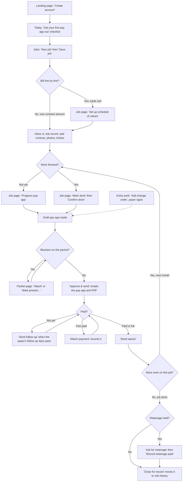

The money loop is the middle: draft, clear the packet, send, follow up, record payment, send waiver, then back to the next month's progress. A job usually goes round it once per month. Each step ends up on Today as a row, so the contractor can run the loop from Today without hunting (see section 14).

---

## 2. First day setup

**Goal:** create the company, confirm the email, and fill in the company details that print on every pay app. Redrawn from the code after Round 2 (Oct 27); the screens are the wireframes `CheckEmail`, `FirstRun`, `NewJob` and `FirstPacket` (`docs/wireframes/`).

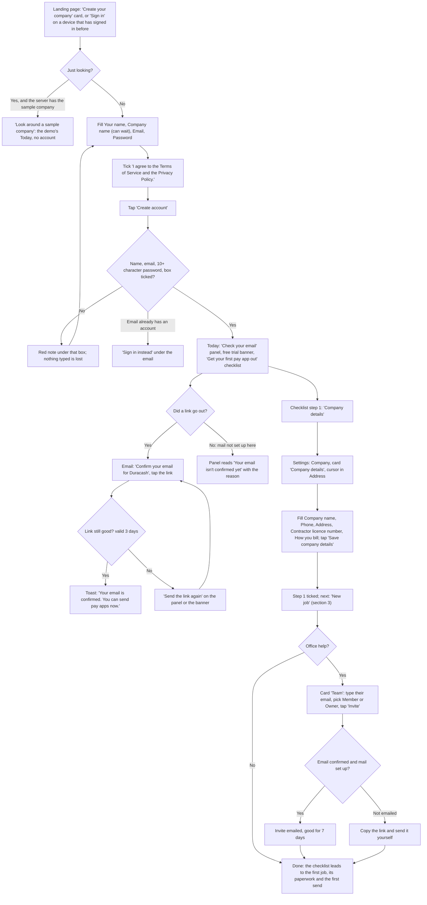

Code: landing and sign-up card static/app.js:306-360 (Sign in first when this browser has signed in, static/app.js:23-29); `Look around a sample company` static/app.js:332, 470-490, server.py:1215 (`_p_demo`); checks in place static/app.js:413-425 and the password rule when the box is left static/app.js:399-403; `Sign in instead` static/app.js:450-457, server.py:1194-1213 (`exists`); a blank company name takes the person's name server.py:1203; "Check your email" panel static/app.js:1793-1802 (`Got it`, `Send the link again`); the banner that stays until confirmed static/app.js:1804-1811; confirm link static/app.js:1681-1686, link valid 72 hours auth.py:51; checklist static/app.js:1942-1986, its step 1 `Company details` static/app.js:1957-1958 opens Team & account at `#co-address`; `Save company details` static/app.js:904-906, 1876; `Invite` static/app.js:839-848, server.py:1515-1517. Optional two-step sign-in: `Set up two-step sign-in` on Team & account, then `Turn on`.

**Taps from start to done:** about 5. Create account (1, after typing 3 boxes and the tick; the company name can wait), the email link (1), Company details on the checklist (1, lands in the Address box), Save company details (1), Invite (1, optional).

**What Round 2 changed here:**
- After sign-up a "Check your email" panel says where the link went, or why none did (R1-07). Until the email is confirmed, a server that sends mail refuses to send pay apps, waivers and follow-ups, and the send buttons say why instead of parking the email in the Outbox.
- The checklist's first step is the company address, phone and licence (R2-03), and its button goes straight to the Address box. Before you send also says "Your company address is blank on this PDF." while it is (R2-05).
- Company name is optional at sign-up (R2-02); a returning browser opens on Sign in; a visitor can look around the sample company first (R2-06).

**Where it could still be simpler:**
- `Invite` is refused with "Confirm your own email address before inviting people." only after it is tapped (server.py:1516-1517); the Team card doesn't say so beforehand.
- Hiding the checklist is per person, so a teammate who joins later sees it too until they hide it.

---

## 3. Add a job by hand

**Goal:** get a job and the customer who pays it into Duracash. This is also the only way a customer (payer) gets created.

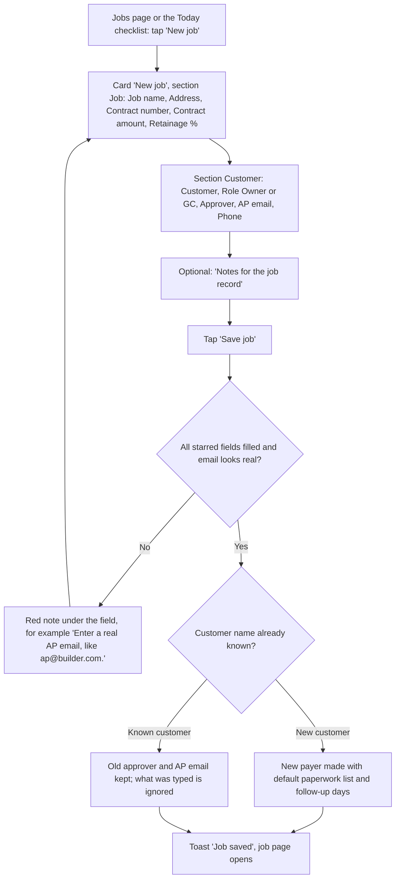

Code: `New job` static/app.js:2124, form static/app.js:2126-2155, `Save job` static/app.js:2154, field checks static/app.js:1096-1109, server domain.py:1542-1691, known customer domain.py:1607-1626, toast static/app.js:1136-1140.

**Taps from start to done:** 2 taps (New job, Save job), but 11 fields to fill, 6 of them required.

**Where it could be simpler:**
- "Notes for the job record" sounds like a notes box, but for a new customer the text becomes that customer's paperwork list. "Gate code 1234, call before 8am" turns into two items that block the first pay app (domain.py:1589-1592, domain.py:1410-1420, domain.py:1457-1466).
- Approver and AP email are required even for a homeowner job with no AP department, and are thrown away for a known customer with no message (domain.py:1575-1578, domain.py:1607-1626).
- Customer is free text. "ABC Builders" and "ABC Builders Inc" make two customers, and there is no way to rename or merge one (server.py:2186-2187).
- Contract amount is a number box: typing "48,500" fails (static/app.js:2136, static/app.js:1094). Retainage takes whole numbers only, so 7.5% becomes 7% (static/app.js:2137, static/app.js:1095).

---

## 4. Set up the schedule of values

**Goal:** bill line by line (quantity times rate), the way a GC wants a trade sub to bill.

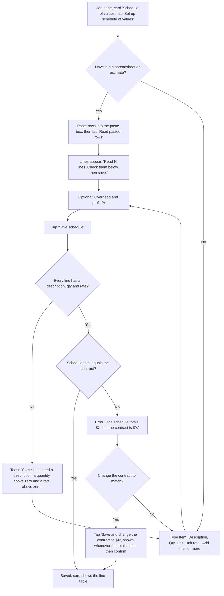

Code: `Set up schedule of values` static/app.js:1400, `Read pasted rows` static/app.js:1365, parse server.py:1417-1419 and sov.py:430-526, `Save schedule` static/app.js:1384, check static/app.js:1449, total check domain.py:1806-1825, the change-contract button static/app.js:1342-1347 and static/app.js:1385, its confirm static/app.js:1451.

**Taps from start to done:** 3 with a paste (Set up schedule of values, Read pasted rows, Save schedule). One more (the confirm) if the contract is changed to match.

**Where it could be simpler:**
- A 7-column editing table is hard on a phone (static/app.js:1350-1388).
- The schedule locks as soon as any pay app exists, even an unsent draft, and nothing says "void the draft to edit" (sov.py:52, domain.py:1789-1796).
- A pasted row like "Site cleanup, 3 loads" is read as a $3.00 lump sum (sov.py:450-470).

---

## 5. Import existing paperwork

**Goal:** get contracts, photos, tickets, emails and old notes onto the right job without retyping.

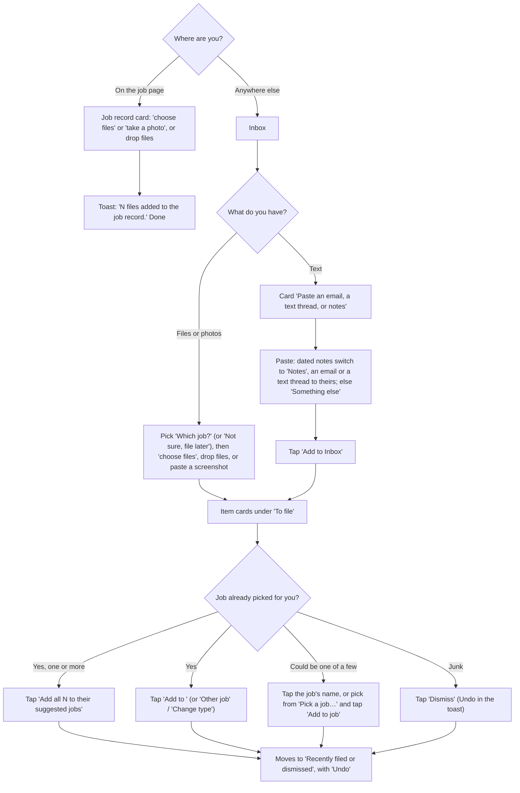

Code: job page drop zone static/app.js:2276-2279; Inbox drop zone and `choose files` static/app.js:1974; file checks importer.py:122-148 (15 MB, listed types only); paste card static/app.js:1976-1987; notes split importer.py:251-296; job matching importer.py:315-354; card `inboxItemCard` and its helpers static/js/inbox.js (R5-05); paste guess `pasteGuess` (R5-06); "Which job?" `uploadJobOptions` (R5-07); `Undo` static/app.js:1994-1996.

**Taps from start to done:** 2 from the job page (choose files, pick). From the Inbox: 2 to add (choose files or Add to Inbox), then 1 per item to file, or 1 for all suggested items.

**Where it could be simpler:**
- The paste box defaults to "An email". Thirty days of pasted notes become one lump on one day unless the user switches to "Notes" first (static/app.js:1979-1984).
- Phone photos and PDFs match a job only by file name, so "IMG_2231.jpg" never gets a suggestion (server.py:1730-1732). Matching also wants the exact full address, the full job name, a PA number, or the job code in UPPERCASE (importer.py:326-346).
- On a phone the list of items to file sits below the drop zone and the paste card, off screen (static/app.js:1970-1993).
- Once a record is attached to a pay app's paperwork, `Undo` says to remove it from the packet first, and there is no button for that (importer.py:556-558).

---

## 6. Change order

**Goal:** record extra work with a price and get it signed, so it can be billed.

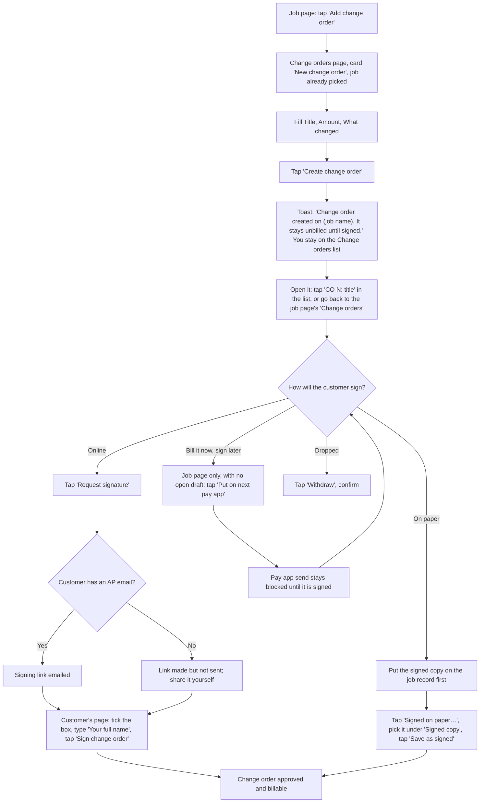

Code: `Add change order` static/app.js:668, form static/app.js:2668-2680, `Create change order` static/app.js:2679 and its toast static/app.js:1026, list link `CO N: title` static/app.js:2685, sign controls on the change order page static/app.js:2404 and the job page static/app.js:2270, `Request signature` static/app.js:561 and domain.py:1185-1206, signing page payer_page.py:131-154, `Signed on paper…` / `Save as signed` static/app.js:562-569, `Put on next pay app` static/app.js:2270 and domain.py:1270-1284 (send blocked: domain.py:125-131), `Withdraw` static/app.js:563 with its confirm static/app.js:988-991.

**Taps from start to done:** 3 to create (Add change order, fill, Create change order), 1 to open the change order, then 1 for online signing (Request signature) or 3 for paper (Signed on paper…, pick, Save as signed).

**Where it could be simpler:**
- `Add change order` leaves the job page for the company-wide Change orders list, and stays there after saving (static/app.js:1015-1027).
- "Signed on paper…" needs the signed copy already uploaded, or it is a dead end; the picker preselects the first record of any kind (static/app.js:567-571).
- `Put on next pay app` hides that it will block sending until signed; the reason only shows as a hover tip, which phones don't show.
- Without the site address set on the server, the contractor sees "Signing links need the site's address (DURACASH_URL) set on the server." (domain.py:1191-1192), a message meant for us, not them.

---

## 7. Packet check (the paperwork the customer wants with each pay app)

**Goal:** clear every "missing" item so the pay app can be sent.

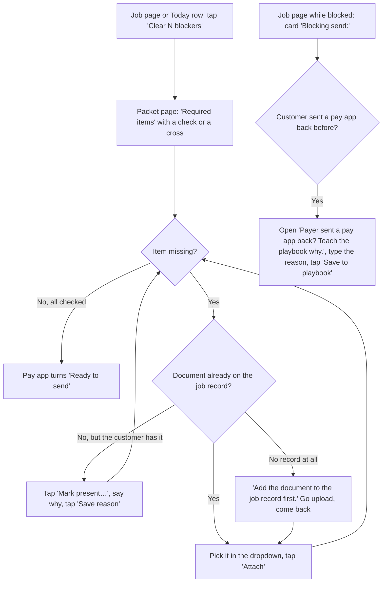

Code: `Clear N blockers` static/app.js:654 and static/app.js:598-599, packet page static/app.js:2348-2377, `Attach` static/app.js:2371, `Mark present…` / `Save reason` static/app.js:2372-2374, no-record note static/app.js:2371, teach card (job page only, inside the "Blocking send:" card) static/app.js:2218-2227. Attaching or marking present re-checks the pay app (domain.py:894-898, domain.py:411, domain.py:1538). The list comes from the customer's playbook paperwork text (domain.py:1457-1474).

**Taps from start to done:** 1 to open, then 2 per missing item (pick, Attach) or 3 (Mark present…, type, Save reason).

**Where it could be simpler:**
- The paperwork list only appears once the first pay app is drafted ("The packet is made later, with the first pay app.", static/app.js:2129). The contractor learns what's missing at send time instead of collecting it during the job.
- No upload on the packet page itself: with no records it is a dead end on a phone (static/app.js:2371).
- No way to take back a wrong attachment or a "present" mark, and the dropdown preselects the first record, so one tap can attach the wrong file (server.py:2213-2246).
- "Present" and "packet" are office words; "I have this" and "Paperwork" would read easier.

---

## 8. Draft, approve and send a pay app

**Goal:** turn finished work into a pay app and email it with its PDF and paperwork.

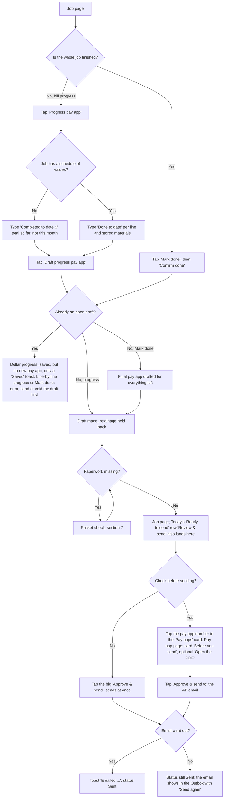

Code: `Progress pay app` static/app.js:659, progress form static/app.js:2230 and static/js/sov.js:27-46, `Mark done` static/app.js:660, `Confirm done` static/app.js:2232, mark done domain.py:252-273 (open draft refused at domain.py:256-260), dollar progress domain.py:217-249 (open draft skipped silently at domain.py:282-287), line progress refuses an open draft (domain.py:1867-1869), draft domain.py:276-356, `Review & send` static/app.js:601 (it opens the job page; its scroll target `.send-check` exists only on the pay app page, static/app.js:2427), pay app link in the job page's Pay apps card static/app.js:2262, job-page `Approve & send` static/app.js:655 and static/app.js:894, `Open the PDF` static/app.js:2426, `Approve & send to …` static/app.js:2435, send domain.py:424-460, Outbox `Send again` static/js/format.js:93-102. A job already marked done with unbilled work shows `Draft pay app` instead (static/app.js:658).

**Taps from start to done:** 3 for a progress bill when nothing is missing (Progress pay app, Draft progress pay app, Approve & send), or 4 with the "Before you send" check (the pay app number, then Approve & send to …).

**Where it could be simpler:**
- "Completed to date $" means the running total, not this month. Typing this month's amount gives "Completed-to-date must be higher than the last recorded amount." and the form doesn't show the last amount (static/app.js:2230, domain.py:230-238).
- The big `Approve & send` on the job page sends at once, with no review of who it goes to or how much (static/app.js:655). Only the pay app page has the "Before you send" check.
- Today's `Review & send` says "Check what goes out, then approve" but opens the job page, where the big button is that same instant `Approve & send`; the "Before you send" card it tries to scroll to is on the pay app page (static/app.js:600-601, static/app.js:1079-1082, static/app.js:2427).
- With a draft already open, a dollar progress entry is saved but no new pay app appears; the only message is the usual "Saved" toast (domain.py:282-287, static/app.js:487).
- `Confirm done` can't be undone and sets every line to 100% (domain.py:252-273). There is also no way to void a pay app once sent.

---

## 9. Follow up on an unpaid pay app

**Goal:** send a polite chase email when the customer's usual wait has passed.

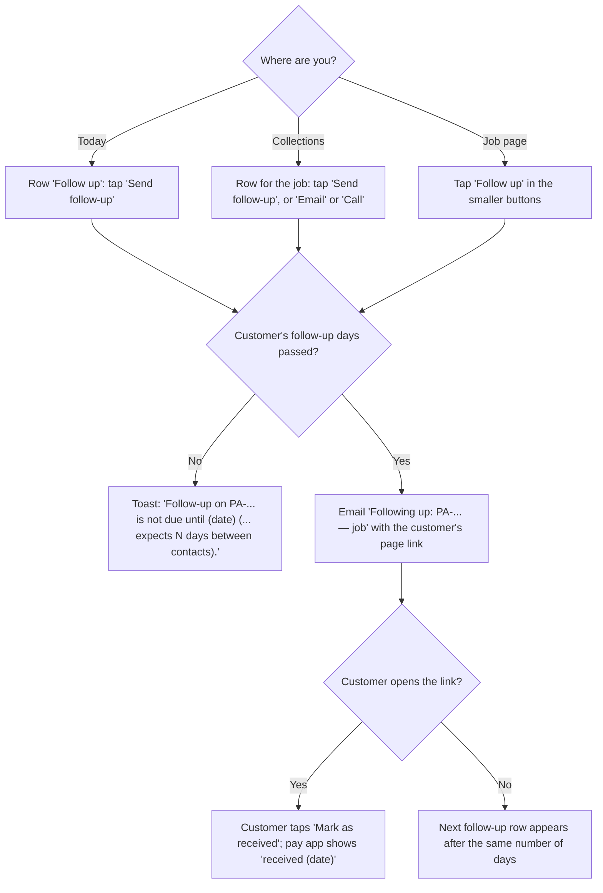

Code: Today row static/app.js:612-619, Collections static/app.js:2715-2717, job page `Follow up` static/app.js:666, server rule domain.py:463-505, not-due message domain.py:474-482, `Mark as received` payer_page.py:88-91.

**Taps from start to done:** 1.

**Where it could be simpler:**
- The email goes with one tap and no preview of what it says (static/app.js:618). The helper asks before sending; the buttons don't.
- Collections shows `Send follow-up` even when it is not due yet, and then refuses with a toast (static/app.js:2715).
- If the email bounced there is no "send again", and the pay app can't be re-sent to a fixed address (static/js/format.js:100, server.py:1680-1681).

---

## 10. Record a payment

**Goal:** record a check or transfer against the right pay app so the waiver step opens.

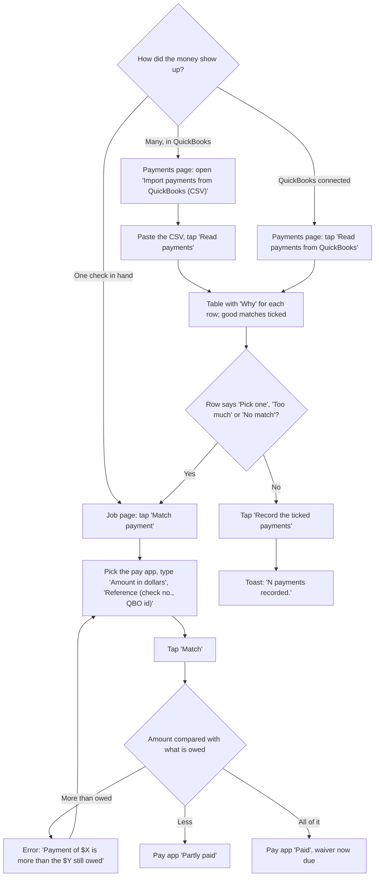

Code: `Match payment` static/app.js:657, form static/app.js:2233, client check static/app.js:997-1004, server domain.py:508-584, over-payment domain.py:541-544; CSV card static/app.js:2729-2740, `Read payments` static/app.js:2740, matching qbo_csv.py:95-136, `Record the ticked payments` static/app.js:2738; connection `Connect QuickBooks` / `Read payments from QuickBooks` static/app.js:2744-2750.

**Taps from start to done:** 2 by hand (Match payment, Match) plus typing the amount. 3 for a CSV (open card, Read payments, Record the ticked payments).

**Where it could be simpler:**
- No way to accept a short pay. A pay app the customer will never top up stays "Partly paid" forever, no waiver comes due and the job can't close (domain.py:572-574, domain.py:98-99). This is the biggest gap in the money loop.
- No "date received" on the hand form, so a check typed in late is dated today and skews the days-to-pay numbers (domain.py:559).
- The amount box starts empty instead of showing what is owed.
- In the CSV import, rows that don't match have no checkbox and no picker, so they must be done by hand on each job (static/app.js:2733-2735). One check covering two pay apps can't be split (domain.py:541-547).

---

## 11. Lien waiver

**Goal:** send the signed lien waiver for each pay app that is paid in full.

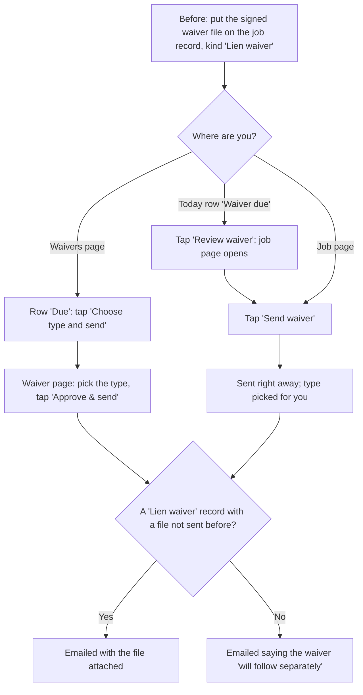

Code: `Review waiver` static/app.js:603, `Send waiver` static/app.js:656, server domain.py:604-648, missing-file wording domain.py:639-642, `Choose type and send` static/app.js:2793, type picker and `Approve & send` static/js/jobs.js:65-73, type names static/js/jobs.js:56-61.

**Taps from start to done:** 2 from Today (Review waiver, Send waiver), or 1 from the job page.

**Where it could be simpler:**
- `Send waiver` sends at once, picks the type for the user, and doesn't check that a waiver file is on the job. The email then promises the waiver "will follow separately" (domain.py:611, domain.py:639-642, domain.py:2000-2008).
- Today's `Review waiver` opens the job page, not the waiver page with the type choice (static/app.js:603).
- Four waiver types, with no plain line saying what conditional or unconditional means.
- A waiver only comes due after full payment, so there is no conditional waiver before payment or after a partial payment (domain.py:565-571).

---

## 12. Retainage release

**Goal:** get the money held back on the job paid at the end.

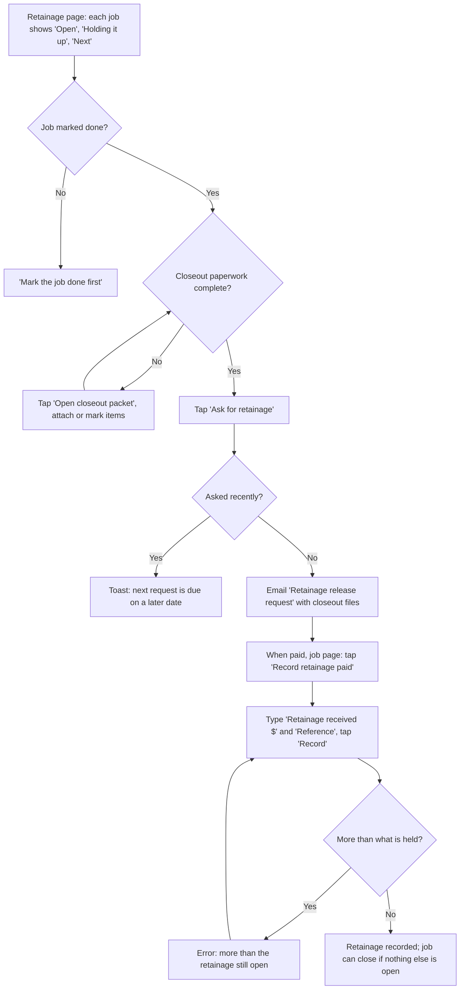

Code: Retainage page static/app.js:2800-2820, `Ask for retainage` static/app.js:662 and static/app.js:2815, server domain.py:667-712, `Record retainage paid` static/app.js:667, form static/app.js:2234, server domain.py:715-737.

**Taps from start to done:** 4 (Ask for retainage, then later Record retainage paid, type, Record).

**Where it could be simpler:**
- On the job page `Ask for retainage` shows whenever money is held, even before the job is done, and then fails with a toast (static/app.js:662, domain.py:672-679).
- Today never shows a row for "retainage ready to ask for" (static/app.js:578-628), so it is easy to forget.
- Retainage received has no date field and doesn't show on the Payments page or match from the QuickBooks import (static/app.js:2725-2726).

---

## 13. Close the job

**Goal:** file a fully settled job away in Job history.

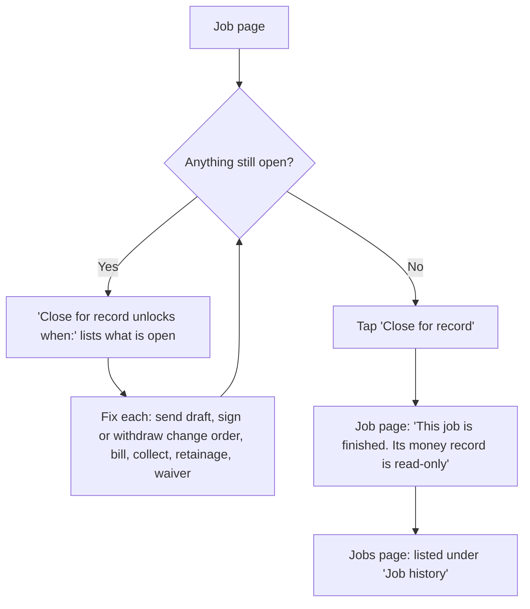

Code: unlock list static/app.js:2239 and domain.py:82-103, `Close for record` static/app.js:661, server domain.py:1305-1313, closed note static/app.js:2235, `Job history` static/app.js:2172.

**Taps from start to done:** 1.

**Where it could be simpler:**
- No confirm and no reopen. After closing, every money change is refused (domain.py:1369-1374).
- A short-paid pay app blocks closing forever ("$X is still outstanding.", domain.py:98-99). See section 10.
- "Close for record" is not a phrase a remodeler uses; "Finish job" or "Archive job" would read easier.

---

## 14. The weekly Today routine

**Goal:** open one page, see everything waiting, and handle it top to bottom.

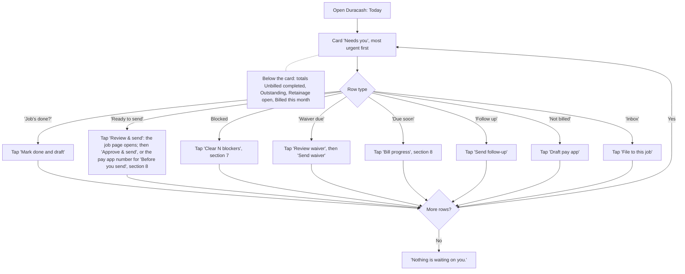

Code: Today page static/app.js:2046-2079 (the "Needs you" card at 2064-2071 comes before the totals at 2073-2078), queue and button labels static/app.js:578-628 (`Mark done and draft` :586, `Clear N blockers` :599, `Review & send` :601, `Review waiver` :603, `Draft pay app` :606, `Bill progress` :608, `Send follow-up` :618, `File to this job` :624), empty message static/app.js:2072.

**Taps from start to done:** 1 to 2 per row. A typical week with one send, one follow-up and two filings is about 5 taps.

**Where it could be simpler:**
- Today has no rows for retainage ready to ask for, payments later than the customer's usual wait, or emails that bounced (static/app.js:578-628).
- "Waiver due" ranks above blocked paperwork and follow-ups; worth checking that order with real contractors.
- `File to this job` files with a guessed kind that is not shown in the row (static/app.js:621-625).

---

## 15. The payer playbook

**Goal:** keep each customer's rules (who approves, AP email, chase timing, paperwork list) right, since they drive every pay app and follow-up.

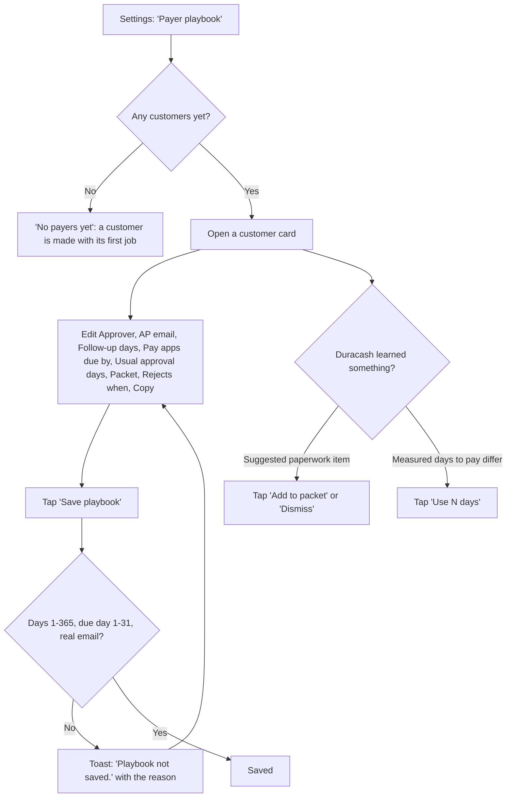

Code: page static/app.js:2823-2856, empty state same lines, form static/app.js:2841-2850, `Save playbook` static/app.js:2850, save rules static/app.js:1177-1183 and domain.py:933-975, `Add to packet` / `Dismiss` static/app.js:2832-2835, `Use N days` static/app.js:2836-2840.

**Taps from start to done:** 2 (open the card, Save playbook), plus 1 per suggestion.

**Where it could be simpler:**
- A customer can only be created by adding a job, and can't be renamed, merged or deleted (server.py:2186-2187, domain.py:933-936).
- A blank box is skipped on save, so Packet, Rejects when and Copy can't be cleared (static/app.js:1177-1182).
- Labels are office words: "Copy" means CC emails, "Rejects when", "Packet", "Usual approval days".
- Errors show only as a toast, not next to the field.

---

## Flows not charted, or charted with less confidence

- **Billing and subscribe** (Stripe `Subscribe` / `Manage billing`, static/app.js:1666-1676): the card only shows when Stripe is set up on the server, so it is left out of the first-day chart.
- **Two-step sign-in** (static/app.js:1678-1691): mentioned in section 2, not charted; it is optional.
- **QuickBooks connection** (`Connect QuickBooks`, static/app.js:2744-2748): the Intuit sign-in in the middle happens off our site. Charted as one branch in section 10 only.
- **Email forwarding, text messages and phone sharing into the Inbox** (static/app.js:1997-2008, server.py:1786-2034, server.py:1911-1944): these need server setup (email provider, Twilio) the contractor can't do alone. Left out of section 5.
- **Pencil copy** (`Send pencil copy`, `Payer agreed to pencil`, `Payer wants changes`, static/app.js:663-665): an optional side path before send; not charted.
- **Tap counts** are the fewest taps on the happy path with fields already filled, counted from the code, not timed with a user.
- Line numbers in the source maps for job-page buttons were a few lines off; the numbers here were checked against the current static/app.js:654-671.
