# Duracash client flows

For Stephen to review. Each chart shows what a contractor taps, screen by screen, to get one task done. Every screen name and button label is copied from the app code (`static/app.js`, `static/js/*.js`, `payer_page.py`, `domain/__init__.py`, `server.py`), last brought up to the code on Nov 5, 2026, after the Nov 3 overhaul; the file:line after a label is where it lives today (a bare `:N` is in the file named last before it). Read each chart from top to bottom. Diamonds are real branches the code takes. What isn't built and what is still to be decided are at the end, under Limits and open questions.

The demo company is Hartline Remodeling (`seed.py`), opened with **Look around a sample company** on the landing page (no account) or the login `owner@hartline.example` / `demo`. The demo can't send email, so some steps end at "Not sent: demo account". The wireframes in `docs/wireframes/` draw the screens as they stood after the final pass of Oct 29, with their words kept up to date; they don't show the Nov 3 overhaul's new cards and forms, so where they differ this file and the code are right.

Screen names used below (pages and tabs: `SECTIONS`, static/app.js:29-37; addresses: static/js/routes.js:9-32):

| Screen | Address |
|---|---|
| Dashboard: Overview, Results, Calendar | `/dashboard`, `/dashboard/results`, `/dashboard/calendar` |
| Jobs: Open jobs, New job record, Job history, Client playbook | `/jobs`, `/jobs/daily`, `/jobs/history`, `/jobs/clients` |
| Job page | `/jobs/<id>` |
| Communications: Inbox, Outbox | `/communications`, `/communications/outbox` |
| Import/Export: Import, Export | `/data/import`, `/data/export` |
| Money: Pay apps, Change orders, Unpaid, Payments, Closeout | `/money`, `/money/change-orders`, `/money/collections`, `/money/payments`, `/money/waivers` (`/money/retainage` opens it at Held back, still owed) |
| Automations: reminders and notifications | `/automations` |
| Pay app (with its supporting documents), Closeout documents, Change order and Waiver pages | `/money/pay-app/<job>/<id>`, `/money/packet/<job>/closeout`, `/money/change-order/<job>/<id>`, `/money/waiver/<job>` |
| Settings: Company, Team, My account, Billing, Activity log | `/settings/company` (`/settings` opens it), `/settings/team`, `/settings/account`, `/settings/billing`, `/settings/audit` |
| The client's page for one pay app; the signing page for one change order | `/p/<link>`, `/s/<link>` (no sign-in; `payer_page.py`) |

The menu has seven sections on a computer; on a phone it shows five and puts Import/Export and Automations under **More** (Stephen's Oct 29 review). The old addresses still open their page at its new one (`PATH_ALIASES`, static/js/routes.js): `/today...` the Dashboard's, `/inbox` and `/money/outbox` Communications, `/settings/playbook` the Client playbook, `/settings/help` My account (Help was emptied; **Show the setup checklist** and the account id are on My account). The in-app **←** button goes back to the page you came from and names it; opened from a link it goes to the page's own list, in that page's place, so the list's own **←** goes on up instead of back again (G3, D1; the tab's title is the page's own name, `pageTitle` static/app.js:72, D9; static/js/trail.js, `backButton` static/js/app-core.js:427, `up` in static/app.js).

The job page has no More menu. The **Next step** card holds one line and one main button, and every other action shows under it, grouped **Bill**, **Get paid** and **Close out** (`jobActionsHtml` static/js/views/job.js:204, `ACTION_GROUPS` static/js/jobs.js:481); a rare or destructive one (**Undo Done**, **Delete Draft**) is drawn smaller. The labels are **Progress Pay App**, **New Change Order** and **Final Pay App**, which takes the place of Mark done. The main button is picked in this order (`jobActions`, static/js/jobs.js:422): **Client Agreed to the Draft** while a draft is with the client; the blocker button (**Add N missing documents**, **Check N documents**, **Add or check N documents**, **Fix N things before sending** or **Get CO N signed**); **Review & Send**; **Choose Waiver and Send**. Then, while a sent pay app is unpaid: **Send Follow-Up** once it is due, **Draft Pay App**, **Record a Payment**. Otherwise: **Draft Pay App**, **Progress Pay App**, **Open Closeout Documents**, **Finish Job**, **Ask for Retainage**, **Record Retainage Paid**. The Next step line ends by naming that button in the same words ("PA-OAK-02 for $9,000.00 to Sam is ready. Review & Send."; `nextStep`, static/js/jobs.js:87), and `domain.today_rows` has the same sentences for the Dashboard. While something blocks the send, the line names the button and lists every blocker under it (J6). The buttons land on the document: a blocker button opens the pay app at the item, or the change order when that is all that blocks (`openSupportingDocs` static/js/views/paperwork.js:398); **Review & Send** opens the pay app at the Review & send card; **Open Closeout Documents** opens that page at the first missing item.

**Final Pay App** opens a card (**Anything to note? (optional)**, Period to, **Draft Final Pay App**), then a box that says the amount before anything changes, section 8. **Finish Job** warns when closeout documents are missing, section 13. Above the Next step card, **Where this job stands** shows the stage (Started, Work in progress with the percent billed, Pay app out, Approved, Paid, Work done, Retainage released, Finished) and the key dates: start date, anticipated end date, this and next month's pay app due day, last pay app sent, payment due, next follow-up, marked done, retainage asked and the next ask, finished (J7; `standingCardHtml` static/js/views/job.js:145, from the server's `job_stage` and `job_key_dates`, domain/jobinfo.py:159). A card above it says what the client's playbook is missing when that holds the job up (section 15). Further down the page are the schedule of values (section 4), **Supporting documents for this job** (section 15), **Job records** (section 5) and the job's log, **Activity** (`jobHistoryHtml` static/js/views/job.js:131). Nobody sees a button their permission profile doesn't allow (send, waivers, retainage requests, record payments, delete a draft, pull back, finish, delete, accept short pay, Add more work; `ACTION_PERM`, static/js/jobs.js:398, `JOB_ACTION_PERMS`, domain/profiles.py:53, refused on the server too); the built-in Member profile records payments and drafts, and Settings, Team can give it, or a profile of your own, more (section 16).

A company set to bill homeowners in draws (a setting from before Oct 29; How you bill is no longer on the Company page) reads Draw and Draws wherever this file says pay app (`termText`, static/js/terms.js; `domain.term_text`).

---

## 1. The whole life of a job

The money loop is the middle: draft, add the supporting documents, review, send, follow up, record the payment, send the waiver, then back to next month's progress. A job usually goes round it once a month. Each step shows up on the Dashboard as a row, and in the owners' daily email, so the contractor can run the loop from the Dashboard (section 14). Duracash emails clients and only texts the company's own team (section 18).

---

## 2. First day setup

**Goal:** create the company, confirm the email, and fill in the company details that print on every pay app. The screens are the wireframes `Landing`, `CheckEmail`, `FirstRun`, `NewJob` and `Settings`.

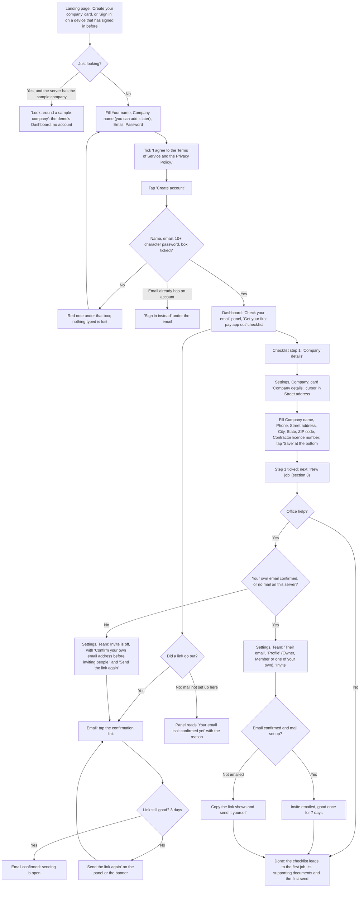

Code: landing and sign-up card `renderLanding`, static/js/views/auth.js:45 (Sign in first when this browser has signed in, static/js/views/auth.js:11-17; the terms box static/js/views/auth.js:94); **Look around a sample company** static/js/views/auth.js:71 and `lookAround` static/js/views/auth.js:219, server `_p_demo`; "Check your email" panel `checkEmailHtml`, static/js/views/auth.js:375 (**Send the link again**, **Got it**); checklist `onboardingHtml`, static/js/views/today.js:172-216, its step 1 **Company details** opens Settings, Company at `#co-address`; Company page `companyView`, static/js/views/settings.js:198; **Save** `save-company` static/js/views/settings.js:724 (the details, the address in four boxes and the switches together, S1 and S3; the server checks each box, `update_company`); Team `teamCardHtml`, static/js/views/settings.js:77, **Invite** `team-invite` static/js/views/settings.js:639 (off, with the reason and **Send the link again**, while `inviteLocked` static/js/setup.js:41; the server still refuses, `_p_team_invite`). Two-step sign-in is on for every account (section 16).

**Taps from start to done:** about 5. Create account (1, after typing 3 boxes and the tick), the email link (1), Company details on the checklist (1, lands in the Street address box), Save (1), Invite (1, optional).

**What changed since Round 2:** Settings is four pages (Company, Team, My account, Billing) instead of one long Team & account page (R6-03); the checklist and Review & send name Settings, Company. Sign-up is limited to 5 an hour per network (R6-05). The Company page has **Sending and email** (who may send, the daily email) for owners.

**Where it could still be simpler:**
- Hiding the checklist is per person, so a teammate who joins later sees it until they hide it (it can be brought back from Settings, My account).

---

## 3. Add a job by hand

**Goal:** get a job, the client who pays it and its schedule of values into Duracash. A new job needs a complete client playbook: the client's name and type, who signs off, the billing email and a phone number. Clients can also be added on their own (section 15).

```mermaid
flowchart TD
    A["Jobs page or the Dashboard checklist: tap 'New job'"] --> IC{"Have the contract as a file or text?"}
    IC -->|"Yes"| IM["'Import contract' (Word, PDF or text) or 'Paste the contract's text', 'Read it': the boxes it finds fill in, each marked 'From the contract'"]
    IC -->|"No"| B
    IM -->|"A scanned PDF"| IS["'Couldn't read text from this file; fill the fields in by hand.'"]
    IM --> B
    IS --> B
    B["Card 'New job', nothing folded: Job name, Street address, City, State, ZIP, Contract amount, Start date (today), Anticipated end date"]
    B --> C{"'Existing client' or 'New client'? (no clients yet: New client)"}
    C -->|"Existing client"| C1["Pick from the list. A line shows the client's type, who signs off, email and phone, with 'Change in the Client playbook' (what you typed stays). Boxes appear only for what this client is missing"]
    C -->|"New client"| C2["Client name, Client type (starts on Choose…), Who signs off on your bills (starts empty), Email for pay apps, Phone, Pay apps due by, Payment terms"]
    C1 --> D
    C2 --> D["Also: Retainage %, Contract number, Assigned to (with a team), Notes (kept in the job records)"]
    D --> SV{"Card 'Schedule of values': type lines?"}
    SV -->|"Yes"| SV1["Description, Qty, Unit, Unit rate $; 'Add line'. They must add up to the contract amount"]
    SV -->|"Leave it blank"| SV2["One lump-sum line for the contract amount is made"]
    SV1 --> E
    SV2 --> E["Tap 'Save job'"]
    E --> F{"Each box as the field rules say, the client complete?"}
    F -->|"No"| G["Red note under the box, for example 'Enter the email pay apps go to, like ap@builder.com.' Nothing is saved"]
    G --> B
    F -->|"Yes"| H{"Client name already known?"}
    H -->|"New client"| I["New client made with its type's default supporting documents list"]
    H -->|"Known client (same name, ignoring case)"| J["The client's settings are kept; what was asked for is saved to its playbook"]
    H -->|"Nearly the same as a saved one: 'ABC Builders Inc', 'abc builders, LLC'"| N["Under Client: 'Use ABC Builders' or 'Keep “ABC Builders Inc” as a new client'. Nothing is saved yet"]
    N -->|"'Use ABC Builders'"| J
    N -->|"'Keep “ABC Builders Inc” as a new client'"| I
    I --> K["Job page opens; an imported contract is on its Job records as Contract, with its schedule of values if one was ticked"]
    J --> K
```

Code: `views.jobs`, static/js/views/jobs.js:383 (**New job**, the boxes, **Save job**); `jobFields` static/js/views/jobs.js:23 (the address as four boxes, J1, Start date, J8, and **Anticipated end date**) and its checks `jobFieldErrors` static/js/views/jobs.js:58 (on Edit job, with `savedJobFields` static/js/views/jobs.js:74, only the boxes changed from what the form opened with are checked, the address's four as one; the server's `edit_job`, domain/__init__.py:5262, does the same, so a contract number or address saved before the rules doesn't block another edit), with the field rules of static/js/validate.js (G1, checked on leaving a box by static/js/forms.js). **Existing client** and **New client** are `nj-client-mode` static/js/views/jobs.js:570, `clientMode` static/js/views/jobs.js:120; with no clients saved the form goes straight to the new client's boxes. A saved client's line is `knownPayerText` static/js/views/jobs.js:113, its boxes `payerSlotHidden` static/js/views/jobs.js:127 and `payerMissing` static/js/views/jobs.js:109, from the server's `playbook_missing`, domain/__init__.py:2905: a blank box, a client type never picked (one read from an older role isn't an answer) or a signer that only defaulted to the client's own name (`signer_defaulted`, domain/__init__.py:2898). **Client type** and **Who signs off on your bills** start blank and nothing fills them. Typing the signer in its box sends `approver_confirmed`, static/js/views/jobs.js:543, which `signer_answered`, domain/__init__.py:2890, counts as a person's answer, even when it is the client's own name; saving the card without typing it does not. **Change in the Client playbook** `nj-to-playbook` static/js/views/jobs.js:565 keeps what was typed and brings it back on return to Jobs.

**Import contract** `contractImportHtml` static/js/views/jobs.js:234, `readContract` static/js/views/jobs.js:309 (POST /api/contract/read, server `contract_import.read`, contract_import.py:39, which reads Word files, text PDFs and pasted text and saves nothing; a PDF is read moving forward only, for at most 1.5 s, 30 MB inflated and 400,000 characters, `pdf_text` contract_import.py:173, so a small crafted file can't hold the server), `fileContract` static/js/views/jobs.js:328 (the file goes on the record as kind contract after the save; the schedule of values goes up with `update_contract` when **Use the schedule total as the contract amount** is ticked). The contract's completion date fills Anticipated end date (`fillFromContract` static/js/views/jobs.js:280). When the contract's schedule of values doesn't add up to the contract amount, the line under its checkbox says by how much and offers that box (`sovTotalChoice` static/js/views/jobs.js:264).

The schedule is asked for by `newJobSovHtml` static/js/views/jobs.js:356 (hidden when a contract read found one and it is ticked). The lines go as `sov_lines` to `create_job`, domain/__init__.py:4998: lines that don't add up to the contract are refused under the card with nothing saved (field `sov`), and with none the job gets the one lump-sum line. **Save job** `create-job` static/js/views/jobs.js:495. The job is made with `playbook_required`, so its pay apps wait for a complete playbook (section 15). Each box is checked again on the server by the same rules in domain/validate.py; a refusal is keyed by field and shown under its box (`showFieldErrors` in static/js/forms.js); the address is kept whole too, "Street, City, ST 12345", for the pay app PDF, the client's page and Inbox matching. Client type has five kinds: General contractor and Another subcontractor use a general contractor's defaults, Owner or developer, Homeowner and Public agency an owner's (`CLIENT_TYPES` static/js/jobs.js:548, `client_type_role` domain/jobinfo.py:31). Notes become a "Job notes" record, never a supporting document (R1-04). A near match (Oct 23 note 5) is found by `payer_near` domain/__init__.py:2985, which compares names with `customer_key` domain/__init__.py:2970; the refusal carries `same_customer` and `showSameCustomer` static/js/views/jobs.js:146 shows the two buttons, `nj-same-use` static/js/views/jobs.js:579 and `nj-same-keep` static/js/views/jobs.js:588. Nothing is merged without a tap.

Jobs saved before the address had four boxes keep their one line: Edit job shows it all in Street address until someone splits it (migration step `_jobs_clients_address_parts`, migrations.py:111). Jobs saved before Nov 3 have no schedule unless someone set one, keep dollar progress, and aren't held up by an incomplete playbook; sending still needs the email.

**Taps from start to done:** 3 taps (New job, Existing client or New client, Save job), 7 boxes with a complete saved client, 11 with a new one; with a contract file, one more (Import contract) and a check of each box.

**Where it could still be simpler:**
- The supporting documents list for a new client is set by its Client type and is changed in the Client playbook, or for one job on the job page (section 15), not on the New job form.
- Reading a contract is plain rules, not a reader of any layout: a scanned PDF, or a contract that words the sum or the parties unusually, leaves those boxes for you to fill.

---

## 4. The schedule of values

**Goal:** every new job bills from a schedule of values: quantity done drives what can be billed, and the person keeps the last word on each amount. The card is on every job page.

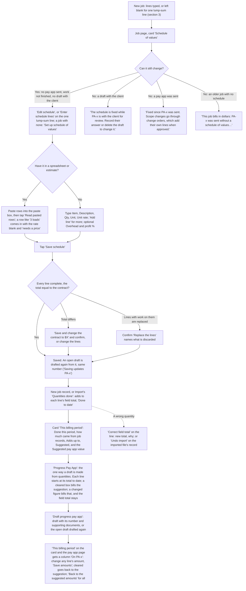

Code: asked at New job, section 3. Card `sovCardHtml`, static/js/views/job-sov.js:159 (**Set up schedule of values**, **Edit schedule** or **Enter schedule lines** by `v.auto`); editor `sovEditorHtml`, static/js/views/job-sov.js:80 (**Read pasted rows**, **Add line**, **Save schedule**, **Save and change the contract to $X** `updateSovTotals` static/js/views/job-sov.js:56, its confirm in `sovSave` static/js/views/job-sov.js:221, and **Replace the lines**, from `sovLostLines` static/js/sov.js:51); parse `sov.parse_rows`, sov.py:758 (a header found in the first 5 rows, R5-08; one number next to a unit word in `UNIT_WORDS` sov.py:636 is a quantity with no price, sent back with `needs_price` and a blank rate); save `save_sov`, domain/__init__.py:5460, which refuses a blank rate.

The lock rules are `_sov_view`, domain/__init__.py:6198: `editable` until the first pay app is sent (a draft doesn't lock it, Nov 3 Decision 2), not while a draft is with the client for review, not once the work is finished or the job closed. The card says why in `sovFixedNote` static/js/sov.js:85, with **Delete Draft** for whoever may delete drafts in `sovDraftLockHtml` static/js/sov.js:73. A job with a sent pay app and no schedule bills in dollars and says so. While nothing is billed on the automatic line, the Edit job form can still change the contract amount (`contract_follows`, `_contract_follows` domain/__init__.py:6108).

Field totals and billing are apart. A New job record's quantities and an imported file add to the line's field total (`add_field_quantities`, domain/daily.py:532), shown as **Done to date** beside **Earned to date**, **Billed** and **Balance to finish**; nothing they do makes or changes a draft. A record that can't add (the draft is with the client, the job is marked done, a line would go past its scheduled quantity) is saved anyway with `quantities_not_applied` saying why. The only ways to a draft from quantities are **Progress Pay App**, `sovProgressHtml` static/js/sov.js:160 and `record_sov_progress`, domain/__init__.py:5568, and **Final Pay App**, which sets every line to 100%. The form starts each line from `form_done_milli`, `_progress_form_figure` domain/__init__.py:6189 (the field total, or the open draft's own typed figure). A blank box is the suggestion; a figure typed that differs from the field total is the person's own, audited with the suggested and final figures, and the field total stays as it was. With nothing recorded and nothing typed it refuses, "Enter the quantity completed to date on at least one line."

The period card is `sovPeriodHtml`, static/js/sov.js:108, from `_sov_period`, domain/__init__.py:6135: everything recorded and not yet on a sent pay app, late records included; shown on the card, the progress form and the draft's own page (`views.payappDetail`). **Save amounts** `sov-amounts`, **Back to the suggested amounts** `sov-amounts-reset`, static/js/views/job-sov.js:321, server `set_payapp_amounts`, domain/__init__.py:702 (the draft is drafted again, same number and supporting documents; any amount from $0 to what is left on the line; each change audited as "Pay app amount changed"; refused while the draft is with the client).

**Correct field total** is `sovCorrectHtml`, static/js/views/job-sov.js:127, server `correct_field_total`, domain/__init__.py:5690: the new total and why it was wrong, with a confirm that warns when it goes below what sent pay apps billed (they stay as they are, and nothing more is suggested until the field total passes that), and the old and new totals in the activity log. **Undo import** on an imported file's record, `quantities-undo` static/js/views/job-record.js:89, server `undo_quantity_import`, domain/__init__.py:5736, takes off what that file added and keeps the record, saying so. Both go through `_field_totals_change`, domain/__init__.py:5658: an open draft drafted at the old field total follows, unless it is with the client, and a figure typed on a draft stays until the person changes it. Import/Export, Import has two cards: **Quantities done** (under Flows not charted) and **Schedule of values**, `sovPickerHtml` static/js/views/data.js:109, listing only jobs whose schedule can still change, with **Open its schedule**.

On a phone each line is a card with the description on top (R6-02).

**Taps from start to done:** none if the schedule is the lump-sum line or was typed at New job. Later, 3 with a paste (Edit schedule, Read pasted rows, Save schedule), one more (the confirm) if the contract changes to match. Billing: 2 (Progress Pay App, Draft progress pay app).

**Where it could still be simpler:**
- A lump-sum line's % done takes one decimal, so a dollar figure that isn't a tenth of a percent is reached by changing the amount on the draft.
- A mistake found after the first pay app is sent means a change order.

---

## 5. Import existing documents

**Goal:** get contracts, photos, tickets, emails and old notes onto the right job without retyping. For what happened on site today, use New job record (section 17).

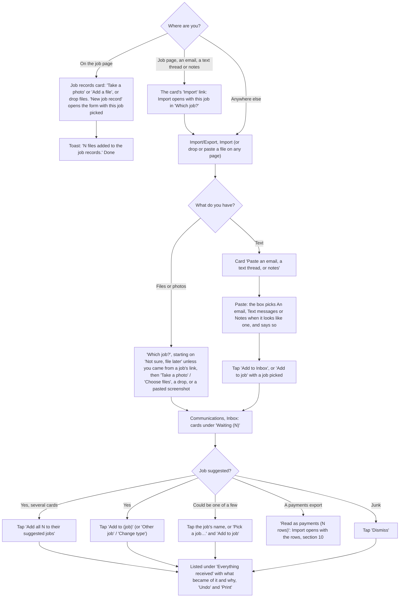

Code: Job records card `recordCardHtml`, static/js/views/job-record.js:65 (**New job record**, **Take a photo** / **Add a file** `pick-files` static/js/views/inbox.js:451, the Import link `import-for-job` static/js/views/inbox.js:469); record rows with **Edit** `recordRow` static/js/views/job-record.js:21 (R5-07), in groups with their counts and a filter row (`recordGroupsHtml` static/js/views/job-record.js:51, `RECORD_GROUPS` static/js/jobs.js:612: Contract and change orders, Diary entries, Delivery tickets, Progress photos, Time sheets, Tickets, Invoices, Inspections, Stored materials, Lien waivers, Insurance and certificates, Closeout, Pay app backup, Conversations, Notes and other). Import `views.import`, static/js/views/data.js:130 (the file box `dropzoneHtml` static/js/views/inbox.js:163 with **Which job?**, `uploadJobOptions` static/js/views/inbox.js:147, and the touch-only **Take a photo** / **Choose files**, the paste box `pasteBoxHtml` static/js/views/inbox.js:182, the payments import of section 10, **Quantities done** and **Schedule of values**, section 4); Inbox `views.inbox`, static/js/views/inbox.js:418 (**Waiting (N)**, a phone's **Take a photo**, **Everything received**, **Bring emails and texts in automatically**); **Everything received** `receivedHtml` static/js/views/inbox.js:263 (Received, From, Subject with the files, Came in by, Status in words `receivedStatus` static/js/views/inbox.js:235 with how it was matched; filters **Came in by**, **Status**, **Job** and **Sort** `setReceivedFilter` static/js/views/inbox.js:217, each label kept with its box, one per row on a phone (D5, `receivedSelect` static/js/views/inbox.js:254); **Undo**, **Print** `print-received` static/js/views/inbox.js:529), paged by the server `GET /api/inbox` (`_g_inbox_page` server.py:1259, `domain.inbox_page` domain/comms.py:78, the reason in words `_why` domain/comms.py:46); the page load carries only what waits and the last 20 others (`inbox_for_page_load` domain/comms.py:25); cards `inboxItemCard` static/js/views/inbox.js:286 with `choiceJobs` / `choiceLine` / `pasteGuess` in static/js/inbox.js; a ticket is offered as **Delivery ticket** or **Time sheet**, `FILE_KINDS` and `fileKindPick` static/js/jobs.js:21, filed as `ticket:delivery` or `ticket:time_sheet` by `file_item` importer.py:650; uploads three at a time `uploadFiles` static/js/views/inbox.js:34; server matching `importer.match_job`, importer.py:471 (a job code in capitals, or in small letters as its own word when no job's name or address has that word; the full job name or a part of it no other job has, like Oak Street for Oak Street kitchen, or one telling word written with a capital, like Vesta; a code in small letters or one name word counts less than the client's AP email; a tie suggests nothing), kinds `guess_kind` importer.py:391, notes split `split_notes` importer.py:362; **Undo** `undo_item` importer.py:804, refused while a pay app's supporting documents use the record by `_paperwork_refusal` importer.py:757, with a link in the refusal card (`showRefusal` static/js/app-core.js:349).

**Taps from start to done:** 2 from the job page (Take a photo or Add a file, pick). From Import: 2 to add, then 1 per card in the Inbox to file, or 1 for all suggested cards.

**Where it could still be simpler:**
- Forwarding email and texts in needs an email service or a Twilio number set up by an owner (deferred: a provisioned address per company, improvement plan section 5).
- Once a record is attached by hand to a pay app's supporting documents, Undo on the Inbox is refused. For a draft it links to that pay app's page, where Remove is. For a pay app that went out it links to the pay app: the record stays as sent, and pulling the pay app back (only while nothing is paid) is the way to change what went out.

---

## 6. Change order

**Goal:** record extra work (or a credit) with its reason and price, get it signed, and bill it.

Code: **New Change Order** `new-co` static/js/views/job-cos.js:166 (a job action, static/js/jobs.js:393); card `newCoCardHtml` static/js/views/job-cos.js:75 and `coFormFields` static/js/views/job-cos.js:93 (**Add a cost line** `co-add-item` :168); **Create change order** `add-co-here` static/js/views/job-cos.js:174, checked first in `addChangeOrder`; server `_add_co` server.py:3166 and `add_change_order` :3173 (reasons `CO_REASONS` domain/__init__.py:3298; refuses a missing reason, Other without a description, more than 50 cost lines, an amount that differs from the cost lines, backup not on this job's record, a start day in the future, zero, and a credit larger than the contract total). On Money, Change orders (`views.cos`, static/js/views/changeorders.js:99) the list has no form: **New Change Order** `co-new` :185 opens the job's form straight away when only one job is open, else asks **Which job?** and **Open the form** `co-new-open` :192. Sign controls `coSignControls` static/js/views/job-cos.js:46 (**Request signature**, **Signed on paper…** with **Signed by (name)** and **Date signed**, **Withdraw**, **Take a photo of the signed copy**, **Save as signed** `approve-co` static/js/views/changeorders.js:199); server `request_co_signature` domain/__init__.py:3540 (without the site address it refuses with `NO_SIGNING_LINKS`, :3536, and the server log names DURACASH_URL, `_request_co_signature` server.py:3187), `mark_co_signed` :2328 (needs the signer's name and a date no later than today; signing, online or on paper, takes "(unsigned)" off the line of an open draft that billed it, so the PDF no longer says so), `withdraw_change_order` :3429; **Bill now (send waits for signature)** in `views.job` (static/js/views/job.js:232), server `include_change_order`, domain/__init__.py:3864 (an open draft still only here is drafted again with the CO on it, same number; one with the client for their review is refused); signing page `render_co`, payer_page.py:311 (Scope, Price and Schedule from `co_snapshot`, :291, version 2; an older signature keeps its own snapshot and hash). The change order page `views.coDetail`, static/js/views/changeorders.js:85: Summary (reason, cost lines, pricing, schedule, work started, Waiting on), **Client logged it on their end** `co-logged` :214 (server `mark_co_logged`, domain/__init__.py:3676, only once signed), **Work started…** `co-work-started` server.py:3427 (server `set_co_work_started` :3427; the flag is `co_started_unsigned` domain/__init__.py:3635), Backup, the Contract sum card `coContractHtml` static/js/views/changeorders.js:55 ("if signed" while unsigned, counting every change order signed so far; a signed one counts those signed before it by signing day, `coSignedOn` :44) and History `coHistoryHtml` :30 (created, put on the bill, signature requested, signed, withdrawn, taken off a deleted draft, work started, client logged it, each with who and when; older change orders get theirs from the job's audit rows, migrations.py `_payapps_cos_co_history`).

**Taps from start to done:** 2 to create (New Change Order, Create change order) after typing, then 1 for online signing (Request signature) or 3 on paper (Signed on paper…, Take a photo of the signed copy, Save as signed).

**Where it could still be simpler:**
- A change order has no PDF of its own yet (improvement plan section 5).
- A change order can't be edited once made; withdraw it and make a new one.

---

## 7. Supporting documents and blockers

**Goal:** get every required document in, for real, so the pay app can be sent. An item clears on a real file a person has checked, not on a title. Supporting documents are part of the pay app: the job page's buttons land on the pay app's page, at the item.

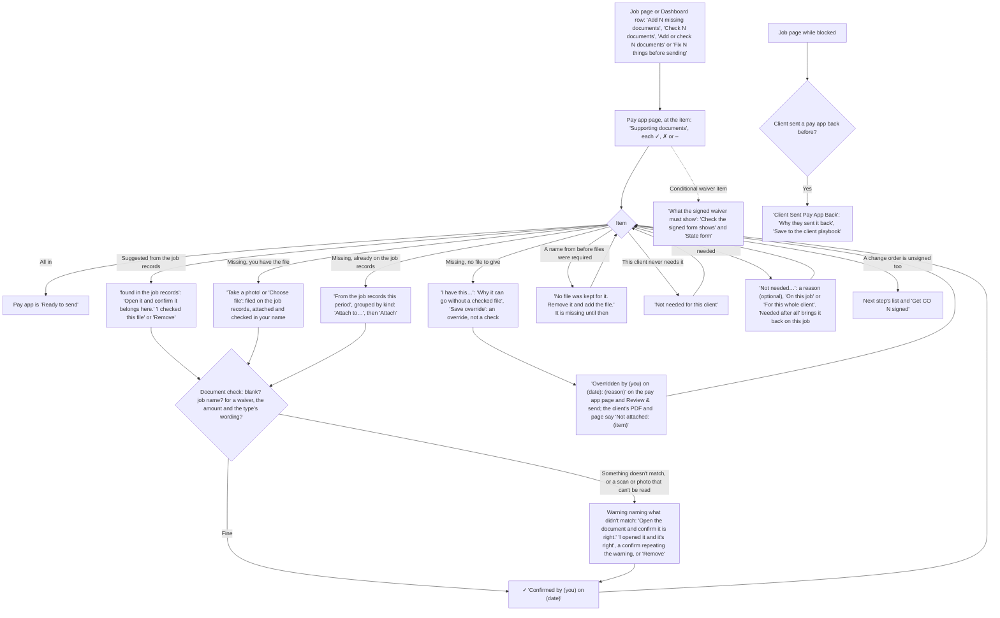

Code: the blocker button's words `domain.blocker_button`, domain/__init__.py:351, the lines `_blocker_text` domain/__init__.py:309 and `blocker_items` domain/__init__.py:317. The buttons land by `openSupportingDocs`, static/js/views/paperwork.js:398: the pay app's page, scrolled to the item with focus on it (`item_id`, `packet_item_id` on the Dashboard's row). Closeout, and an older job with no pay app yet, keep their own page, `views.packetDetail`, static/js/views/paperwork.js:414, which also shows **Also blocking send**. On the pay app's page `supportingDocsHtml` static/js/views/paperwork.js:377 draws the items, `packetItemsHtml` static/js/views/paperwork.js:329 (each attached record with its kind, its files as links and photos as small pictures, and who attached it when, `attachmentRow` static/js/views/paperwork.js:130, `recordFileLinks` static/js/views/paperwork.js:29), and **From the job records this period** `periodHtml` static/js/views/paperwork.js:198 (the records after the previous pay app's period, grouped; **Attach to…** lists only the missing items that take that kind of record, plus **Send with the pay app**).

A real file: `_can_fill`, domain/__init__.py:4530, needs a stored, non-empty file of a type a person can open (`DOCUMENT_TYPES`; a lien waiver, contract, insurance certificate or completion certificate can't be a spreadsheet, `DOCUMENTS_ONLY`). A note fills only an item whose label asks for a note. `attach_record_to_packet`, domain/__init__.py:4949, refuses a record with no file: "(record) has no file. (item) needs the document itself, not a note." Attaching and confirming are one step for the person doing it, so the item clears with their name and the date (`_clear_item`, domain/__init__.py:4590, `confirmed_by`), unless the document check has something to say.

Suggestions: `_attach_from_record`, domain/__init__.py:4463, looks through the job records, and what fits an item is attached with `auto` and `unconfirmed`, so it doesn't clear until a person taps **I checked this file** (`confirmHtml` static/js/views/paperwork.js:317, `packet-confirm` static/js/views/paperwork.js:455, server `confirm_packet_item`, domain/__init__.py:4679). A record a person took off (`detached_record_ids`) isn't suggested again.

Document checks: doc_check.py, `check` doc_check.py:276, reads PDF, Word and text files, never OCR. A file that is blank, or that can't be opened, is flagged. With text, it looks for the job's name; for a lien waiver also the amount and the type's wording (`_type_problems` doc_check.py:250: "It says unconditional, not conditional.", "Final wording not found."). A photo or scan is "couldn't be checked". Every flag is a warning for a person to clear, never a hard block: **I opened it and it's right** with a confirm repeating the warning, and the warning stays shown beside who confirmed it. A first attach never clears a flag. Whatever goes wrong while reading is itself a warning. The reading happens before the company's lock (`_read_ahead` server.py:3336).

One look clears a file: the page's first read lists every problem at once (`recheck_packet_item`, domain/__init__.py:4667), and one **I opened it and it's right** clears them all for that file at that amount (`_clear_item`, domain/__init__.py:4590, `confirming`), even if the check finds something more by then. A newer file, or a new amount, asks again. Confirm carries what the page was showing (`shown`, `_shown` server.py:3232): a Confirm refused for a file added since says so on the page and asks nothing about a file nobody looked at. Field documents (daily tickets, time sheets and the like, `FIELD_RECORD_KINDS`, domain/__init__.py:4546) don't need the job name, since field paperwork often doesn't say it; the other checks still apply.

**I have this…** stays as an override, `resolve_packet_item`, domain/__init__.py:855: it needs a reason ("Enter why (item) can go without a checked file."), and who, when and why are kept on the item and in the activity log ("Override: I have this"). They show on the pay app page, in Review & send's **Overrides**, and on Pay apps' column as **Complete, overridden**. The client's page, the PDF and the email's checklist say **Not attached: (item)** instead of a tick (payer_page.py:171, payapp_pdf.py:391).

Name-only: `sov.name_only`, sov.py:237, finds an item in only on names, from before files were required (nothing attached has a file behind it). On a pay app not sent yet it counts as missing, `missing_packet` domain/__init__.py:290, whatever older code stored; a pay app already sent stays as it went.

Not needed: `skip_packet_item`, domain/__init__.py:4762 takes an item off the client's list, or off the job's own list when it has one (`job_paperwork`). A closeout item comes off this job only. A conditional waiver comes off this job unless **For this whole client** is tapped, which keeps it off on the client, `waiver_not_needed`. **Needed after all**, `skippedHtml` static/js/views/paperwork.js:300 and `jobPaperworkHtml` static/js/views/job-paperwork.js:25, server `waiver_needed_after_all`, domain/__init__.py:4244, brings it back on this job; what was marked for the whole client is changed in the Client playbook, with **Needed after all** on the client's card (`client_waiver_needed_again`, domain/__init__.py:4255, section 15).

Who it reaches (`_skip_item`, server.py:3238): a client's rule or list is the client's settings, so **For this whole client** and **Not needed for this client** take the company permission (section 15). Without it, an item comes off this pay app only, as **Not needed on this pay app** (`skipped_scope`), and the client's list stays; the conditional waiver can still be marked **On this job**.

Server: the standard items `PAPERWORK_ITEMS`, domain/__init__.py:4364; a new pay app's list `_new_packet` domain/__init__.py:4103 (the job's own list, else the client's, else the default one, and always a conditional waiver named by its type, unless marked as not needed; an item of the list naming an unconditional waiver is that type and never filled by a conditional one); daily tickets when the pay app bills a change order or a unit-price line `_add_ticket_item` domain/__init__.py:4294; closeout documents for every job at Final Pay App `_ensure_closeout_packet` domain/__init__.py:4066; `detach_packet_item` domain/__init__.py:4725 (**Remove**: the records stay on the job, and one suggested automatically isn't suggested again); attach, skip and override are refused once the pay app has gone to the client (`_still_a_draft` domain/__init__.py:4755); `set_waiver_type` domain/__init__.py:1515, `link_record_to_work` domain/__init__.py:6077; **Client Sent Pay App Back** in `views.job`, static/js/views/job.js:232, `learn_rejection` domain/__init__.py:3897. A pay app, schedule of values or continuation sheet item is in from the start ("Produced by Duracash with the pay app"). A notarized pay application comes back from a notary, so it is its own item (`NOTARIZED_RE` domain/__init__.py:4355).

**Taps from start to done:** 1 to open, then 2 per missing item (Take a photo, take it) or 2 to attach a record (pick, Attach), plus 1 or 2 if a warning needs a look.

**Where it could still be simpler:**
- A scanned document can't be read without OCR, so every scan gets a person's look (see Limits and open questions).

---

## 8. Draft, check and send a pay app

**Goal:** turn work done into a pay app, look over everything that goes, and email it with its PDF and supporting documents.

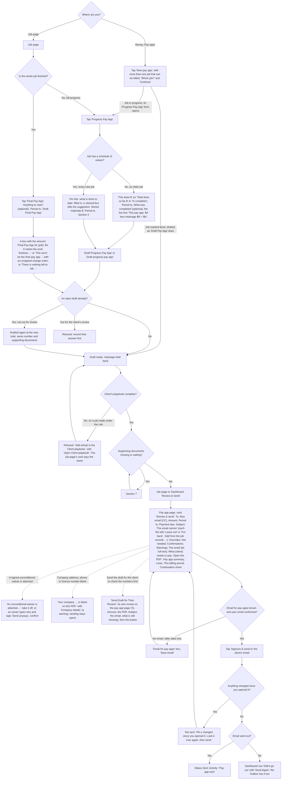

Code: **Progress Pay App** and **Final Pay App** in `jobActions`, static/js/jobs.js:422; on Money, Pay apps (`views.payapps`, static/js/views/payapps.js:183) **New pay app** `payapp-new` static/js/views/payapps.js:248 lists only the jobs `payAppStarts` (static/js/jobs.js:570) finds the job page would offer **Draft Pay App** or **Progress Pay App** on, to this person (`mayTake`), and opens that job's own step, `startPayApp` static/js/views/payapps.js:229, so there is one way of drafting; older jobs' progress card `progressFormHtml`, static/js/views/job.js:97 (`progressFigures`, static/js/jobs.js:277, checks it as the server does); line-by-line card `sovProgressHtml` static/js/sov.js:160 (it names an open draft it replaces, which keeps its number and supporting documents; a lump-sum line's **% done** takes at most one decimal, `lumpDone` static/js/sov.js:34, never rounded). Final Pay App's box asks `GET /api/jobs/<id>/final-preview` first (`done` static/js/views/job.js:384, `final_pay_app_preview` domain/__init__.py:535) and words it in `finalPayAppConfirm` static/js/jobs.js:137; server `record_progress` domain/__init__.py:403, `record_sov_progress` domain/__init__.py:5568, `mark_done` domain/__init__.py:485 (a draft still only here becomes the final pay app, same number and supporting documents; one with the client for their review is refused), `draft_invoice` domain/__init__.py:552 (a redraft keeps the records added to the email and the files left out, `_carry_send_choices` domain/__init__.py:777).

The playbook gate is `_need_playbook`, domain/__init__.py:2945: only on a job with `playbook_required` (section 15). It applies when a pay app starts, a draft goes for review and at send. Older jobs still need the email at send, `_send_to` domain/__init__.py:2714.

**Review & Send** opens the pay app page at `.send-check` (static/js/jobs.js:444, static/js/today.js:26); pay app page `views.payappDetail`, static/js/views/payapps.js:102 (the **Pay app summary** card `payappSummaryHtml` static/js/views/payapps.js:76, lines 1-9 as the PDF prints them, `payapp_pdf.summary` payapp_pdf.py:137, through `domain.payapp_figures` domain/__init__.py:2093; the continuation sheet `continuationHtml` static/js/sov.js:204, whose **Qty to date** column is also on the PDF sheet and the client's page, `_sheet` payer_page.py:90; **Open the PDF**, **Download for QuickBooks**, **Approve & send to …**; the blank company details warning `companyGapsHtml` static/js/setup.js:29). What Review & send lists is `beforeYouSendHtml`, static/js/views/paperwork.js:213 (**Leave out** / **Put back** / **Take off** `payapp-attach` static/js/views/paperwork.js:499, **Add from the job records…** `payapp-add` static/js/views/paperwork.js:504, **Overrides**, **Not needed**, **Confirmations**, **Warnings**, **The email** from `email_preview`, **Send anyway** `send-override` static/js/views/paperwork.js:529; server `change_payapp_attachments` domain/__init__.py:6004, only while the pay app is a draft). A send needs that look: the button carries `review_stamp`, domain/__init__.py:1041 (the pay app, its amount and the files going), and `approve_and_send`, domain/__init__.py:1048, refuses a stamp that doesn't match, and one that is missing ("Open PA-x and look it over, then send."). An attached unconditional waiver is refused without an owner's reason, `unconditional_waivers_attached` domain/__init__.py:991, reading a file that doesn't say its type. A bill that stopped being the final one under a confirmed waiver is refused until a person looks again (section 11). **Send Draft for Their Review** opens `pencilReviewHtml`, static/js/views/payapps.js:27 (`pencil_preview`; missing documents are listed and don't hold it back, since it is a check of the numbers), then `pencil`, server `send_pencil`, domain/__init__.py:820. **Send Again** `email-retry` static/js/views/communications.js:84. Mistakes: **Undo Done** (before the final pay app goes out, `undo_mark_done`, domain/__init__.py:3830), **Delete Draft** (`void_draft`, domain/__init__.py:3719), **Pull back this pay app…** on a sent one with nothing paid (`void_sent_pay_app`, domain/__init__.py:3767).

An unconditional waiver on Review & send has two levels, and the reading errs on the side of the first (`unconditional_reading`, doc_check.py:200). The owner's gate: **An unconditional waiver is attached**, with the file named and **Take off** or **Leave out**. Only an owner sends past it, with **Send anyway** and a reason (`send-override`, static/js/views/paperwork.js:529), kept as `unconditional_override` and in the activity log. A record typed unconditional is always the gate. A record filed as a waiver is the gate for any use of the word not taken back at once ("not an unconditional"), anywhere in the file, in any line: a conditional title on page one doesn't hide an unconditional one further down. A file filed as anything else is the gate for a line that looks like a heading (short, title case, or starting or ending with a waiver or release word) or a waiver phrase near the word. The look-and-clear: **Mentions an unconditional waiver**, with what was found and **Open**; whoever can send opens it and taps **It's right** (`unconditional-look`, static/js/views/paperwork.js:524, server `confirm_unconditional_mention`, domain/__init__.py:973), and the activity log says that, not that an unconditional waiver went. It is only for the sentences that say one comes later (`_comes_later`, doc_check.py:145: "will deliver an unconditional waiver", "becomes unconditional on receipt of payment", "if you have not been paid, use a conditional waiver"), and, on a file not filed as a waiver, a passing mention in a sentence (a daily log: "Sub's unconditional lien waiver received"). The look counts for the files the page was showing (`shown`): a file added since asks again (`_looked_at_mention`, domain/__init__.py:939). I opened it and it's right on the waiver item counts as this look only for someone who can send pay apps. A look never changes the record's waiver type.

**Taps from start to done:** 3 for a progress bill with nothing missing (Progress Pay App, Draft progress pay app, Review & Send) plus Approve & send: 4.

---

## 9. Conversations and following up on an unpaid pay app

**Goal:** keep what the client said on the job's records, and send a polite chase email when the client's usual wait has passed.

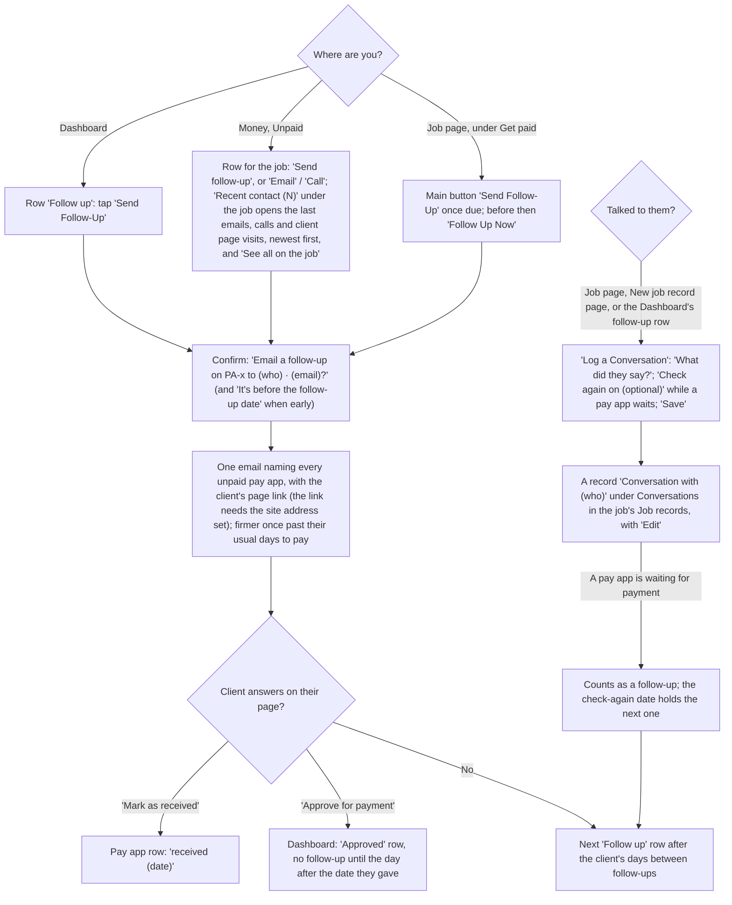

Code: Dashboard row kind `follow_up` in `domain.today_rows`, domain/__init__.py:2429 (with **Log a Conversation**, `rowButtons` static/js/today.js:57); Unpaid `views.collections`, static/js/views/collections.js:25 (**Recent contact (N)** `recentContactHtml` static/js/views/collections.js:14, from `contact_log`, domain/contact.py:45); job page **Send Follow-Up** / **Follow Up Now** static/js/jobs.js:82; the confirm `follow-up` static/js/views/collections.js:71; server `record_follow_up`, domain/__init__.py:1182 (from the third follow-up it also emails the client's **Also email from the third follow-up** address); the client's page `payer_page.render`, payer_page.py:152 (**Mark as received** `mark_received` payer_page.py:211, **Approve for payment** `approve` payer_page.py:226).

Conversations: **Log a Conversation** is a job action on any open job (`jobActions`, group Get paid), on the New job record page and on the follow-up row, `log-conversation` static/js/views/job.js:409; form `conversationFormHtml` static/js/views/job.js:57, server `note_contact`, domain/__init__.py:1273, which adds a record of kind `conversation`. `_log_conversation`, domain/__init__.py:1254, makes it count while a pay app waits. **Edit** on the record, `recordRow` static/js/views/job-record.js:21, changes what it is, its kind and **What they said**, server `edit_record`; a record changed to the kind Conversation does what Log a Conversation does. Older notes labelled "Spoke to Sam" read and file as "Conversation with Sam", `recordFace` static/js/jobs.js:632; what is stored stays until someone edits it.

**Taps from start to done:** 2 (Send Follow-Up, then the confirm); 3 for a conversation (Log a Conversation, type, Save).

**Where it could still be simpler:**
- The confirm says who it goes to but not what the email says; the Outbox shows the text once it has gone.

---

## 10. Record a payment

**Goal:** record a check or transfer against the right pay app so the waiver step opens.

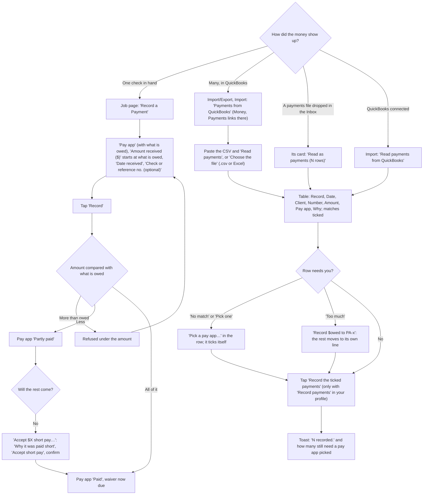

Code: **Record a Payment** card in `views.job` (`match` static/js/views/job.js:463, prefill `prefillPaymentAmount` static/js/views/job.js:221), server `match_payment`, domain/__init__.py:1298 (takes `received_on`); short pay `shortPayCardHtml` static/js/views/job.js:37, `accept-short-pay` static/js/views/payapps.js:294, server `settle_short_pay`, domain/__init__.py:1403; the import card `paymentsImportHtml`, static/js/views/payments.js:95-111, on Import (`views.import` static/js/views/data.js:9); Payments `views.payments` static/js/views/payments.js:115-138 lists what was recorded and links to Import (**Read payments** `qbo-read` static/js/views/payments.js:156, **Choose the file** `qbo-choose-file` static/js/views/payments.js:189, **Record the ticked payments** `qbo-apply` static/js/views/payments.js:164, shown only with `can("record_payments")` (static/js/views/payments.js:9; the route has perm="record_payments", server.py:2923, `_m_payments_apply` server.py:1907), the split `qbo-split` static/js/views/payments.js:176); row cells `qboTick` / `qboPayAppCell` static/js/views/payments.js:62-74 with static/js/payimport.js (`pickPayApp`, `splitTooMuch`, `afterRecord`); server `qbo_csv.parse` qbo_csv.py:330 and `propose` :476; Inbox **Read as payments** `inbox-read-payments` static/js/views/payments.js:182 (opens Import); QuickBooks card `qboCardHtml` static/js/views/payments.js:79 (**Connect QuickBooks**, **Read payments from QuickBooks**, **Check against QuickBooks**, **Disconnect**). The wireframe is `PaymentsImport`.

Refunds: **Received** is payments less money refunded (`collected_cents`, `job_money`, domain/__init__.py:145), on the job card, the CSVs (exports.py), the job file, the monthly summary and the prior payments on the pay app page and the client's page. Payment records stay as they were. The Money card shows **Refunded or credited (taken off Received)** (static/js/views/job-money.js:19) when there is any. A refund is money returned whatever the contract does next: when a later change order raises the contract, what it leaves short shows as owed (`refund_owed_cents`, `_owed_text` domain/__init__.py:216), the **Owed back** row on the Dashboard, and it stops Finish Job. It can be recorded with **Record a Payment** on the last pay app sent, or cleared with a signed credit; what comes back takes that much off what is owed, and no more is taken once it is back. A credit against a short pay moved no money, so it doesn't come off Received, and it stands only as long as the short pay does: if the client later pays that short pay after all, the job reads overbilled again. **Record Refund or Credit** is section 13.

**Taps from start to done:** 2 by hand (Record a Payment, Record); 3 for a CSV (Read payments, a pick if needed, Record the ticked payments).

**Where it could still be simpler:**
- QuickBooks is read on request, not every day (deferred until a live Intuit connection is tested, improvement plan section 5).

---

## 11. Lien waiver

**Goal:** a conditional waiver goes with each pay app; once it is paid, send the signed unconditional one. Each retainage release owes its own.

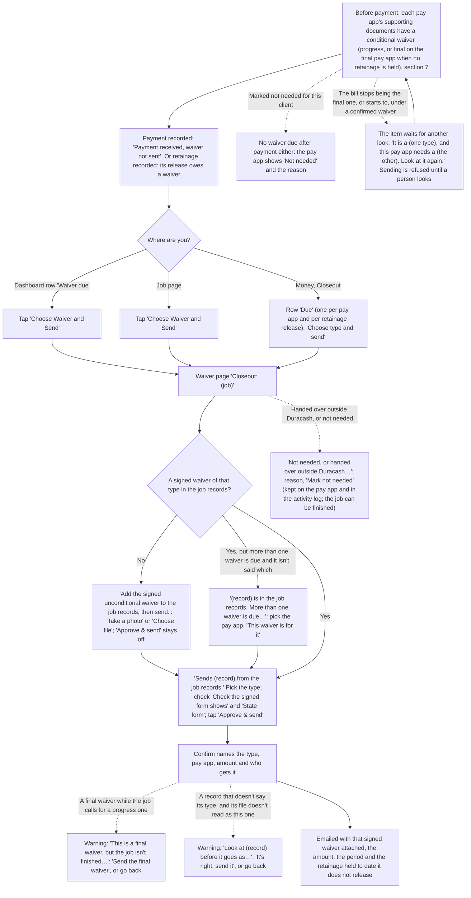

Code: Dashboard row kind `waiver` (**Choose Waiver and Send**, `open-waiver`); job page **Choose Waiver and Send** static/js/jobs.js:113; Closeout `views.waivers`, static/js/views/closeout.js:145 (one row per pay app, per retainage release and, while it is still owed, the older job-level **Earlier payment**, `waiverRows` static/js/views/closeout.js:33, with Not needed rows and their reason (their Type is —); **Which type?**, **Not chosen yet**, **Choose type and send**); waiver page `views.waiverDetail`, static/js/views/closeout.js:101, headed **Closeout: (job)** like its tab (**Waivers due**, **Check the signed form shows** `waiverChecklistHtml` static/js/views/paperwork.js:105, whose **Add your legal name** opens Settings, Company at the legal-name box (D2), **State form**, **By pay app** with **Before payment** and **After payment**); **This waiver is for it** `waiver-for` static/js/views/closeout.js:243 when a signed waiver isn't tied to a pay app and more than one is due (`waiverForHtml` static/js/views/closeout.js:78, offering each paid pay app, release and **Earlier payment**, `EARLIER_PAYMENT` domain/__init__.py:1556; server `set_waiver_type` domain/__init__.py:1515 with `for_id`, the choices `_waiver_owed` domain/__init__.py:1559); **Not needed, or handed over outside Duracash…** with **Mark not needed** (`waiverNotNeededHtml` static/js/views/closeout.js:90, server `waiver_not_needed` domain/__init__.py:1802, needs a reason; a client marked not needed owes none after payment, `_waiver_comes_due` domain/__init__.py:1634); type picker and hint `waiverSendForm` static/js/jobs.js:207; server `send_waiver`, domain/__init__.py:1658 (refused until a signed waiver of the type is in the job records, `waiver_on_file` domain/__init__.py:1594, never one that already went out in any email, nor one taken for another pay app or release; one taken for none is refused while more than one waiver is due, `_hold_unclear_waivers` domain/__init__.py:1583), both stages `waiver_stages` domain/__init__.py:1870, the type it suggests `suggested_waiver_kind` domain/__init__.py:1455 (conditional before payment, unconditional after, never final while retainage is held); state forms `helper/waiver_forms.json` (Georgia so far), `/api/waiver-forms` server.py:3034.

Retainage releases: `record_retainage_payment`, domain/__init__.py:1970, adds one waiver per release, unconditional, on final payment only when the job is finished by it; releasing all the retainage on a job half done is a progress waiver, since it gives up no rights to the work still to bill. A release marked final that the job isn't finished for (recorded earlier, or reopened since) is sent as progress unless a person says otherwise. Sending a final waiver when a progress one is due warns and takes a confirm before any email (`confirm_final`, never a hard block).

Type flips: `_name_conditional_waiver`, domain/__init__.py:4322, names the waiver item by whether the pay app is the final one with no retainage held or open. When that changes (a change order written since, say), a waiver confirmed as one type isn't confirmed as the other: `_ask_for_a_look` domain/__init__.py:4833 puts it back to wait with a warning, and `approve_and_send` refuses. A signed waiver filling an item must fit its type (`_fits_waiver_item` domain/__init__.py:4697); an unconditional waiver never fills a conditional item.

The look warning: **Approve & send** reads each file on the waiver's record, whatever its label or type, before any email (`send_waiver`, domain/__init__.py:1658, `look_warning`). When something doesn't match, it says **Look at (record) before it goes as the (type)** with what didn't match, and sends only once a person answers **I opened it and it's right**, for that record (`looked_at`, static/js/views/closeout.js:220). The activity log keeps it (`waiver_looked_at`). It is a warning, never a hard block (Decision 6).

A final waiver that goes out fills the closeout's **Final lien waivers** when it is still missing, whichever type that item names (`_final_waiver_fills_closeout`, domain/__init__.py:1790), so nobody files it twice.

**Taps from start to done:** 2 (Choose Waiver and Send, Approve & send) and the confirm, plus the type if it isn't the one picked for you.

**Where it could still be simpler:**
- Duracash does not write the waiver: sign the form your state or the client requires and add it to the job records. Only Georgia's forms are listed so far.

---

## 12. Retainage release

**Goal:** get the money held back on the job paid at the end.

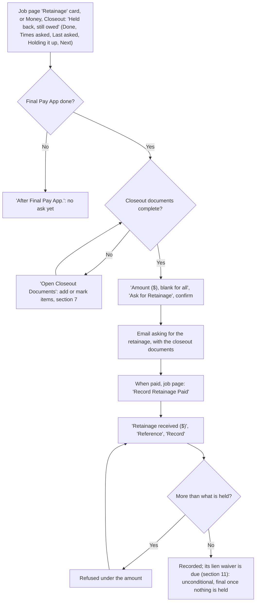

Code: the job page's **Retainage** card `retainageCardHtml`, static/js/views/job-money.js:41 (rate, held, released, still held, **Job done**, **Times asked**, **Last asked**, **Next ask allowed**, **Pay apps holding it**, **Releases** with each one's waiver, **Closeout documents** with its files; figures `retainageFacts` static/js/jobs.js:244); Closeout's held-back table in `views.waivers`, static/js/views/closeout.js:100-150, `retainageAskHtml` :17; job page **Ask for Retainage** only once the work is done and the closeout documents is in (static/js/jobs.js:128; the card says why otherwise, `retainageNote` static/js/jobs.js:371); after a request, whole or part, the next waits the client's **Days between follow-ups** (`retainageAskWaits` static/js/jobs.js:365, the server's wait in `chase_retainage`); the confirm static/js/views/closeout.js:21; server `chase_retainage`, domain/__init__.py:1908 (refused before the job is marked done); **Record Retainage Paid** card in `views.job`, `retainage-paid` static/js/views/job.js:415, server `record_retainage_payment`, domain/__init__.py:1970 (each release owes a lien waiver, `retainage_waivers`).

**Take Credit off Retainage**: a signed credit that leaves the job overbilled can come out of the retainage held, so the client doesn't pay that part of it and nothing was overpaid to refund. It needs the Record payments permission and a reason (**What was agreed**), and is in the activity log (`apply_credit_to_retainage`, domain/__init__.py:5831). It lowers the open retainage with no money received, up to what is overbilled, held and signed (`retainage_credit_room`, domain/__init__.py:227), and shows as **Signed credit taken off retainage** on the Money card. When it takes the last of what was held with nothing else open, the job is finished by it, so the final lien waiver comes due, as a release row headed **Signed credit**, unless a final waiver already went out or the client doesn't take them. The button is on the **Before you can finish this job** list (`closeBlockerActions`, static/js/jobs.js:486).

**Taps from start to done:** 4 (Ask for Retainage and the confirm, then later Record Retainage Paid, Record), then the release's waiver (section 11).

**Where it could still be simpler:**
- The closeout documents hold back the ask for the money, not the Finish Job warning: section 13.

---

## 13. Finish the job

**Goal:** file a fully settled job away in Job history, with its job file.

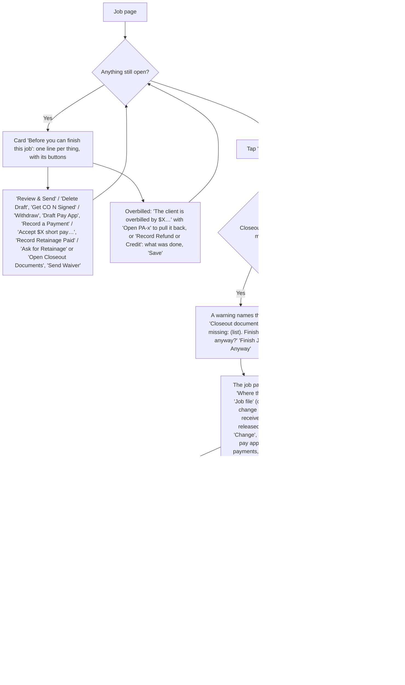

Code: the card in `views.job` from `close_blocker_items`, domain/__init__.py:241 ("A lien waiver is still due." until every paid pay app's and every retainage release's waiver is sent), buttons `closeBlockerActions`, static/js/jobs.js:486; **Finish Job** static/js/jobs.js:131 and its warning and confirm `close` static/js/views/job.js:474 (missing closeout documents warn and ask, they don't stop it; Nov 3 review); server `close_job`, domain/__init__.py:3908. Overbilled comes from `job_money`, domain/__init__.py:145: work billed past the contract and signed change orders (a credit signed after the bill went out, say). **Record Refund or Credit** is `overbilling-settled` static/js/views/job.js:433, server `settle_overbilling`, domain/__init__.py:5802: what was done is required, kept and in the activity log, and the job can then be finished. The job file `archiveHtml` static/js/views/job.js:158 (J9) with **Change** for the start date (`save-start` static/js/views/job.js:448); **Download job file** GET /api/jobs/<id>/archive/job-file.zip, `job_archive.build` job_archive.py:87 (anyone signed in to the company); **Add more work** in `views.job` (`reopen` static/js/views/job.js:442), server `reopen_job`, domain/__init__.py:3919 (the Finish and reopen jobs permission, `JOB_ACTION_PERMS` domain/profiles.py:53); the open jobs `openJobs` static/js/jobs.js:562, used by Money's lists and `views.calendar`; the job filters on pages of records `jobFilterOptions` static/js/jobs.js:604 (open jobs, then "Finished jobs"); a job with only drafts deleted before they were sent and no payments can be deleted instead (**Delete job** under Edit job, `can_delete_job` domain/__init__.py:5428).

**Taps from start to done:** 2 (Finish Job, the confirm).

**Where it could still be simpler:**
- The Job filters on the pages of records offer only jobs finished in the last 90 days; an older job's records are in its job file under Job history.

---

## 14. The Dashboard routine

**Goal:** open one page, see everything waiting, who has it and when it is due, and handle it top to bottom. Each person gets their own rows by email each morning there is something due: an owner gets what is assigned to them and what nobody has; a member gets what is assigned to them.

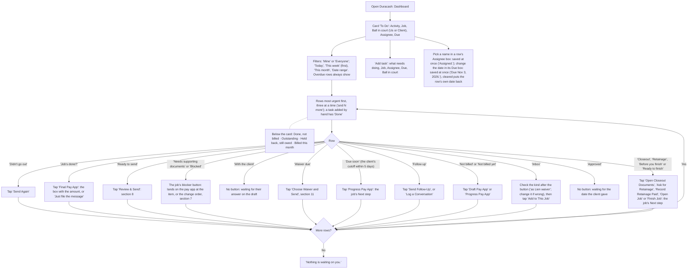

The rows and the job page agree: `domain.today_rows` gives one next step per job, in the order of the job page's `jobActions`, in its words, with its button's label. A row that needs more than a tap opens the job at its **Next step** card (`OPENS_JOB`, `ACTIONS` static/js/today.js:21; **Before you finish** opens at **Before you can finish this job**). A follow-up is a row of its own beside that job's other row. Rows that wait on the client say so: **With the client**, **Approved**, and a retainage ask already made (ball in court Client, due the day it can be asked again).

Code: the rows and their order `domain.today_rows`, domain/__init__.py:2429 (one rule set for the Dashboard and the daily email `daily_digest` domain/__init__.py:2608, sent per person by `_digests`, monthly.py:140; finishing rows go in the email once a week, every seventh day from the day the work was marked done, or Mondays for an older job, `WEEKLY_DIGEST_KINDS` and `_digest_week_day` domain/__init__.py:2597, and stay on the Dashboard every day); each row's key, due date, ball in court and assignee `decorate_rows`, domain/tasks.py:50 (assigned with `assign_row` domain/tasks.py:254, tasks added by hand `add_task` domain/tasks.py:178, `edit_task` domain/tasks.py:197; `set_task_done` domain/tasks.py:236; routes `/api/tasks…`, handlers `_task_change` server.py:2006; a team member removed: `reassign_open_tasks` domain/tasks.py:295, which moves their open tasks, their rows and the jobs they were assigned to the owner who removed them, called from `_p_team_remove` server.py:2132); one list and the period filter `todoItems` / `periodRange` / `inPeriod`, static/js/tasks.js:35; drawn by `todoHtml` / `rowButtons` / `assignSelect` / `dueInput`, static/js/today.js:85; the card `todoCardHtml` static/js/views/today.js:77 with **Add task** `taskFormHtml` static/js/views/today.js:61 (an Inbox row's kind select, which starts at the kind the Inbox guessed, `inboxKindSelect` static/js/today.js:49, sent as the row's `item_kind`); Dashboard page `views.dashboard`, static/js/views/today.js:264 (metrics and the jobs table under the card); the "Job's done?" box `inbox-mark-done` static/js/views/inbox.js:514. The daily email is turned off in Settings, Company: **Daily email of what's due**. A row with no date of its own is sent with a blank due date and is due on the person's own today (`todoItems`; the server's day is UTC, already tomorrow on a US evening); the same goes for a new job's start date and a Diary entry's day, which take the date the page sends (`local_today` domain/jobinfo.py:84). A due date set by hand is kept with the row's own date at the time (`row_due`) and stops applying when the row comes back with a new one (`_override_holds` domain/tasks.py:75); `prune_assignments` domain/tasks.py:100 drops those and the assignments of rows that are gone before every save. The daily email lists a "due soon" row as soon as it shows, so the pay app can be got ready before the cutoff; only a row whose date was set by hand waits for that day (`due_now` in `daily_digest`).

**Taps from start to done:** 1 to 2 per row. A typical week with one send, one follow-up and two filings is about 6 taps with the confirms.

**Where it could still be simpler:**
- A pay app ready to send is due on the client's next cutoff, so with a cutoff weeks away it shows under **This month**, not **This week**.

The Calendar starts with **Tasks** (T6): the same items and the calendar's dates in **This week**, **Next week**, **This month** or **Custom**, each opening its day, with **Add task** (`tasksBlockHtml`, static/js/views/today.js:100).

---

## 15. Client playbook

**Goal:** keep each client's rules (who signs off, where pay apps go, follow-up timing, the supporting documents list) right, since they drive every pay app and follow-up. A complete playbook is the client's name and type, who signs off, the billing email and a phone number; the rest has defaults.

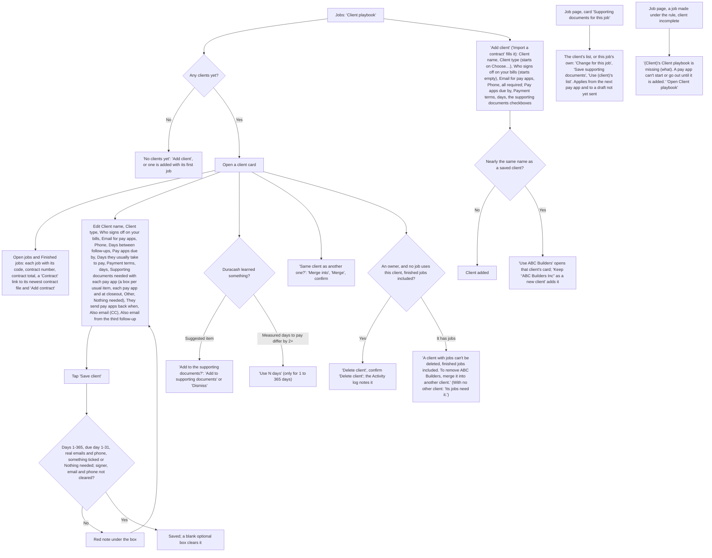

Code: page `views.playbook`, static/js/views/clients.js:150 (**Add client** `add-payer` static/js/views/clients.js:291, server `add_payer` domain/__init__.py:3028; **Save client** `save-playbook` static/js/views/clients.js:247, server `update_payer`, domain/__init__.py:2786; the jobs `clientJobsHtml` static/js/views/clients.js:80, asked for when the card opens from GET /api/payers/<id>/jobs, `payer_jobs` domain/jobinfo.py:202, finished jobs included (S10); the boxes `paperworkHtml` static/js/views/clients.js:95, built by `paperworkChoices` static/js/jobs.js:653 from the server's standard catalog `PAPERWORK_ITEMS` domain/__init__.py:4364, saved as the comma list the server reads, `parse_packet_text` domain/__init__.py:4023 (S11); **Import a contract** as on New job (S12); **Merge** `merge-payer` static/js/views/clients.js:336, server `merge_payer`, domain/__init__.py:3082; **Use ABC Builders** / **Keep “ABC Builders Inc” as a new client** `ap-same-use` / `ap-same-keep` static/js/views/clients.js:326; **Delete client** `delete-payer` static/js/views/clients.js:331, shown by `deletePayerHtml` static/js/views/jobs.js:172 to those whose profile may edit client settings when `job_count` is 0, server `delete_payer` domain/__init__.py:3104). Every label has an (i) with the trade term (`FIELD_HELP`, static/js/help.js).

Required playbook: `playbook_missing`, domain/__init__.py:2905; the boxes `PLAYBOOK_FIELDS`, domain/__init__.py:2884. A value saved can be changed, not cleared: `update_payer` refuses a blank signer, email or phone once it has one ("Enter the email pay apps go to, like ap@builder.com."), and Add client and New job refuse a client without them, so a client with no email only exists in data from before the rule. Such a client is asked for what it lacks the next time it is used for a new job, and its existing jobs aren't held up (Nov 3 Decisions 3 and 4). A job made under the rule has `playbook_required`, so `_need_playbook`, domain/__init__.py:2945, stops a pay app starting or going out while the playbook is incomplete, and the job page's card `playbookMissingHtml` static/js/views/job-paperwork.js:14 says what is missing with **Open Client playbook** `open-client-card` static/js/views/clients.js:313. Who signs off that only defaulted to the client's own name (`signer_defaulted`) starts empty on the card (`signerDefaulted` static/js/views/clients.js:16), so a plain save isn't an answer; typing it sends `approver_confirmed`, kept on the client until the signer changes.

Anticipated end date: on New job and Edit job (`anticipated_end_on`, `parse_end_date` domain/jobinfo.py:70: blank until known, never before the start date; a contract's completion date fills it). It shows in **Where this job stands** (`job_key_dates` domain/jobinfo.py:159), on the calendar feed while the job is open (`events` calendar_feed.py:43), in the Jobs CSV (`jobs_rows` exports.py:55), in the job file's summary (job_archive.py:47) and in Important dates reminders.

Per job: the card **Supporting documents for this job**, `jobPaperworkHtml` static/js/views/job-paperwork.js:25, server `set_job_paperwork`, domain/__init__.py:4160, keeps the job's own list (`paperwork_labels`), audited; **Use (client)'s list** goes back. A job on the older job-level list can't have its own. Public jobs: **Certified payroll** and **Notarized pay application** are items of the catalog, each with a record kind of its own, so a time sheet or the app's backup doesn't fill them (`PAPERWORK_ITEMS`). Tick them on the client, or for one job on this card.

Who can change a client: the Team page's **Edit company details, client settings and connections** (`company`). The server checks it on `/api/payers/<id>/update`, `/merge`, `/delete`, `/waiver-needed` and `/suggestion/<id>/add` or `dismiss` (`ROUTES`, server.py:3010). Without it the card reads only (`clientReadOnlyHtml`, static/js/views/clients.js:20): its settings as rows, a suggestion to read with no buttons, and no **Save client**, **Use N days**, **Needed after all** or **Merge**. Three things stay open to everyone on the team. **Add client** and New job make a new client, which changes no saved one. New job fills in what a saved client is missing, and so do **Save email** on Review & send and the boxes under **Still missing** on the read-only card, which is where **Open Client playbook** lands: `/api/payers/<id>/missing`, `fill_missing_client_details`, domain/__init__.py:2912, takes only the blank who signs off, email, phone or client type, refuses one already saved, and ignores every other setting. And **Client Sent Pay App Back** adds its reason to **They send pay apps back when** and suggests a document (`learn_rejection`, domain/__init__.py:3897); the suggestion waits for someone with the permission.

**Taps from start to done:** 2 (open the card, Save client), plus 1 per suggestion.

---

## 16. Team, permissions and signing in

**Goal:** bring people in with the right permissions, keep the company's deletion with one person, and sign in safely. The screens are the wireframes `Settings` and `TwoStep`.

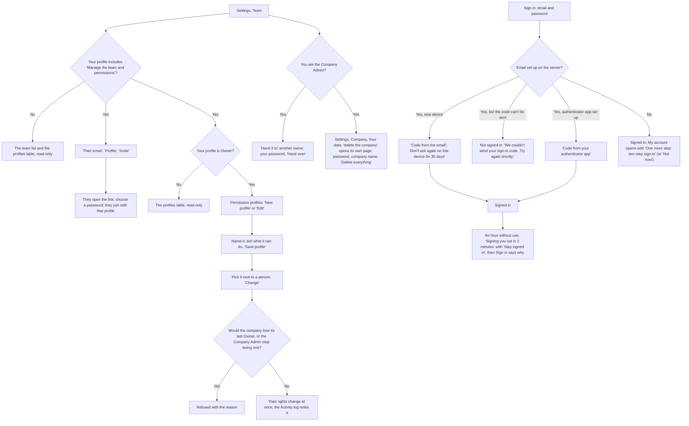

Code: Team page `teamView`, static/js/views/settings.js:246, with `teamCardHtml` static/js/views/settings.js:77 (**Change** `team-profile` static/js/views/settings.js:650), `profilesCardHtml` static/js/views/settings.js:115 and `profileFormHtml` static/js/views/settings.js:130 (**New profile**, **Edit**, **Save profile** `profile-save` static/js/views/settings.js:662, **Delete** `profile-delete` static/js/views/settings.js:673; shown to owners only, `ownerMe()`), `adminCardHtml` static/js/views/settings.js:145 (**Hand over** `admin-hand-over` static/js/views/settings.js:677). The permissions and the job action each needs are `PERMISSIONS` and `JOB_ACTION_PERMS`, domain/profiles.py:53 and domain/profiles.py:52; the server checks `has_perm` on every route flagged perm= (`_run`, server.py:977, the check at server.py:960; owner=True routes at server.py:957, refused with "Only an owner can add, change or delete permission profiles.", `OWNER_ONLY`) and `may_take` on every job action (`_m_job_action`, server.py:2836), and the page hides the same through `mayTake` and `ACTION_PERM`, static/js/jobs.js:398-412, and `can`, static/js/app-core.js:466. Profiles are saved by `_p_profile_save`, server.py:2159 (`save_profile`, domain/profiles.py:155), on owner=True routes, server.py:2835-2837, so only the Owner profile adds, changes or deletes them (A4); a person's profile by `set_role`, auth.py:1064; the Company Admin is `_admin`, auth.py:922, handed on by `hand_over_admin`, auth.py:1136, and the only one `_p_account_delete` lets through, server.py:2149; the delete page is `deleteCompanyView`, static/js/views/settings.js:257. Signing in: `_p_login`, server.py:1538, asks for an emailed code when `_email_code_due`, server.py:1595 (`login_code_check` and `remember_device`, auth.py:1299-1318); a code that can't be sent (`_send_login_code`, server.py:1606, off the shared hourly limit) gives no session; five wrong codes drop the live ones (`_wrong_code`, auth.py:702), and the count of wrong tries clears only once every step has passed (`login_succeeded`, auth.py:530); a password reset (`reset_password`, auth.py:769) forgets remembered devices; the code step on the landing card, static/js/views/auth.js:79-88; with no mail on the server the setup card comes first (`twoStepCardHtml`, static/js/views/settings.js:335, **Not now** `2fa-later` static/js/views/settings.js:717). **Change password** opens `passwordView`, static/js/views/settings.js:369 (**Email me a code** `pw-code`, server `_p_password_code`, server.py:1825). Appearance is `appearanceCardHtml`, static/js/views/settings.js:320, saved with My account's one **Save** (`save-account`, static/js/views/settings.js:732) through `_p_appearance`, server.py:2197, and applied by `applyAppearance`, static/js/theme.js:24, to the dark palette and accents in static/styles.css:761. The idle sign-out is `session_check`, auth.py:587, and static/js/idle.js.

**Taps from start to done:** a new profile and a person on it: 4 (New profile, Save profile after ticking, pick it, Change). Sign in from a new device with email codes: 2 (Sign in, then Sign in with the code).

---

## 17. New job record

**Goal:** one form for what happened on site and the day's documents: delivery tickets, progress photos, time sheets, invoices, inspections. It replaces the daily record and the old "add a note to the record".

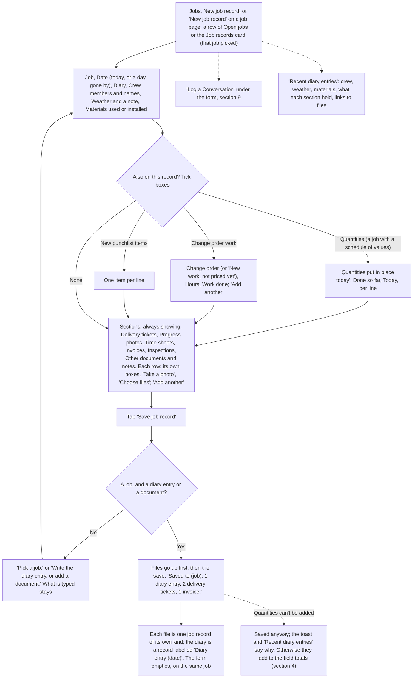

Code: the form `views.daily`, static/js/views/daily.js:59 (tick boxes `SECTIONS` static/js/views/daily.js:30, `sectionHtml` static/js/views/daily.js:105; document sections `RECORD_SECTIONS` static/js/views/daily.js:37, `recordSectionHtml` static/js/views/daily.js:92); **Save job record** `daily-save`, `saveRecord` static/js/views/daily.js:323; files go up one at a time `uploadDailyFiles` static/js/views/daily.js:266 with `for_job_record=1`, so a second Save doesn't upload them again and only the person's own waiting files can be filed (`hold_for_job_record` domain/daily.py:324, `_may_file` domain/daily.py:334); what a Save made `savedWords` static/js/views/daily.js:247. Server `add_daily_record` domain/daily.py:275 (every field checked by `clean_daily_details` domain/daily.py:109; the record's label `Diary entry <date>`, with any quantities; the note read out by `daily_record_note` domain/daily.py:239). Delivery tickets and time sheets share the kind `ticket` with a `ticket_type`, domain/daily.py:46, so they group apart on the job (section 5) and still fill the **Daily tickets and time sheets** item. The stored kind, the address and the ids keep the word "daily".

The paste box and **Add a note to the record** are gone from the job page and Jobs: emails, text threads and notes go in on Import, through the Job records card's link (section 5), and notes go on this form's **Other documents and notes**. Pasted field notes make one record per date, labelled by that date.

**Taps from start to done:** 2 (New job record, Save job record), plus 2 per file.

---

## 18. Email, texts and reminders

**Goal:** clients hear from the company by email only. Texts and reminders are internal: they tell the team what is due, what is missing and what needs a person. Every test of email and text runs on staging, where only named addresses get anything.

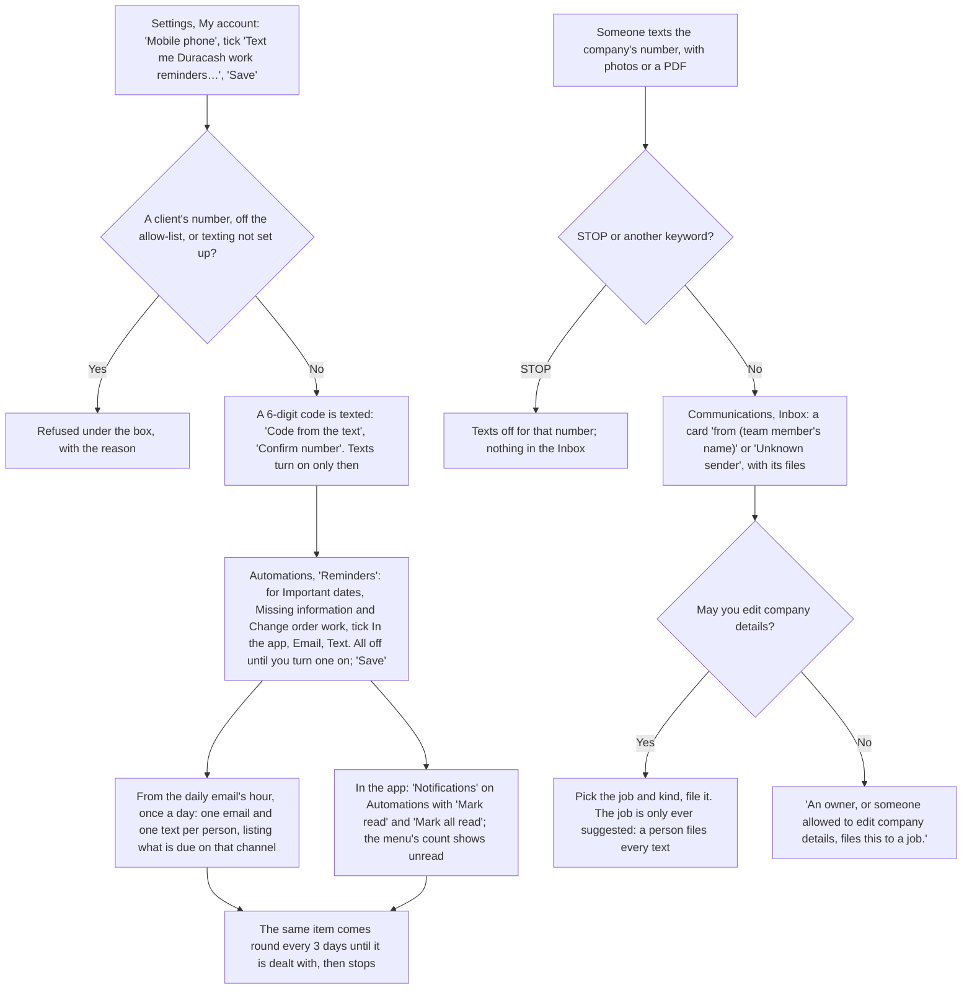

Allow-lists and staging: `mailer.allowed`, mailer.py:87, and `sms.allowed`, sms.py:112. `MAIL_ALLOWLIST` and `SMS_ALLOWLIST` name who may get anything. With `DURACASH_ENV=staging` (the `duracash-staging` service in render.yaml) a blank list sends to nobody; with a mail list in force and a blank text list, no text goes. An email held this way stays in the Outbox as "not sent: this address isn't on this server's allow-list", and **Send Again** sends it once the address is listed. A person off the list gets no confirmation link and signs in without an emailed code, outside production. Staging has no disk, so its data and its counts reset on each deploy. Accounts and live tests: docs/setup-integrations.md.

Outgoing texts: sms.py has one way to send, `send_to_member`, sms.py:296, which takes a user id, never a number. A client's number is refused in any format, matched on its 10 digits (`client_numbers` sms.py:133), when a person saves it, when a code goes and at every send. **My account**: `textsHtml` static/js/views/settings.js:300, `_p_my_sms` server.py:2869 and `_p_my_sms_confirm` server.py:2907; the code `send_code` sms.py:316 lasts 15 minutes, and **Send a new code** (`sms-resend`, static/js/views/settings.js:599) asks for another. At most five codes an hour go to one person or one number (`issue_sms_code` auth.py:303); that is checked before the earlier code is dropped, so the one in hand stays live, and the refusal says which number got none and which has the newest code. One-word STOP turns texts off for every account with that number (`opt_out` sms.py:128); after that a person texts START first, then ticks the box again, and My account says so with the number to text. A code asked for before START is refused, and the refusal says to text START first. Someone who agreed before codes existed sees **Confirm your number to keep getting texts**. At most `SMS_DAILY_LIMIT` (20) a company a day, and none from a read-only company. Twilio's inbound post is checked by signature; production and staging refuse it without the token.

Inbound texts: `_inbound_sms`, server.py:2701. Files come down with `twilio_media.download`; a sender found by `auth.member_by_phone` reads by name, anyone else as **Unknown sender**, and the job match only ever suggests. Filing one needs the permission to edit company details (`by_text`, server.py:2758, drawn by `inboxItemCard` static/js/views/inbox.js:286). **Delivery ticket** and **Time sheet** are separate choices when filing (section 5).

Reminders: reminders.py. The kinds `KINDS` reminders.py:52: **Important dates** (`_date_items` reminders.py:101: a follow-up or payment date in the next 7 days or past, a pay app due day in the next 7 days, an anticipated end date in the next 7 days), **Missing information** (`_missing_items` reminders.py:126: a client on an open job with no billing email or phone, a pay app held up), **Change order work** (`_co_items` reminders.py:141: a job record in the last 30 days with change order work whose change order isn't signed, or on time and materials has no hours or backup; or work no change order covers yet). Who gets what follows the daily email (`for_person` reminders.py:197). The page `views.automations`, static/js/views/automations.js:74; ticking Text without a confirmed number is refused (`_p_reminder_prefs` server.py:2928). `REMINDER_REPEAT_DAYS` sets the interval, default 3. Email and text go from the hourly loop, `run` reminders.py:330, at most one message per person per channel per day, from `DAILY_EMAIL_HOUR_UTC`; a text fits 280 characters and says how many more are on Automations (`text_message` reminders.py:212). In the app, `sync_notifications` reminders.py:394 adds what is due whenever the person loads the app and marks done what has been dealt with; the count is `reminderCount`, static/js/views/automations.js:17, on the Automations menu item and on a phone's **More**.

Timing: `first_wait`, monthly.py:239. Nothing goes at start-up; the first run is about 5 minutes after boot (`BOOT_QUIET_SECONDS`, monthly.py:34), then hourly, so a server restarted often still gets its runs. What was done for the day is kept on disk, so a restart repeats nothing. Daily and monthly emails go at most once per person (`_send_once`, monthly.py:73): each address is written down before it is handed to the mailer and each company is saved as it finishes. After a kill, the people not reached yet still get theirs, the one address in hand may go without, and the alert says so. A record of what was sent that can't be read or isn't the right shape stops those emails, with an alert and a copy kept beside it, rather than risk sending twice (`_read_done`, monthly.py:55), as the reminders' file does. A company that is read-only is skipped (`billing.read_only_why`). A file of counts or places that can't be read means nothing is sent, the server alerts, and a copy is kept. The weekly part of the daily email is in section 14.

---

## Flows not charted, or charted with less confidence

- **Billing** (Settings, Billing: **Subscribe** / **Manage billing** through Stripe, `billingView` static/js/views/settings.js:387): shows only when Stripe is set up on the server; people whose profile doesn't include billing see it read-only.
- **The client's page** (`payer_page.render`, payer_page.py:152; wireframe `PayerPage`): This job (the pay app's lines 1-9 and the prior payments received, `_job_card` :75), the continuation sheet with Qty to date (`_sheet` :90), Mark as received, Approve for payment with a date, Send a question (an Inbox item for the contractor). Charted as branches in section 9.
- **QuickBooks connection** (**Connect QuickBooks**, Settings, Company and Import/Export, Import): the Intuit sign-in in the middle happens off our site. Charted as one branch in section 10.
- **Email forwarding and sharing from the phone into the Inbox** (`views.inbox`, **Bring emails and texts in automatically**): need an owner to set up an email service. Texts in are in section 18. Shared while signed out, files wait 30 minutes for sign-in (**Finish adding N shared items**, `heldShareHtml` static/js/views/auth.js:386).
- **Export** (Import/Export, Export: `views.export` static/js/views/data.js:155): **Download everything** (owners only; the server refuses members, `_g_export`), **Lists for a spreadsheet (CSV)** (I1, `export-lists` static/js/views/data.js:167): **Jobs**, **Pay apps**, **Payments** and **Change orders**, finished jobs included, for everyone signed in like Sent pay apps (`GET /api/export/<kind>.csv`, `_g_export_csv` server.py:1439, built by exports.py: `jobs_rows` exports.py:55 with client, address, contract, billed, received, outstanding, retainage held and still owed, status, started, done and finished; `payapps_rows` :85 without deleted drafts; `payments_rows` :102 with retainage released; `change_orders_rows` :123; every text cell through `text` :27, an apostrophe before = + - @ so a spreadsheet never runs it, dollars from whole cents by `dollars` :34), **Sent pay apps** with each one's **PDF** and **Download for QuickBooks**, filtered by job (`GET /api/payapps/sent`, `_g_sent_payapps` server.py:1275, `domain.sent_payapps_page` domain/comms.py:99; closed jobs' too), the **Calendar feed** with **Copy** (`calendarFeedHtml` static/js/views/inbox.js:126), and links to the Outbox and the Activity log. Settings, Company, **Your data** links here and keeps Reset and Delete.
- **Outbox** (Communications, Outbox: `views.outbox` static/js/views/communications.js:58-78): each email lists what it carried, **Pay app PDF** and each file by name, opening it, or "A file no longer on the job records" (`attachmentsHtml` :19); **Print** (`print-email` :85) prints that one email (To, When, Status, Subject, the message and its attachments) through `printSheet` :40 and the `@media print` rule in static/styles.css (comms-data block), black on white even from dark mode (D7, the `--print-` tokens). **Print** on an Everything received row does the same for something that came in.
- **Quantities done** (Import/Export, Import, M1: quantities from the contractor's own records; `qtyImportHtml` static/js/views/data.js:46): **Job** lists the open jobs with a schedule of values (`qtyJobs` static/js/views/data.js:40; with none, it says why and offers to open a job), then **Choose the file** (CSV or Excel, `qty-choose-file` static/js/views/data.js:214) or rows pasted and **Read quantities** (`qty-read` static/js/views/data.js:208). `POST /api/import/quantities/preview` (`_p_qty_preview` server.py:1890) changes nothing: `qty_import.parse` qty_import.py:125 takes columns by their header (item number, description, quantity this period) or, without one, a leading item number, the words and the last number; `qty_import.preview` qty_import.py:276 matches each row to a schedule line by item number, else by description in any case and punctuation (`_match` qty_import.py:188; a description that fits more than one line asks for the item number), reads a lump sum as the % done this period, and shows the line, Done to date, Add, New total, Scheduled and why a row can't be added. A job that can't take quantities now says why (`quantities_blocked` domain/daily.py:518). **Add N to the schedule of values** (`qty-apply` static/js/views/data.js:239) sends the same file again to `POST /api/import/quantities/apply` (`qty_import.apply` qty_import.py:312, with the preview's `basis`, so a preview tapped twice or one the schedule moved on from is refused: "Read the file again"): the rows that can be added go on the lines' field totals as a job record's quantities do, so no draft is made or changed (section 4); the rest are listed under **Not added**, in the activity log and in a job record note "Quantities imported from (file)". That record has **Undo import**. Who may record progress may import.
- **Draft for the client's review** (**Send Draft for Their Review**, **Client Agreed to the Draft**, **Client Wants Changes**, static/js/jobs.js:96-98): an optional side path before send.
- **Tap counts** are the fewest taps on the happy path with fields already filled, counted from the code, not timed with a user. Confirms count as a tap.

---

## Limits and open questions

Not built:

- **A live link to a contractor's own system.** Quantities come from a New job record or an imported file (Import, Quantities done), not a feed from a field or accounting program.
- **Other states' waiver notes.** Only Georgia's forms and notes are listed (`helper/waiver_forms.json`).
- **OCR and calendar controls.** Reading scanned documents, and choosing what goes onto Outlook, Google or Apple calendars and how, both wait on decisions. Today a scan is "couldn't be checked" and gets a person's look, and the calendar feed is one list for the company.
- **A credit pay app.** A signed credit can leave a job overbilled; it is settled by pulling the pay app back, or with **Record Refund or Credit**.
- **One Twilio number per company.** A number has one webhook, so one number files inbound texts to one company. Outgoing reminders can share a number.

Open questions for Stephen:

- What does "PE" mean in your note on public jobs, and what must be notarized or stamped, and by whom? **Notarized pay application** is a plain document item until that's settled.
- What did you mean by "Government contracting services"?
- Do the signer or the billing email ever vary per job? They are per client today; only the supporting documents list can differ per job.
- Partial payments: which waiver goes, and is one needed for each? Today a waiver comes due only once a pay app is paid in full or a short pay is accepted.
- Should a pay app ever need a second approver before it goes?
- Who is the "manager" who files texts? Today it is anyone whose profile may edit company details.
- Georgia's waiver wording needs an attorney's look before anyone relies on what the document check says about it.
- Should missing closeout documents stop Finish Job? Today they are a warning and a confirm (section 13).
- A conditional waiver on a final draft counts as progress while an earlier pay app is unpaid (`_name_conditional_waiver`, domain/__init__.py:4322), since a waiver on final payment gives up what else is unpaid. Is that right? It is a legal call.
- The job card's arithmetic after a refund: Billed less Received no longer equals Outstanding once money has gone back, because Outstanding counts only what is still owed. Is the **Refunded or credited** row enough, or should the card read differently?
- A pay app holding retainage the client has paid can't be pulled back (`void_sent_pay_app`, domain/__init__.py:3767), so money is never left released with nothing held. Is that the right way out, or should a release be correctable?
- A credit taken off the retainage has no undo. Only a signed change order brings it back (section 12). Should there be one?
- The continuation sheet's Previous column: after a typed amount that doesn't land on a whole quantity, then stored materials, the next sheet's Previous can be slightly under the last sheet ($5.41 in the case found). Totals are right, and tests/test_money_fuzz.py allows it. Fix it, or leave it?
