# Duracash client flows

For Stephen to review. Each chart shows what a contractor taps, screen by screen, to get one task done. Every screen name and button label is copied from the app code (`static/app.js`, `static/js/*.js`, `payer_page.py`, `domain/__init__.py`, `server.py`), regenerated from the code on Oct 29, 2026 after Round 6 (R6-11) and checked again against the code in the final pass the same day; the file:line after a label is where it lives today (a bare `:N` is in the file named last before it). Read each chart from top to bottom. Diamonds are real branches the code takes.

The demo company is Hartline Remodeling (`seed.py`), opened with **Look around a sample company** on the landing page (no account) or the login `owner@hartline.example` / `demo`. The demo can't send email, so some steps end at "Not sent: demo account". The wireframes in `docs/wireframes/` draw the same screens; `Job`, `PhoneJob`, `Money`, `PaymentsImport`, `Inbox`, `Settings` and `PayerPage` were redrawn with this file in R6-11, and `Today`, `PhoneToday`, `Packet`, `PhonePacket`, `SendCheck` and `Playbook` in the final pass.

Screen names used below (pages and tabs: `SECTIONS`, static/app.js:24-30; addresses: static/js/routes.js:9-21):

| Screen | Address |
|---|---|
| Today: Overview, Results, Calendar, Daily record | `/today`, `/today/results`, `/today/calendar`, `/today/daily` |
| Jobs: Open jobs, Job history | `/jobs`, `/jobs/history` |
| Job page | `/jobs/<id>` |
| Inbox | `/inbox` |
| Money: Pay apps, Change orders, Unpaid, Payments, Closeout, Outbox | `/money`, `/money/change-orders`, `/money/collections`, `/money/payments`, `/money/waivers` (`/money/retainage` opens it at Held back, still owed), `/money/outbox` |
| Pay app, Paperwork, Change order and Waiver pages | `/money/pay-app/<job>/<id>`, `/money/packet/<job>/<id>` (`closeout` for the closeout paperwork), `/money/change-order/<job>/<id>`, `/money/waiver/<job>` |
| Settings: Company, Team, My account, Billing, Customer settings, Activity log, Help | `/settings/company` (`/settings` opens it), `/settings/team`, `/settings/account`, `/settings/billing`, `/settings/playbook`, `/settings/audit`, `/settings/help` |
| The customer's page for one pay app; the signing page for one change order | `/p/<link>`, `/s/<link>` (no sign-in; `payer_page.py`) |

On the job page the **Next step** card holds one main button and, beside it, the next two as two-line buttons (the label, then why). The rest sit under **More (N)**, grouped Bill, Get paid and Close out. The main button is picked in this order: the blocker button (**Fix N things before sending**, **Add N missing documents** or **Get CO N signed**), **Review & send**, **Choose waiver and send**, then, while a sent pay app is unpaid, **Send follow-up** once it is due and **Draft pay app**; otherwise **Draft pay app**, **Progress pay app**, **Finish job**, **Ask for retainage** (`jobActions`, static/js/jobs.js:266-316). While the customer has the pay app and no follow-up is due there is no main button. A member does not see what only an owner may do (send, waivers, retainage requests, delete a draft, pull back, finish, delete, accept short pay, reopen; `OWNER_ONLY`, static/js/jobs.js:251, `OWNER_ACTIONS`, server.py:2557) unless the company turned on **Members can send pay apps, lien waivers and retainage requests** (Settings, Company).

A company set to **Draws from homeowners** (Settings, Company, How you bill) reads Draw and Draws wherever this file says pay app (`termText`, static/js/terms.js; `domain.term_text`).

---

## 1. The whole life of a job

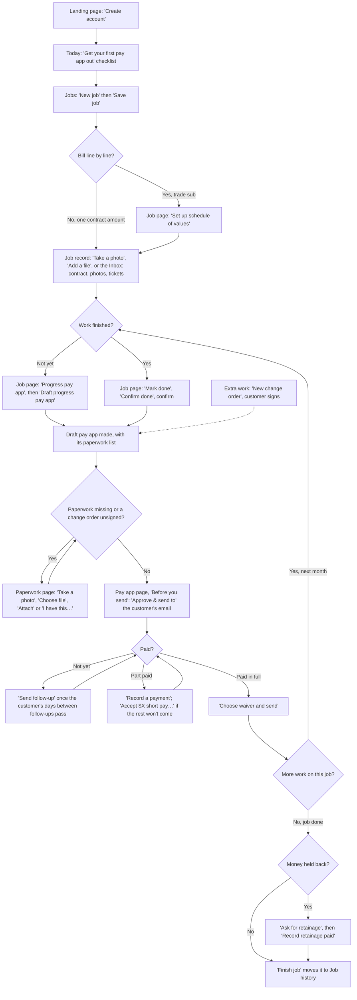

The money loop is the middle: draft, add the paperwork, send, follow up, record the payment, send the waiver, then back to next month's progress. A job usually goes round it once a month. Each step shows up on Today as a row, and in the owners' daily email, so the contractor can run the loop from Today (section 14).

---

## 2. First day setup

**Goal:** create the company, confirm the email, and fill in the company details that print on every pay app. The screens are the wireframes `Landing`, `CheckEmail`, `FirstRun`, `NewJob` and `Settings`.

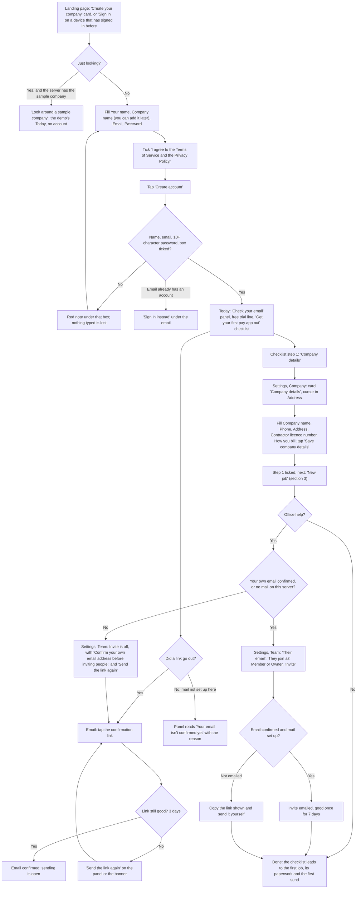

Code: landing and sign-up card `renderLanding`, static/js/views/auth.js:45 (Sign in first when this browser has signed in, static/js/views/auth.js:11-17; the terms box static/js/views/auth.js:91); **Look around a sample company** static/js/views/auth.js:71 and `lookAround` static/js/views/auth.js:213, server `_p_demo`; "Check your email" panel `checkEmailHtml`, static/js/views/auth.js:357 (**Send the link again**, **Got it**); checklist `onboardingHtml`, static/js/views/today.js:58-102, its step 1 **Company details** opens Settings, Company at `#co-address`; Company page `companyView`, static/js/views/settings.js:112; **Save company details** `save-company` static/js/views/settings.js:580; Team `teamCardHtml`, static/js/views/settings.js:60, **Invite** `team-invite` static/js/views/settings.js:534 (off, with the reason and **Send the link again**, while `inviteLocked` static/js/setup.js:41; the server still refuses, `_p_team_invite`). Two-step sign-in is on Settings, My account (`myAccountView`, static/js/views/settings.js:167): **Set up two-step sign-in**, scan the QR code, **Turn on**, save the recovery codes.

**Taps from start to done:** about 5. Create account (1, after typing 3 boxes and the tick), the email link (1), Company details on the checklist (1, lands in the Address box), Save company details (1), Invite (1, optional).

**What changed since Round 2:** Settings is four pages (Company, Team, My account, Billing) instead of one long Team & account page (R6-03); the checklist and Before you send name Settings, Company. Sign-up is limited to 5 an hour per network (R6-05). The Company page has **Sending and email** (who may send, the daily email) for owners.

**Where it could still be simpler:**
- Hiding the checklist is per person, so a teammate who joins later sees it until they hide it (it can be brought back from Help).

---

## 3. Add a job by hand

**Goal:** get a job and the customer who pays it into Duracash. Customers can also be added on their own (section 15).

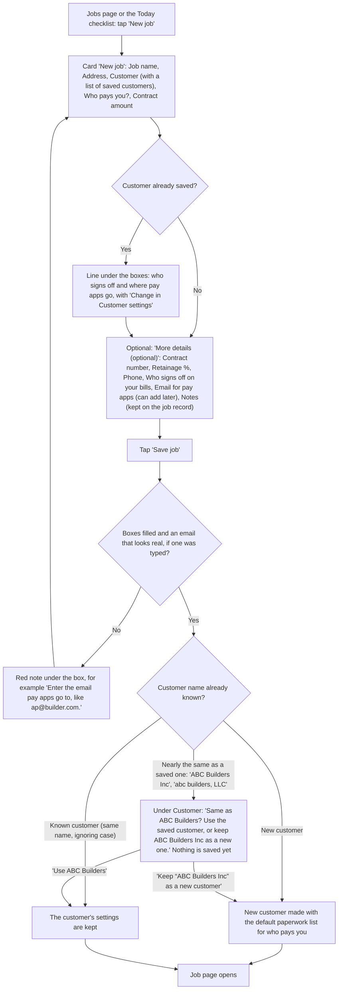

Code: `views.jobs`, static/js/views/jobs.js:136-194 (**New job**, the five boxes, **More details (optional)**, **Save job**); `jobFields` static/js/views/jobs.js:16; the saved-customer line `knownPayerText` static/js/views/jobs.js:35; **Save job** `create-job` static/js/views/jobs.js:226; server `create_job`, domain/__init__.py:2734 (a refusal is keyed by field and shown under its box, `showFieldErrors` in static/js/forms.js). Notes become a "Job notes" record, never paperwork (R1-04). A near match (Oct 23 note 5) is found by `payer_near` domain/__init__.py:1711, which compares names with `customer_key` (:1696: case, spaces, punctuation, "The" in front and Inc, LLC, Co, Corp, Company, Ltd at the end don't count); the refusal carries `same_customer` and `showSameCustomer` static/js/views/jobs.js:53 shows the two buttons, **Use ABC Builders** `nj-same-use` :259 and **Keep “ABC Builders Inc” as a new customer** `nj-same-keep` :269 (sent again with `new_customer: true`). Nothing is merged without a tap.

**Taps from start to done:** 2 taps (New job, Save job) and 5 boxes, one of them a select.

**Where it could still be simpler:**
- The paperwork list for a new customer is set by Who pays you? and only shows once the first pay app is drafted; it is changed in Customer settings, not on the New job form.

---

## 4. Set up the schedule of values

**Goal:** bill line by line (quantity times rate), the way a GC wants a trade sub to bill.

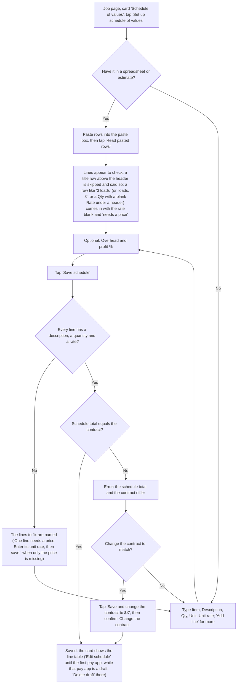

Code: `sovCardHtml`, static/js/views/job.js:328-373 (**Set up schedule of values** static/js/views/job.js:343, **Edit schedule** static/js/views/job.js:369); editor `sovEditorHtml`, static/js/views/job.js:288-326 (**Read pasted rows** static/js/views/job.js:303, **Add line** static/js/views/job.js:311, **Save schedule** static/js/views/job.js:322, **Save and change the contract to $X** static/js/views/job.js:284 and static/js/views/job.js:323); the confirm static/js/views/job.js:399; parse `sov.parse_rows`, sov.py:458 (a header found in the first 5 rows, R5-08; one number next to a unit word in `UNIT_WORDS` sov.py:388, after it or just before it, checked by `_counts_units` sov.py:428, is a quantity with no price, sent back with `needs_price` and a blank rate; under a header, a quantity with the rate and amount blank comes back the same way); the editor marks it with `sovLineProblem`, static/js/sov.js:42 ("needs a price" static/js/views/job.js:271, the toast static/js/views/job.js:396); save `save_sov`, domain/__init__.py:2981, which refuses a blank rate ("needs a price (unit rate)", sov.py:336). While the only pay app is a draft, the card's note and **Delete draft** come from `sovDraftLockHtml`, static/js/sov.js:57 (used at static/js/views/job.js:337 for a job with no schedule and static/js/views/job.js:347 for one with a schedule), from `draft_lock` in `_sov_view` (`_sov_draft_lock`, domain/__init__.py:3173); the button is the `void-draft` action and its confirm. On a phone each line is a card with the description on top (R6-02).

**Taps from start to done:** 3 with a paste (Set up schedule of values, Read pasted rows, Save schedule). One more (the confirm) if the contract changes to match.

**Where it could still be simpler:**
- The schedule is fixed once the first pay app exists, even an unsent draft. While the only pay app is a draft the card says "The schedule is fixed while PA-x is a draft. Delete the draft to change it." with a **Delete draft** button (owners; anyone else reads "An owner can delete the draft to change it." and no button); after one is sent it says "Fixed once the first pay app exists. Scope changes go through change orders, which add their own lines when approved." A mistake found on the second pay app means a change order. A job with no schedule whose only pay app is a draft shows one line instead of the card: "To bill line by line, delete draft PA-x first, then set up a schedule of values." with **Delete draft** (anyone else reads "To bill line by line, an owner has to delete draft PA-x first. Then you can set up a schedule of values."). Once a pay app is sent, a job with no schedule hides the card.

---

## 5. Import existing paperwork

**Goal:** get contracts, photos, tickets, emails and old notes onto the right job without retyping.

```mermaid
flowchart TD
    A{"Where are you?"} -->|"On the job page"| B["Job record: 'Take a photo' or 'Add a file', drop files, or 'Paste an email, a text thread, or notes' then 'Add to job'"]
    B --> C["Toast: 'N files added to the job record.' Done"]
    A -->|"Anywhere else"| D["Inbox"]
    D --> E{"What do you have?"}
    E -->|"Files or photos"| F["'Which job?' (or 'Not sure, file later'), then 'Take a photo' / 'Choose files', a drop, or a pasted screenshot"]
    E -->|"Text"| G["Card 'Paste an email, a text thread, or notes'"]
    G --> H["Paste: the box picks An email, Text messages or Notes when it looks like one, and says so"]
    H --> K["Tap 'Add to Inbox'"]
    F --> L["Cards under 'Waiting (N)'"]
    K --> L
    L --> M{"Job suggested?"}
    M -->|"Yes, several cards"| N["Tap 'Add all N to their suggested jobs'"]
    M -->|"Yes"| O["Tap 'Add to (job)' (or 'Other job' / 'Change type')"]
    M -->|"Could be one of a few"| P["Tap the job's name, or 'Pick a job…' and 'Add to job'"]
    M -->|"A payments export"| PAY["'Read as payments (N rows)': Payments opens with the rows, section 10"]
    M -->|"Junk"| Q["Tap 'Dismiss'"]
    N --> R["Listed under 'Recently added or dismissed', with 'Undo'"]
    O --> R
    P --> R
    Q --> R
```

Code: job record card in `views.job`, static/js/views/job.js:599-620 (**Take a photo** / **Add a file** `pick-files` static/js/views/inbox.js:346, paste box `pasteBoxHtml` static/js/views/inbox.js:141 with **Add to job**); record rows with **Edit** `recordRow` static/js/views/job.js:442 (R5-07); Inbox `views.inbox`, static/js/views/inbox.js:294-341 (**Waiting (N)**, **Which job?**, the touch-only **Take a photo** / **Choose files**, **Recently added or dismissed**, **Bring emails and texts in automatically**); cards `inboxItemCard` static/js/views/inbox.js:170 with `choiceJobs` / `choiceLine` / `pasteGuess` in static/js/inbox.js; uploads three at a time `uploadFiles` static/js/views/inbox.js:38; server matching `importer.match_job`, importer.py:451 (a job code in capitals, or in small letters as its own word when no job's name or address has that word; the full job name or a part of it no other job has, like Oak Street for Oak Street kitchen, or one telling word written with a capital, like Vesta; a code in small letters or one name word counts less than the customer's AP email; a tie suggests nothing), kinds `guess_kind` importer.py:371, notes split `split_notes` importer.py:342, filing `file_item` importer.py:620; **Undo** `undo_item` importer.py:762, refused while paperwork uses the record by `_paperwork_refusal` importer.py:719, with a link in the refusal card (`showRefusal` static/js/app-core.js:293).

**Taps from start to done:** 2 from the job page (Take a photo or Add a file, pick). From the Inbox: 2 to add, then 1 per card to file, or 1 for all suggested cards.

**Where it could still be simpler:**
- Forwarding email and texts in needs an email service or a Twilio number set up by an owner (deferred: a provisioned address per company, improvement plan section 5).
- Once a record is attached by hand to paperwork, Undo on the Inbox is refused. For a draft it links to that pay app's Paperwork page, where Remove is. For a pay app that went out it links to the pay app: the record stays as sent, and pulling the pay app back (only while nothing is paid) is the way to change what went out.

---

## 6. Change order

**Goal:** record extra work (or a credit) with a price and get it signed, so it can be billed.

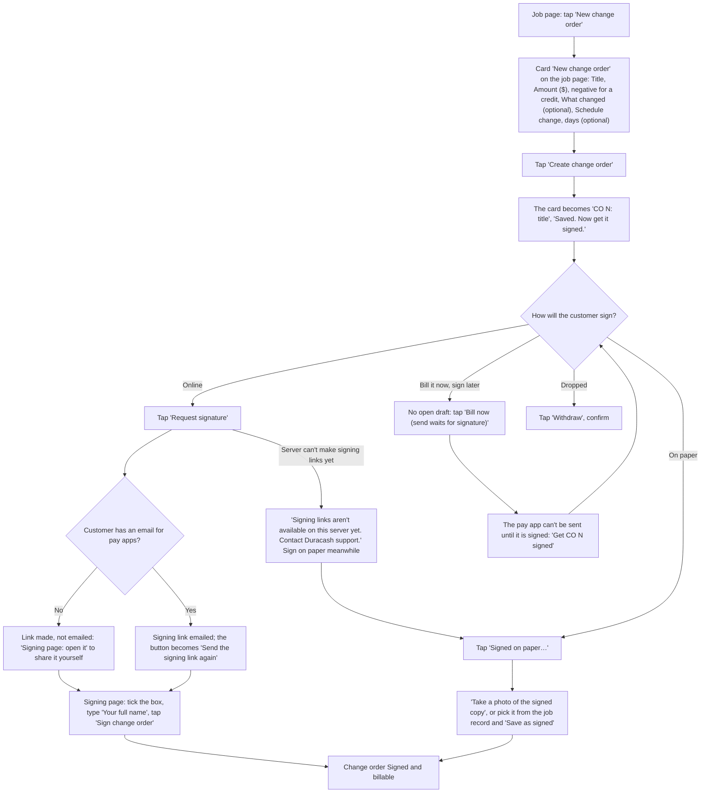

Code: **New change order** `new-co` static/js/views/job.js:715 (a job action, static/js/jobs.js:304); card `newCoCardHtml` static/js/views/job.js:192 and `coFormFields` static/js/views/job.js:207; **Create change order** `add-co-here` static/js/views/job.js:717, server `add_change_order` domain/__init__.py:1954 (refuses only zero and a credit larger than the contract total); sign controls `coSignControls` static/js/views/job.js:26 (**Request signature**, **Signed on paper…**, **Withdraw**, **Take a photo of the signed copy**, **Save as signed**); server `request_co_signature` domain/__init__.py:2065 (without the site address it refuses with `NO_SIGNING_LINKS`, domain/__init__.py:2061, and the server log names DURACASH_URL, `_request_co_signature` server.py:2483), `mark_co_signed` domain/__init__.py:2111 (signing, online or on paper, takes "(unsigned)" off the line of an open draft that billed it, so the PDF no longer says so), `withdraw_change_order` :2122; **Bill now (send waits for signature)** in `views.job`, server `include_change_order`, domain/__init__.py:2256; signing page `render_co`, payer_page.py:254. The Change orders tab (`views.cos`, static/js/views/money.js:383) lists every change order and also has a New change order form.

**Taps from start to done:** 2 to create (New change order, Create change order) after typing, then 1 for online signing (Request signature) or 2 on paper (Signed on paper…, Take a photo of the signed copy).

**Where it could still be simpler:**
- A change order has no PDF of its own yet (improvement plan section 5).

---

## 7. Paperwork (what the customer wants with each pay app)

**Goal:** get every missing item in so the pay app can be sent.

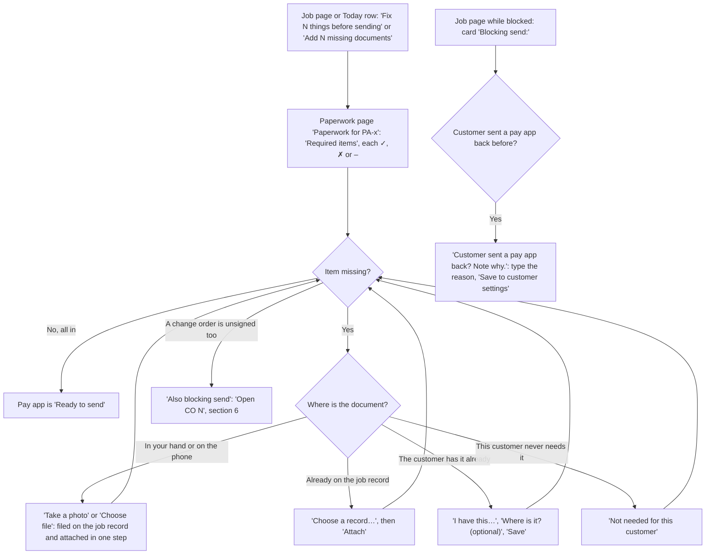

Code: the blocker button's words `domain.blocker_button`, domain/__init__.py:271; paperwork page `views.packetDetail`, static/js/views/money.js:157-207 (**Take a photo** / **Choose file** upload with `?attach=`, **Choose a record…** / **Attach** `attach-record` static/js/views/money.js:752, **I have this…** / **Save** `resolve` static/js/views/money.js:650, **Not needed for this customer** `packet-skip` static/js/views/money.js:751, **Remove** on a draft's, the job's and closeout paperwork `packet-detach` static/js/views/money.js:750, **Also blocking send**); server `attach_record_to_packet` domain/__init__.py:2698, `resolve_packet_item` :576, `skip_packet_item` :2591, `detach_packet_item` :2563; the note-why card in `views.job` (`learn` static/js/views/job.js:734, server `learn_rejection`, domain/__init__.py:2282). The list comes from Customer settings, Paperwork needed with each pay app; a pay app, schedule of values or continuation sheet item is in from the start ("Produced by Duracash with the pay app").

**Taps from start to done:** 1 to open, then 2 per missing item (Take a photo, take it) or 2 to attach a record (pick, Attach).

**Where it could still be simpler:**
- The paperwork list only appears once the first pay app is drafted; the setup checklist asks for the contract and paperwork on the job record before that.

---

## 8. Draft, check and send a pay app

**Goal:** turn finished work into a pay app and email it with its PDF and paperwork.

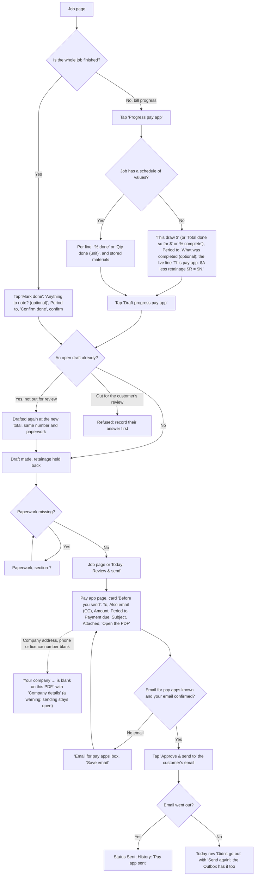

Code: **Progress pay app** and **Mark done** in `jobActions`, static/js/jobs.js:292-293; progress card `progressFormHtml`, static/js/views/job.js:117-142 (`progressFigures`, static/js/jobs.js:148, checks it as the server does), line-by-line card `sovProgressHtml` static/js/sov.js:79-99; **Draft progress pay app** `progress` static/js/views/job.js:640 and `sov-progress` static/js/views/job.js:637; Mark done card in `views.job` and its confirm static/js/views/job.js:654; server `record_progress` domain/__init__.py:320, `record_sov_progress` :3055, `mark_done` :400, `draft_invoice` :434; **Review & send** opens the pay app page at `.send-check` (static/js/jobs.js:284, static/js/today.js:22); pay app page `views.payappDetail`, static/js/views/money.js:235-313 (**Before you send**, **Open the PDF**, **Download for QuickBooks**, **Approve & send to …**; the blank company details warning `companyGapsHtml` static/js/setup.js:29, a warning only); server `approve_and_send`, domain/__init__.py:602; **Send again** `email-retry` static/js/views/money.js:642. Mistakes: **Undo done** (before the final pay app goes out, `undo_mark_done`, domain/__init__.py:2225), **Delete draft** (`void_draft`, domain/__init__.py:2140), **Pull back this pay app…** on a sent one with nothing paid (`void_sent_pay_app`, domain/__init__.py:2166).

**Taps from start to done:** 3 for a progress bill with nothing missing (Progress pay app, Draft progress pay app, Review & send) plus Approve & send: 4.

**Where it could still be simpler:**
- **Send draft for their review** (the customer checks the numbers first) is under More, not charted; it waits on **Customer agreed to the draft** or **Customer wants changes**.

---

## 9. Follow up on an unpaid pay app

**Goal:** send a polite chase email when the customer's usual wait has passed, or note a phone call.

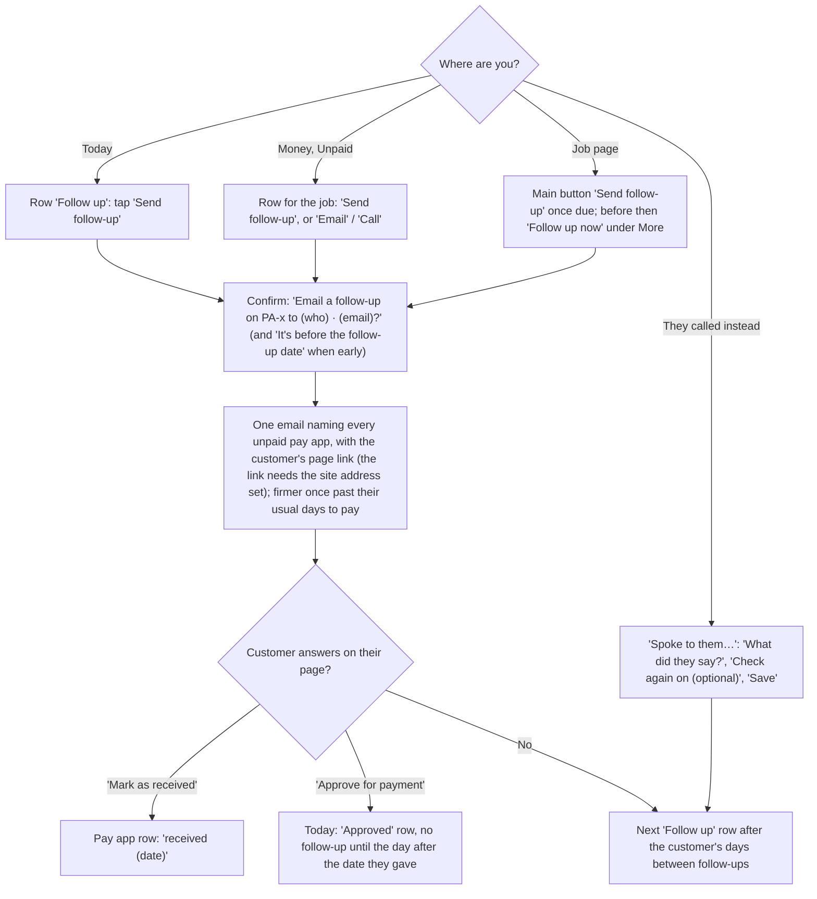

Code: Today row kind `follow_up` in `domain.today_rows`, domain/__init__.py:1356-1478 (with **Spoke to them…**, static/js/today.js:51); Unpaid `views.collections`, static/js/views/money.js:414; job page **Send follow-up** / **Follow up now** static/js/jobs.js:287; the confirm static/js/views/money.js:717; server `record_follow_up`, domain/__init__.py:692 (not-due refusal :720, from the third follow-up it also emails the customer's **Also email from the third follow-up** address); **Spoke to them…** `contactFormHtml` static/js/views/job.js:77 and `note_contact`, domain/__init__.py:764; the customer's page `payer_page.render`, payer_page.py:125 (**Mark as received** `mark_received` :176, **Approve for payment** `approve` :191).

**Taps from start to done:** 2 (Send follow-up, then the confirm).

**Where it could still be simpler:**
- The confirm says who it goes to but not what the email says; the Outbox shows the text once it has gone.

---

## 10. Record a payment

**Goal:** record a check or transfer against the right pay app so the waiver step opens.

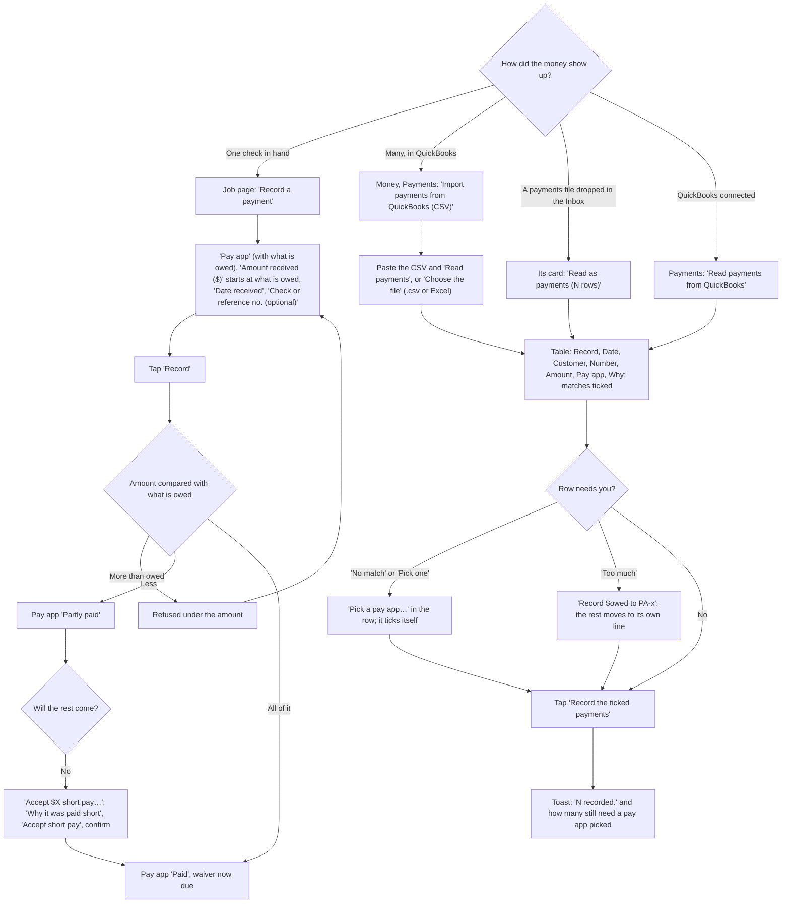

Code: **Record a payment** card in `views.job` (`match` static/js/views/job.js:705, prefill `prefillPaymentAmount` static/js/views/job.js:181), server `match_payment`, domain/__init__.py:799 (takes `received_on`); short pay `shortPayCardHtml` static/js/views/job.js:58, `accept-short-pay` static/js/views/money.js:693, server `settle_short_pay`, domain/__init__.py:888; Payments `views.payments`, static/js/views/money.js:457-497 (**Read payments** `qbo-read` static/js/views/money.js:577, **Choose the file** `qbo-choose-file` static/js/views/money.js:608, **Record the ticked payments** `qbo-apply` static/js/views/money.js:584, the split static/js/views/money.js:596); row cells `qboTick` / `qboPayAppCell` static/js/views/money.js:108-130 with static/js/payimport.js (`pickPayApp`, `splitTooMuch`, `afterRecord`); server `qbo_csv.parse` qbo_csv.py:149 and `propose` :203; Inbox **Read as payments** `inbox-read-payments` static/js/views/money.js:602; QuickBooks card `qboCardHtml` static/js/views/money.js:131 (**Connect QuickBooks**, **Read payments from QuickBooks**, **Check against QuickBooks**, **Disconnect**). The wireframe is `PaymentsImport`.

**Taps from start to done:** 2 by hand (Record a payment, Record); 3 for a CSV (Read payments, a pick if needed, Record the ticked payments).

**Where it could still be simpler:**
- QuickBooks is read on request, not every day (deferred until a live Intuit connection is tested, improvement plan section 5).

---

## 11. Lien waiver

**Goal:** send the signed lien waiver for each pay app that is paid.

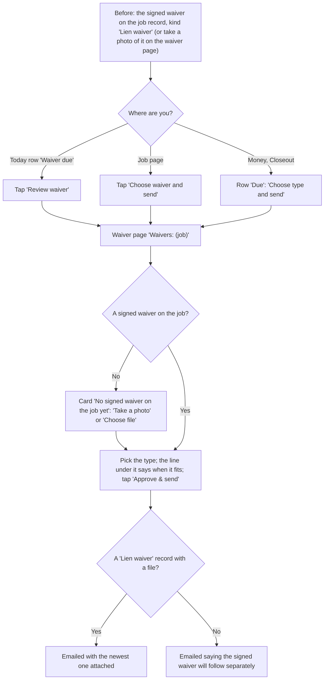

Code: Today row kind `waiver` (**Review waiver**, `open-waiver`); job page **Choose waiver and send** static/js/jobs.js:285; Closeout `views.waivers`, static/js/views/money.js:499 (**Which type?**, **Not chosen yet**, **Choose type and send**); waiver page `views.waiverDetail`, static/js/views/money.js:315-352; type picker and hint `waiverSendForm` / `WAIVER_HINTS`, static/js/jobs.js:101-126; server `send_waiver`, domain/__init__.py:950 (the "will follow separately" wording :989).

**Taps from start to done:** 2 (Review waiver, Approve & send), plus the type if it isn't the one picked for you.

**Where it could still be simpler:**
- Duracash never writes the waiver: state forms and their wording are deferred until Stephen decides (improvement plan section 5).

---

## 12. Retainage release

**Goal:** get the money held back on the job paid at the end.

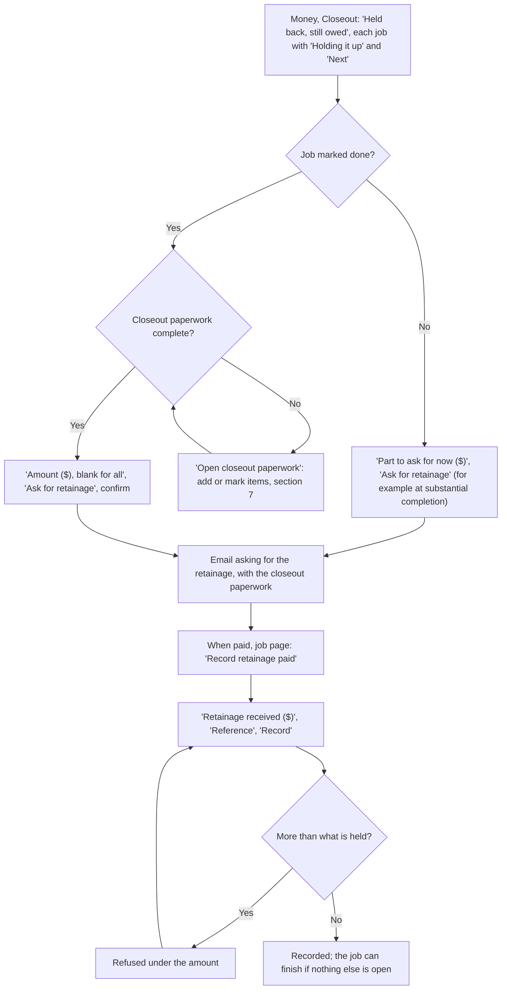

Code: Closeout's held-back table in `views.waivers`, static/js/views/money.js:499-549, `retainageAskHtml` static/js/views/money.js:37; job page **Ask for retainage** only once the work is done and the closeout paperwork is in (static/js/jobs.js:299; the Money card says why otherwise, `retainageNote` static/js/jobs.js:226); the confirm static/js/views/money.js:677; server `chase_retainage`, domain/__init__.py:1015 (before done: :1034); **Record retainage paid** card in `views.job`, `retainage-paid` static/js/views/job.js:670, server `record_retainage_payment`, domain/__init__.py:1082.

**Taps from start to done:** 4 (Ask for retainage and the confirm, then later Record retainage paid, Record).

**Where it could still be simpler:**
- Today has no row for "retainage ready to ask for"; Closeout shows it.

---

## 13. Finish the job

**Goal:** file a fully settled job away in Job history.

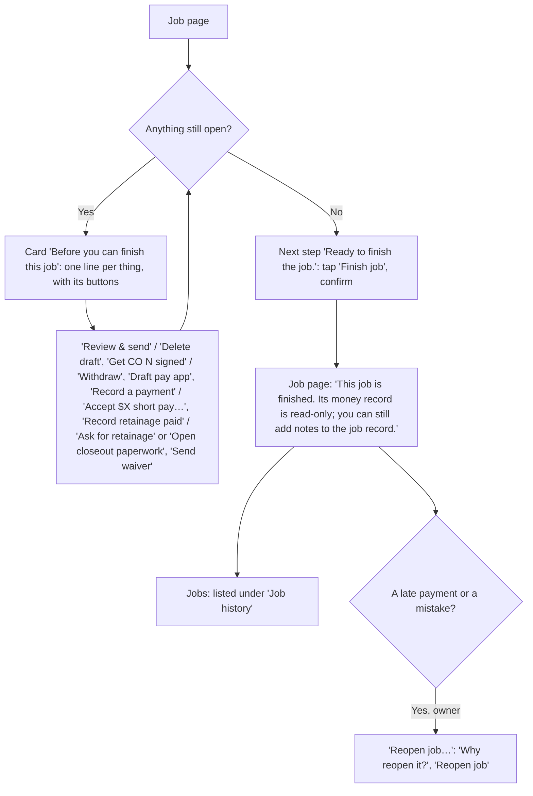

Code: the card in `views.job` from `close_blocker_items`, domain/__init__.py:186, buttons `closeBlockerActions`, static/js/jobs.js:323-349; **Finish job** static/js/jobs.js:294 and its confirm static/js/views/job.js:727; server `close_job`, domain/__init__.py:2293; **Reopen job…** in `views.job`, server `reopen_job`, domain/__init__.py:2304 (owners only); a job with only drafts deleted before they were sent and no payments can be deleted instead (**Delete job** under Edit job, `can_delete_job` :2952).

**Taps from start to done:** 2 (Finish job, the confirm).

---

## 14. The Today routine

**Goal:** open one page, see everything waiting, and handle it top to bottom. The owners get the same rows by email each morning there is something due.

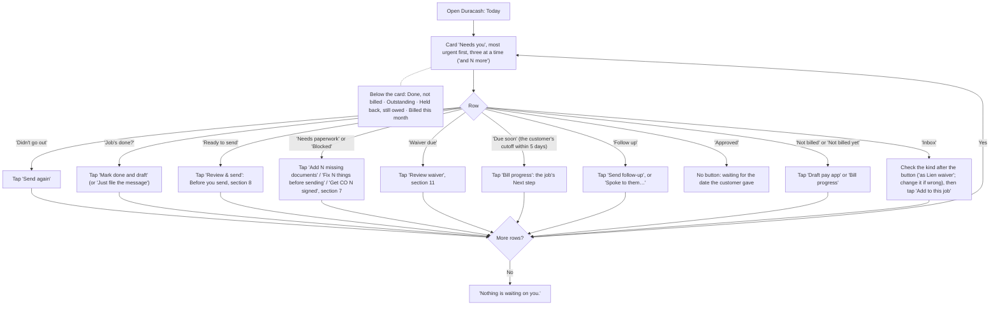

Code: the rows and their order `domain.today_rows`, domain/__init__.py:1356-1478 (one rule set for Today and the daily email `daily_digest` :1482); drawn by `queueHtml` / `rowButtons`, static/js/today.js:48-70 (what each row's button does: `ACTIONS` :18-29; an Inbox row's kind select, which starts at the kind the Inbox guessed, `inboxKindSelect` :40, sent as the row's `item_kind`); Today page `views.dashboard`, static/js/views/today.js:138-202 (metrics and the jobs table under the card); "Mark done and draft" confirm static/js/views/inbox.js:404. The daily email is turned off in Settings, Company: **Daily email of what's due**.

**Taps from start to done:** 1 to 2 per row. A typical week with one send, one follow-up and two filings is about 6 taps with the confirms.

**Where it could still be simpler:**
- No row for retainage ready to ask for (section 12).

---

## 15. Customer settings

**Goal:** keep each customer's rules (who signs off, where pay apps go, follow-up timing, the paperwork list) right, since they drive every pay app and follow-up.

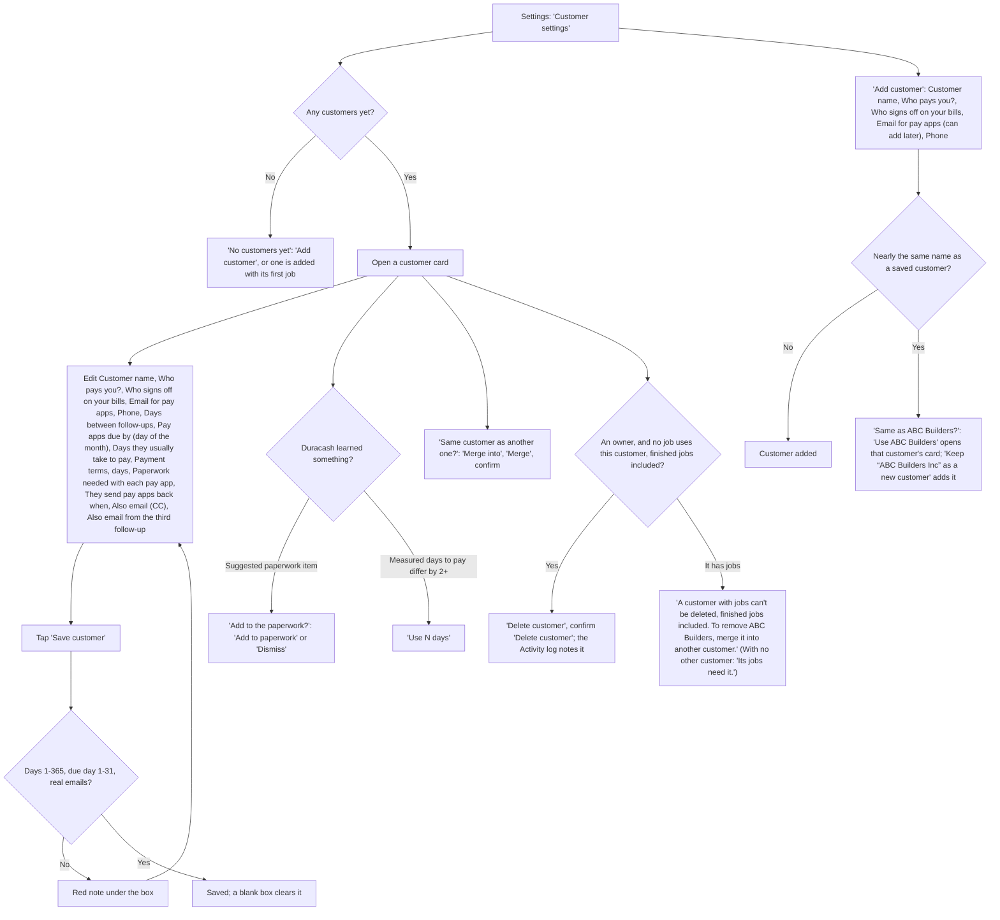

Code: page `views.playbook`, static/js/views/settings.js:420-494 (**Add customer** `add-payer` static/js/views/settings.js:607, server `add_payer` domain/__init__.py:1753; **Save customer** `save-playbook` static/js/views/settings.js:593, server `update_payer`, domain/__init__.py:1599; **Add to paperwork** / **Dismiss** `sug-add` / `sug-dismiss` static/js/views/settings.js:591-592; **Use N days** `use-approval-days` static/js/views/settings.js:579; **Merge** `merge-payer` static/js/views/settings.js:633 (shown when there is another customer), server `merge_payer`, domain/__init__.py:1777; **Use ABC Builders** / **Keep “ABC Builders Inc” as a new customer** `ap-same-use` / `ap-same-keep` static/js/views/settings.js:615-623, server `payer_near` domain/__init__.py:1711; **Delete customer** `delete-payer` static/js/views/settings.js:628, shown by `deletePayerHtml` static/js/views/jobs.js:78 to owners when `job_count` is 0, server `delete_payer` domain/__init__.py:1799, an owner-only route, server.py:2470, refused with the reason while any job, open or finished, uses the customer; it says "counting finished jobs" only when one is finished, and points at Merge only when another customer exists. The card's "N jobs", the Merge question and Delete customer all count with `payerJobCount` static/js/views/jobs.js:71, which uses `job_count` so older finished jobs count too). Every label has an (i) with the trade term (`FIELD_HELP`, static/js/help.js).

**Taps from start to done:** 2 (open the card, Save customer), plus 1 per suggestion.

---

## Flows not charted, or charted with less confidence

- **Billing** (Settings, Billing: **Subscribe** / **Manage billing** through Stripe, `billingView` static/js/views/settings.js:206): shows only when Stripe is set up on the server; members see it read-only.
- **The customer's page** (`payer_page.render`, payer_page.py:125; wireframe `PayerPage`): Mark as received, Approve for payment with a date, Send a question (an Inbox item for the contractor). Charted as branches in section 9.
- **QuickBooks connection** (**Connect QuickBooks**, Settings, Company and Money, Payments): the Intuit sign-in in the middle happens off our site. Charted as one branch in section 10.
- **Email forwarding, text messages and sharing from the phone into the Inbox** (`views.inbox`, **Bring emails and texts in automatically**): need an owner to set up an email service or Twilio. Shared while signed out, files wait 30 minutes for sign-in (**Finish adding N shared items**, `heldShareHtml` static/js/views/auth.js:368).
- **Daily record** (Today, Daily record: **What happened today**, **Save to job record**, `views.daily` static/js/views/today.js:235): one box and one button.
- **Draft for the customer's review** (**Send draft for their review**, **Customer agreed to the draft**, **Customer wants changes**, static/js/jobs.js:300-302): an optional side path before send.
- **Tap counts** are the fewest taps on the happy path with fields already filled, counted from the code, not timed with a user. Confirms count as a tap.
