# Duracash client flows

For Stephen to review. Each chart shows what a contractor taps, screen by screen, to get one task done. Every screen name and button label is copied from the app code (`static/app.js`, `static/js/*.js`, `payer_page.py`, `domain/__init__.py`, `server.py`), regenerated from the code on Oct 29, 2026 after Round 6 (R6-11) and checked again against the code in the final pass the same day; the file:line after a label is where it lives today (a bare `:N` is in the file named last before it). Read each chart from top to bottom. Diamonds are real branches the code takes.

The demo company is Hartline Remodeling (`seed.py`), opened with **Look around a sample company** on the landing page (no account) or the login `owner@hartline.example` / `demo`. The demo can't send email, so some steps end at "Not sent: demo account". The wireframes in `docs/wireframes/` draw the same screens; `Job`, `PhoneJob`, `Money`, `PaymentsImport`, `Inbox`, `Settings` and `PayerPage` were redrawn with this file in R6-11, and `Today`, `PhoneToday`, `Packet`, `PhonePacket`, `SendCheck` and `Playbook` in the final pass.

Screen names used below (pages and tabs: `SECTIONS`, static/app.js:24-30; addresses: static/js/routes.js:9-21):

| Screen | Address |
|---|---|
| Today: Overview, Results, Calendar, Daily record | `/today`, `/today/results`, `/today/calendar`, `/today/daily` |
| Jobs: Open jobs, Job history | `/jobs`, `/jobs/history` |
| Job page | `/jobs/<id>` |
| Inbox | `/inbox` |
| Money: Pay apps, Change orders, Unpaid, Payments, Closeout, Outbox | `/money`, `/money/change-orders`, `/money/collections`, `/money/payments`, `/money/waivers` (`/money/retainage` opens it at Held back, still owed), `/money/outbox` |
| Pay app, Paperwork, Change order and Waiver pages | `/money/pay-app/<job>/<id>`, `/money/packet/<job>/<id>` (`closeout` for the closeout paperwork), `/money/change-order/<job>/<id>`, `/money/waiver/<job>` |
| Settings: Company, Team, My account, Billing, Customer settings, Activity log, Help | `/settings/company` (`/settings` opens it), `/settings/team`, `/settings/account`, `/settings/billing`, `/settings/playbook`, `/settings/audit`, `/settings/help` |
| The customer's page for one pay app; the signing page for one change order | `/p/<link>`, `/s/<link>` (no sign-in; `payer_page.py`) |

On the job page the **Next step** card holds one main button and, beside it, the next two as two-line buttons (the label, then why). The rest sit under **More (N)**, grouped Bill, Get paid and Close out. The main button is picked in this order: the blocker button (**Fix N things before sending**, **Add N missing documents** or **Get CO N signed**), **Review & send**, **Choose waiver and send**, then, while a sent pay app is unpaid, **Send follow-up** once it is due and **Draft pay app**; otherwise **Draft pay app**, **Progress pay app**, **Finish job**, **Ask for retainage** (`jobActions`, static/js/jobs.js:255-305). While the customer has the pay app and no follow-up is due there is no main button. A member does not see what only an owner may do (send, waivers, retainage requests, delete a draft, pull back, finish, delete, accept short pay, reopen; `OWNER_ONLY`, static/js/jobs.js:240, `OWNER_ACTIONS`, server.py:2527) unless the company turned on **Members can send pay apps, lien waivers and retainage requests** (Settings, Company).

A company set to **Draws from homeowners** (Settings, Company, How you bill) reads Draw and Draws wherever this file says pay app (`termText`, static/js/terms.js; `domain.term_text`).

---

## 1. The whole life of a job

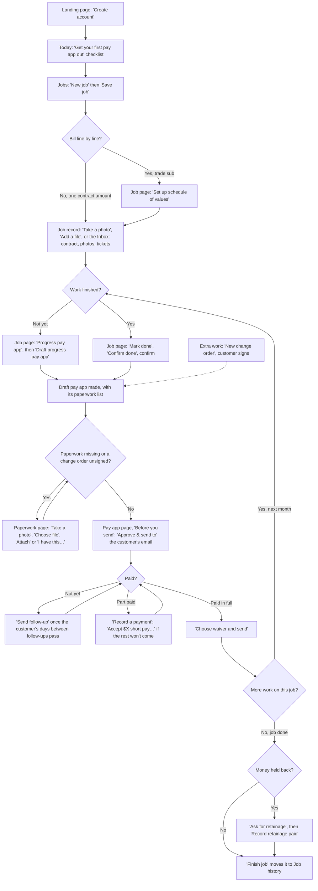

The money loop is the middle: draft, add the paperwork, send, follow up, record the payment, send the waiver, then back to next month's progress. A job usually goes round it once a month. Each step shows up on Today as a row, and in the owners' daily email, so the contractor can run the loop from Today (section 14).

---

## 2. First day setup

**Goal:** create the company, confirm the email, and fill in the company details that print on every pay app. The screens are the wireframes `Landing`, `CheckEmail`, `FirstRun`, `NewJob` and `Settings`.

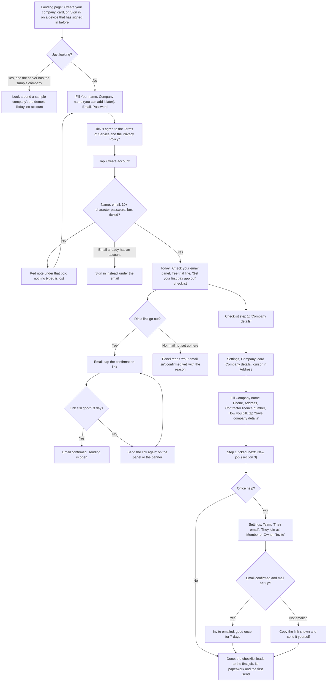

Code: landing and sign-up card `renderLanding`, static/js/views/auth.js:45 (Sign in first when this browser has signed in, static/js/views/auth.js:11-17; the terms box static/js/views/auth.js:91); **Look around a sample company** static/js/views/auth.js:71 and `lookAround` static/js/views/auth.js:213, server `_p_demo`; "Check your email" panel `checkEmailHtml`, static/js/views/auth.js:357 (**Send the link again**, **Got it**); checklist `onboardingHtml`, static/js/views/today.js:58-102, its step 1 **Company details** opens Settings, Company at `#co-address`; Company page `companyView`, static/js/views/settings.js:107; **Save company details** `save-company` static/js/views/settings.js:573; Team `teamCardHtml`, static/js/views/settings.js:59, **Invite** `team-invite` static/js/views/settings.js:527. Two-step sign-in is on Settings, My account (`myAccountView`, static/js/views/settings.js:162): **Set up two-step sign-in**, scan the QR code, **Turn on**, save the recovery codes.

**Taps from start to done:** about 5. Create account (1, after typing 3 boxes and the tick), the email link (1), Company details on the checklist (1, lands in the Address box), Save company details (1), Invite (1, optional).

**What changed since Round 2:** Settings is four pages (Company, Team, My account, Billing) instead of one long Team & account page (R6-03); the checklist and Before you send name Settings, Company. Sign-up is limited to 5 an hour per network (R6-05). The Company page has **Sending and email** (who may send, the daily email) for owners.

**Where it could still be simpler:**
- `Invite` is refused with "Confirm your own email address before inviting people." only after it is tapped; the Team page doesn't say so beforehand.
- Hiding the checklist is per person, so a teammate who joins later sees it until they hide it (it can be brought back from Help).

---

## 3. Add a job by hand

**Goal:** get a job and the customer who pays it into Duracash. Customers can also be added on their own (section 15).

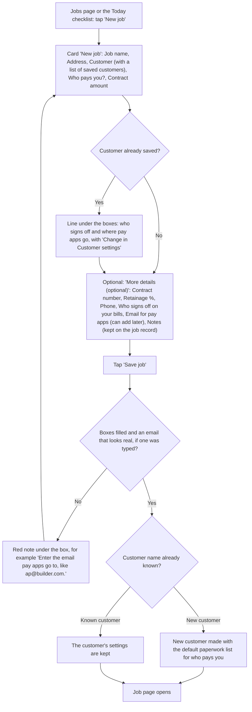

Code: `views.jobs`, static/js/views/jobs.js:89-146 (**New job**, the five boxes, **More details (optional)**, **Save job**); `jobFields` static/js/views/jobs.js:16; the saved-customer line `knownPayerText` static/js/views/jobs.js:35; **Save job** `create-job` static/js/views/jobs.js:178; server `create_job`, domain/__init__.py:2642 (a refusal is keyed by field and shown under its box, `showFieldErrors` in static/js/forms.js). Notes become a "Job notes" record, never paperwork (R1-04).

**Taps from start to done:** 2 taps (New job, Save job) and 5 boxes, one of them a select.

**Where it could still be simpler:**
- The paperwork list for a new customer is set by Who pays you? and only shows once the first pay app is drafted; it is changed in Customer settings, not on the New job form.

---

## 4. Set up the schedule of values

**Goal:** bill line by line (quantity times rate), the way a GC wants a trade sub to bill.

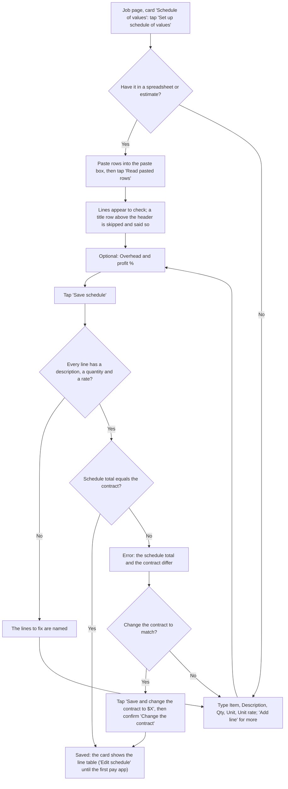

Code: `sovCardHtml`, static/js/views/job.js:326-362 (**Set up schedule of values** static/js/views/job.js:336, **Edit schedule** static/js/views/job.js:360); editor `sovEditorHtml`, static/js/views/job.js:286-324 (**Read pasted rows** static/js/views/job.js:301, **Add line** static/js/views/job.js:309, **Save schedule** static/js/views/job.js:320, **Save and change the contract to $X** static/js/views/job.js:282 and static/js/views/job.js:321); the confirm static/js/views/job.js:387; parse `sov.parse_rows`, sov.py:432 (a header found in the first 5 rows, R5-08); save `save_sov`, domain/__init__.py:2883. On a phone each line is a card with the description on top (R6-02).

**Taps from start to done:** 3 with a paste (Set up schedule of values, Read pasted rows, Save schedule). One more (the confirm) if the contract changes to match.

**Where it could still be simpler:**
- The schedule is fixed once the first pay app exists ("Fixed once the first pay app exists. Scope changes go through change orders, which add their own lines when approved."); a mistake found on the second pay app means a change order.

---

## 5. Import existing paperwork

**Goal:** get contracts, photos, tickets, emails and old notes onto the right job without retyping.

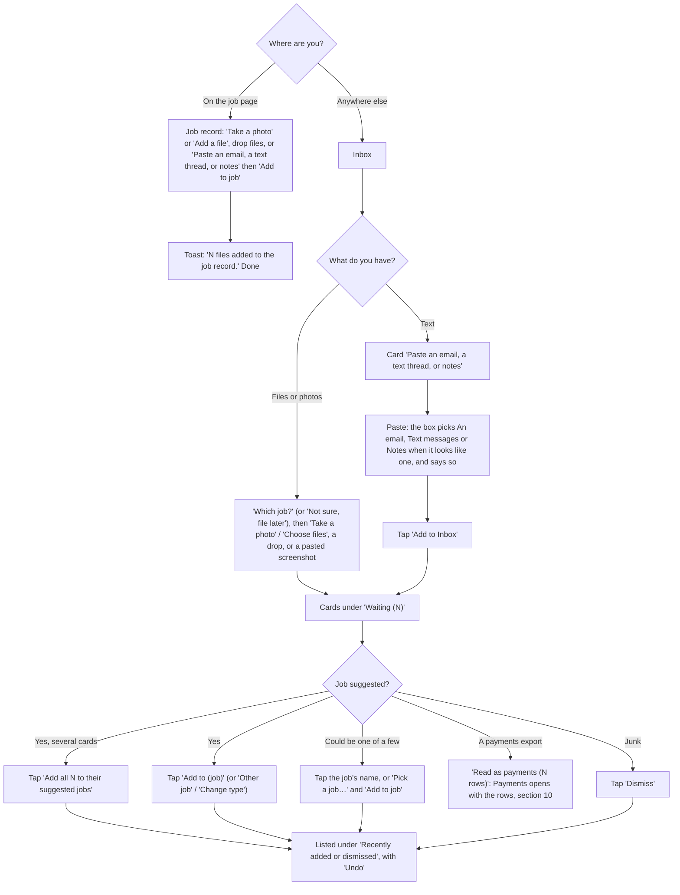

Code: job record card in `views.job`, static/js/views/job.js:587-608 (**Take a photo** / **Add a file** `pick-files` static/js/views/inbox.js:346, paste box `pasteBoxHtml` static/js/views/inbox.js:141 with **Add to job**); record rows with **Edit** `recordRow` static/js/views/job.js:430 (R5-07); Inbox `views.inbox`, static/js/views/inbox.js:294-341 (**Waiting (N)**, **Which job?**, the touch-only **Take a photo** / **Choose files**, **Recently added or dismissed**, **Bring emails and texts in automatically**); cards `inboxItemCard` static/js/views/inbox.js:170 with `choiceJobs` / `choiceLine` / `pasteGuess` in static/js/inbox.js; uploads three at a time `uploadFiles` static/js/views/inbox.js:38; server matching `importer.match_job`, importer.py:442 (a job code in any case as its own word, the full job name or a part of it no other job has, like Oak Street for Oak Street kitchen; a tie suggests nothing), kinds `guess_kind` importer.py:371, notes split `split_notes` importer.py:342, filing `file_item` importer.py:603.

**Taps from start to done:** 2 from the job page (Take a photo or Add a file, pick). From the Inbox: 2 to add, then 1 per card to file, or 1 for all suggested cards.

**Where it could still be simpler:**
- Forwarding email and texts in needs an email service or a Twilio number set up by an owner (deferred: a provisioned address per company, improvement plan section 5).
- Once a record is attached to a pay app's paperwork, Undo on the Inbox says to remove it from the paperwork first.

---

## 6. Change order

**Goal:** record extra work (or a credit) with a price and get it signed, so it can be billed.

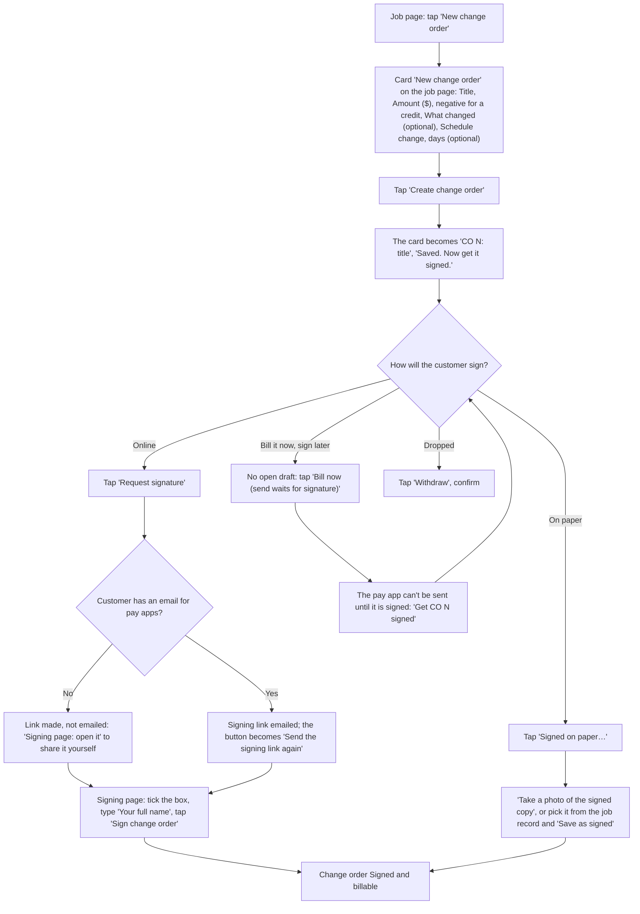

Code: **New change order** `new-co` static/js/views/job.js:703 (a job action, static/js/jobs.js:293); card `newCoCardHtml` static/js/views/job.js:192 and `coFormFields` static/js/views/job.js:207; **Create change order** `add-co-here` static/js/views/job.js:705, server `add_change_order` domain/__init__.py:1869 (refuses only zero and a credit larger than the contract total); sign controls `coSignControls` static/js/views/job.js:26 (**Request signature**, **Signed on paper…**, **Withdraw**, **Take a photo of the signed copy**, **Save as signed**); server `request_co_signature` domain/__init__.py:1975, `mark_co_signed` :2019 (signing, online or on paper, takes "(unsigned)" off the line of an open draft that billed it, so the PDF no longer says so), `withdraw_change_order` :2030; **Bill now (send waits for signature)** in `views.job`, server `include_change_order`, domain/__init__.py:2164; signing page `render_co`, payer_page.py:254. The Change orders tab (`views.cos`, static/js/views/money.js:383) lists every change order and also has a New change order form.

**Taps from start to done:** 2 to create (New change order, Create change order) after typing, then 1 for online signing (Request signature) or 2 on paper (Signed on paper…, Take a photo of the signed copy).

**Where it could still be simpler:**
- A change order has no PDF of its own yet (improvement plan section 5).

---

## 7. Paperwork (what the customer wants with each pay app)

**Goal:** get every missing item in so the pay app can be sent.

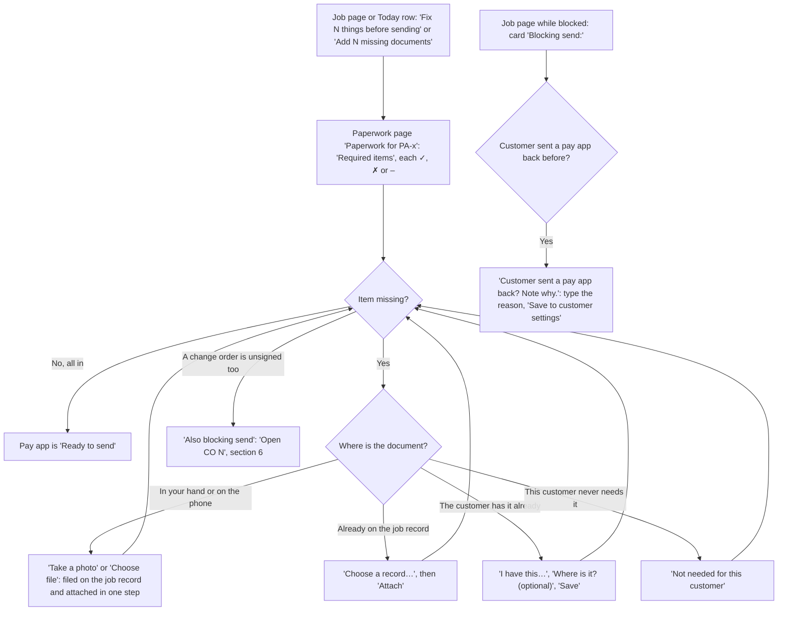

Code: the blocker button's words `domain.blocker_button`, domain/__init__.py:257; paperwork page `views.packetDetail`, static/js/views/money.js:156-206 (**Take a photo** / **Choose file** upload with `?attach=`, **Choose a record…** / **Attach** `attach-record` static/js/views/money.js:753, **I have this…** / **Save** `resolve` static/js/views/money.js:651, **Not needed for this customer** `packet-skip` static/js/views/money.js:752, **Remove** on a draft's, the job's and closeout paperwork `packet-detach` static/js/views/money.js:751, **Also blocking send**); server `attach_record_to_packet` domain/__init__.py:2606, `resolve_packet_item` :556, `skip_packet_item` :2499, `detach_packet_item` :2471; the note-why card in `views.job` (`learn` static/js/views/job.js:722, server `learn_rejection`, domain/__init__.py:2190). The list comes from Customer settings, Paperwork needed with each pay app; a pay app, schedule of values or continuation sheet item is in from the start ("Produced by Duracash with the pay app").

**Taps from start to done:** 1 to open, then 2 per missing item (Take a photo, take it) or 2 to attach a record (pick, Attach).

**Where it could still be simpler:**
- The paperwork list only appears once the first pay app is drafted; the setup checklist asks for the contract and paperwork on the job record before that.

---

## 8. Draft, check and send a pay app

**Goal:** turn finished work into a pay app and email it with its PDF and paperwork.

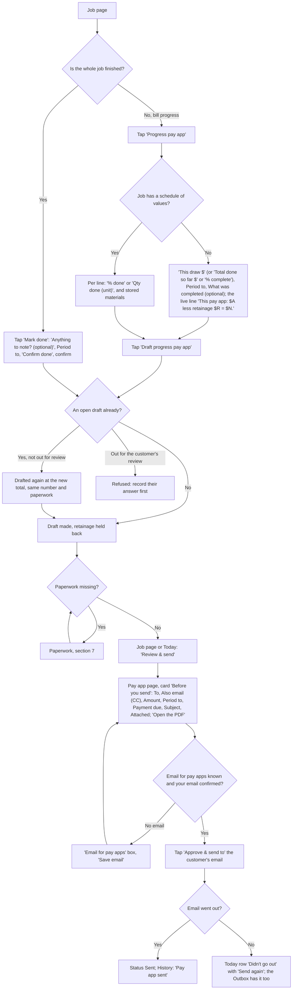

Code: **Progress pay app** and **Mark done** in `jobActions`, static/js/jobs.js:281-282; progress card `progressFormHtml`, static/js/views/job.js:117-142 (`progressFigures`, static/js/jobs.js:148, checks it as the server does), line-by-line card `sovProgressHtml` static/js/sov.js:33-55; **Draft progress pay app** `progress` static/js/views/job.js:628 and `sov-progress` static/js/views/job.js:625; Mark done card in `views.job` and its confirm static/js/views/job.js:642; server `record_progress` domain/__init__.py:300, `record_sov_progress` :2954, `mark_done` :380, `draft_invoice` :414; **Review & send** opens the pay app page at `.send-check` (static/js/jobs.js:273, static/js/today.js:21); pay app page `views.payappDetail`, static/js/views/money.js:234-313 (**Before you send**, **Open the PDF**, **Download for QuickBooks**, **Approve & send to …**); server `approve_and_send`, domain/__init__.py:582; **Send again** `email-retry` static/js/views/money.js:643. Mistakes: **Undo done** (before the final pay app goes out, `undo_mark_done`, domain/__init__.py:2133), **Delete draft** (`void_draft`, domain/__init__.py:2048), **Pull back this pay app…** on a sent one with nothing paid (`void_sent_pay_app`, domain/__init__.py:2074).

**Taps from start to done:** 3 for a progress bill with nothing missing (Progress pay app, Draft progress pay app, Review & send) plus Approve & send: 4.

**Where it could still be simpler:**
- **Send draft for their review** (the customer checks the numbers first) is under More, not charted; it waits on **Customer agreed to the draft** or **Customer wants changes**.

---

## 9. Follow up on an unpaid pay app

**Goal:** send a polite chase email when the customer's usual wait has passed, or note a phone call.

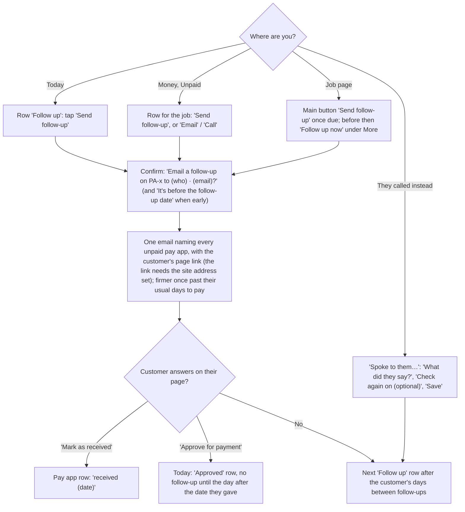

Code: Today row kind `follow_up` in `domain.today_rows`, domain/__init__.py:1331-1452 (with **Spoke to them…**, static/js/today.js:41); Unpaid `views.collections`, static/js/views/money.js:414; job page **Send follow-up** / **Follow up now** static/js/jobs.js:276; the confirm static/js/views/money.js:718; server `record_follow_up`, domain/__init__.py:672 (not-due refusal :700, from the third follow-up it also emails the customer's **Also email from the third follow-up** address); **Spoke to them…** `contactFormHtml` static/js/views/job.js:77 and `note_contact`, domain/__init__.py:744; the customer's page `payer_page.render`, payer_page.py:125 (**Mark as received** `mark_received` :176, **Approve for payment** `approve` :191).

**Taps from start to done:** 2 (Send follow-up, then the confirm).

**Where it could still be simpler:**
- The confirm says who it goes to but not what the email says; the Outbox shows the text once it has gone.

---

## 10. Record a payment

**Goal:** record a check or transfer against the right pay app so the waiver step opens.

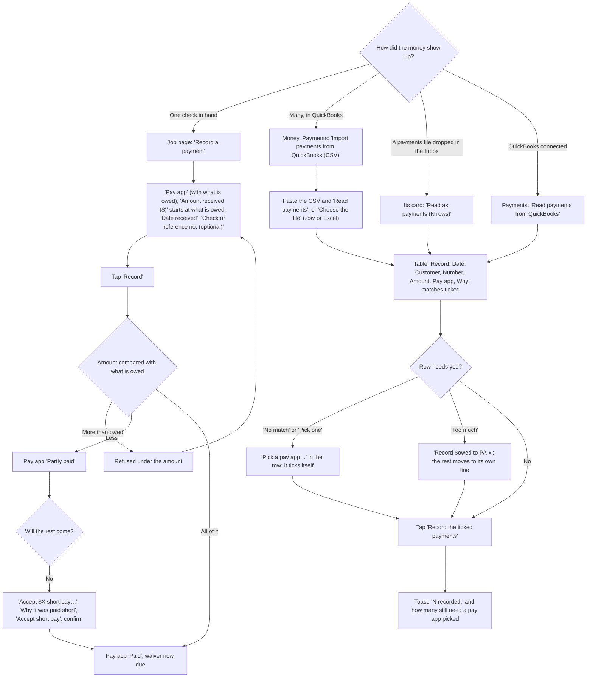

Code: **Record a payment** card in `views.job` (`match` static/js/views/job.js:693, prefill `prefillPaymentAmount` static/js/views/job.js:181), server `match_payment`, domain/__init__.py:779 (takes `received_on`); short pay `shortPayCardHtml` static/js/views/job.js:58, `accept-short-pay` static/js/views/money.js:694, server `settle_short_pay`, domain/__init__.py:868; Payments `views.payments`, static/js/views/money.js:457-497 (**Read payments** `qbo-read` static/js/views/money.js:578, **Choose the file** `qbo-choose-file` static/js/views/money.js:609, **Record the ticked payments** `qbo-apply` static/js/views/money.js:585, the split static/js/views/money.js:597); row cells `qboTick` / `qboPayAppCell` static/js/views/money.js:107-129 with static/js/payimport.js (`pickPayApp`, `splitTooMuch`, `afterRecord`); server `qbo_csv.parse` qbo_csv.py:149 and `propose` :203; Inbox **Read as payments** `inbox-read-payments` static/js/views/money.js:603; QuickBooks card `qboCardHtml` static/js/views/money.js:130 (**Connect QuickBooks**, **Read payments from QuickBooks**, **Check against QuickBooks**, **Disconnect**). The wireframe is `PaymentsImport`.

**Taps from start to done:** 2 by hand (Record a payment, Record); 3 for a CSV (Read payments, a pick if needed, Record the ticked payments).

**Where it could still be simpler:**
- QuickBooks is read on request, not every day (deferred until a live Intuit connection is tested, improvement plan section 5).

---

## 11. Lien waiver

**Goal:** send the signed lien waiver for each pay app that is paid.

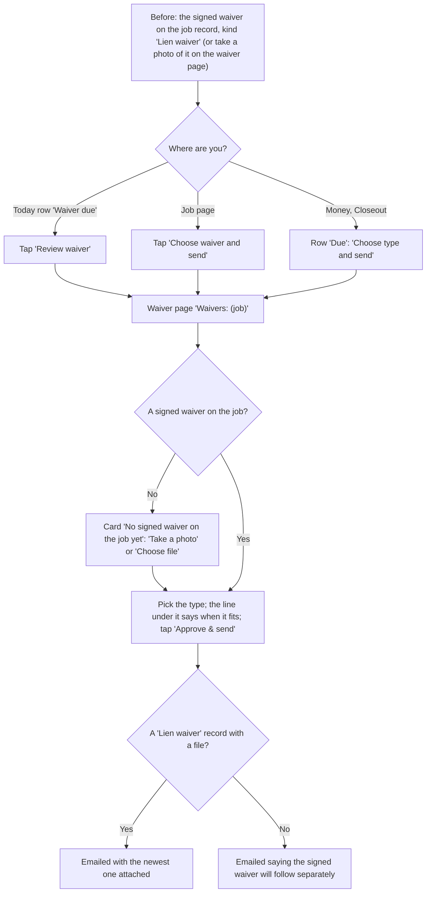

Code: Today row kind `waiver` (**Review waiver**, `open-waiver`); job page **Choose waiver and send** static/js/jobs.js:274; Closeout `views.waivers`, static/js/views/money.js:499 (**Which type?**, **Not chosen yet**, **Choose type and send**); waiver page `views.waiverDetail`, static/js/views/money.js:315-352; type picker and hint `waiverSendForm` / `WAIVER_HINTS`, static/js/jobs.js:101-126; server `send_waiver`, domain/__init__.py:930 (the "will follow separately" wording :969).

**Taps from start to done:** 2 (Review waiver, Approve & send), plus the type if it isn't the one picked for you.

**Where it could still be simpler:**
- Duracash never writes the waiver: state forms and their wording are deferred until Stephen decides (improvement plan section 5).

---

## 12. Retainage release

**Goal:** get the money held back on the job paid at the end.

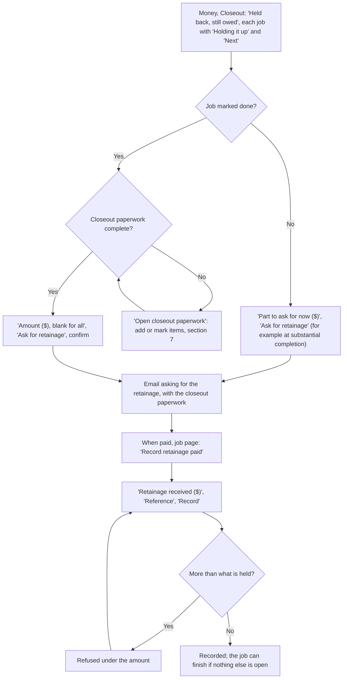

Code: Closeout's held-back table in `views.waivers`, static/js/views/money.js:499-550, `retainageAskHtml` static/js/views/money.js:36; job page **Ask for retainage** only once the work is done and the closeout paperwork is in (static/js/jobs.js:288; the Money card says why otherwise, `retainageNote` static/js/jobs.js:215); the confirm static/js/views/money.js:678; server `chase_retainage`, domain/__init__.py:995 (before done: :1014); **Record retainage paid** card in `views.job`, `retainage-paid` static/js/views/job.js:658, server `record_retainage_payment`, domain/__init__.py:1065.

**Taps from start to done:** 4 (Ask for retainage and the confirm, then later Record retainage paid, Record).

**Where it could still be simpler:**
- Today has no row for "retainage ready to ask for"; Closeout shows it.

---

## 13. Finish the job

**Goal:** file a fully settled job away in Job history.

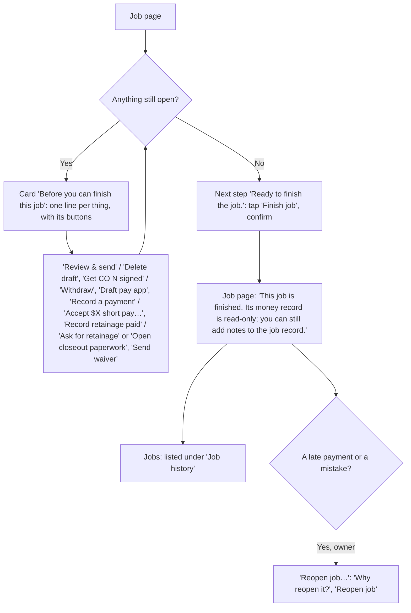

Code: the card in `views.job` from `close_blocker_items`, domain/__init__.py:180, buttons `closeBlockerActions`, static/js/jobs.js:312-337; **Finish job** static/js/jobs.js:283 and its confirm static/js/views/job.js:715; server `close_job`, domain/__init__.py:2201; **Reopen job…** in `views.job`, server `reopen_job`, domain/__init__.py:2212 (owners only); a job with only drafts deleted before they were sent and no payments can be deleted instead (**Delete job** under Edit job, `can_delete_job` :2854).

**Taps from start to done:** 2 (Finish job, the confirm).

---

## 14. The Today routine

**Goal:** open one page, see everything waiting, and handle it top to bottom. The owners get the same rows by email each morning there is something due.

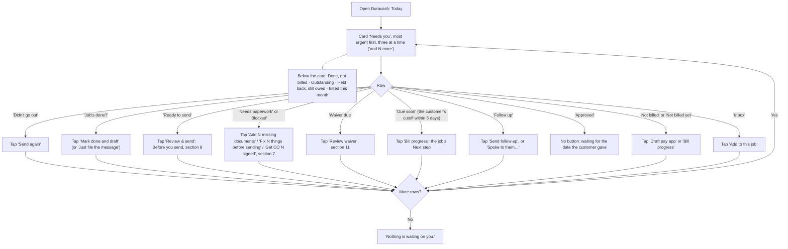

Code: the rows and their order `domain.today_rows`, domain/__init__.py:1331-1452 (one rule set for Today and the daily email `daily_digest` :1456); drawn by `queueHtml` / `rowButtons`, static/js/today.js:38-60 (what each row's button does: `ACTIONS` :17-28); Today page `views.dashboard`, static/js/views/today.js:149-213 (metrics and the jobs table under the card); "Mark done and draft" confirm static/js/views/inbox.js:404. The daily email is turned off in Settings, Company: **Daily email of what's due**.

**Taps from start to done:** 1 to 2 per row. A typical week with one send, one follow-up and two filings is about 6 taps with the confirms.

**Where it could still be simpler:**
- No row for retainage ready to ask for (section 12).

---

## 15. Customer settings

**Goal:** keep each customer's rules (who signs off, where pay apps go, follow-up timing, the paperwork list) right, since they drive every pay app and follow-up.

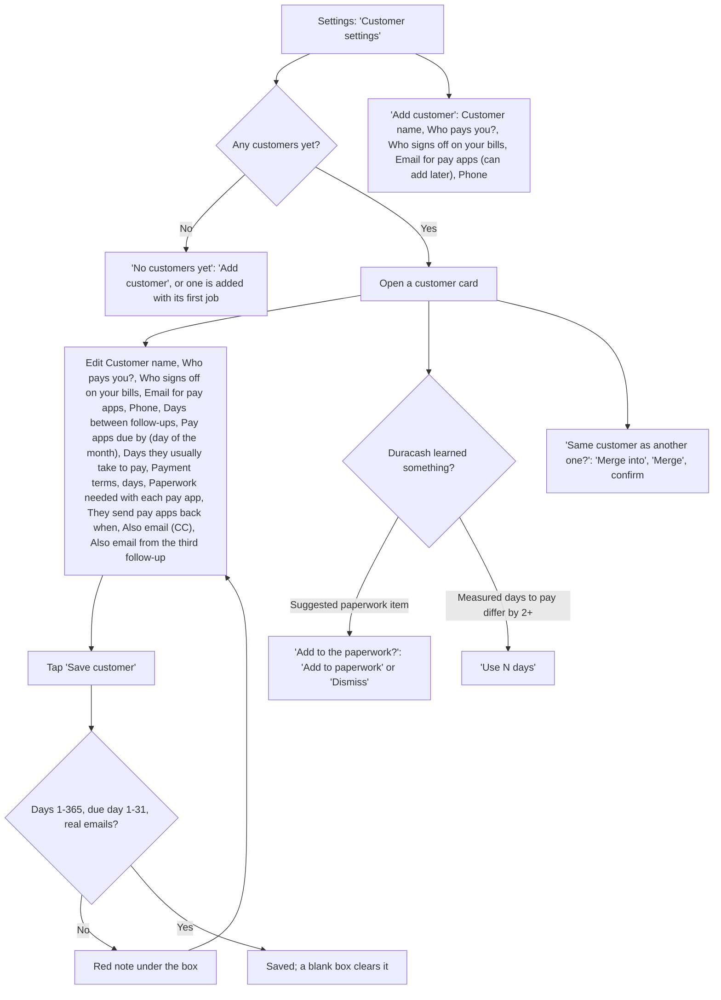

Code: page `views.playbook`, static/js/views/settings.js:415-487 (**Add customer** `add-payer` static/js/views/settings.js:600, server `add_payer` domain/__init__.py:1687; **Save customer** `save-playbook` static/js/views/settings.js:586, server `update_payer`, domain/__init__.py:1573; **Add to paperwork** / **Dismiss** `sug-add` / `sug-dismiss` static/js/views/settings.js:584-585; **Use N days** `use-approval-days` static/js/views/settings.js:572; **Merge** `merge-payer` static/js/views/settings.js:605, server `merge_payer`, domain/__init__.py:1708). Every label has an (i) with the trade term (`FIELD_HELP`, static/js/help.js).

**Taps from start to done:** 2 (open the card, Save customer), plus 1 per suggestion.

---

## Flows not charted, or charted with less confidence

- **Billing** (Settings, Billing: **Subscribe** / **Manage billing** through Stripe, `billingView` static/js/views/settings.js:201): shows only when Stripe is set up on the server; members see it read-only.
- **The customer's page** (`payer_page.render`, payer_page.py:125; wireframe `PayerPage`): Mark as received, Approve for payment with a date, Send a question (an Inbox item for the contractor). Charted as branches in section 9.
- **QuickBooks connection** (**Connect QuickBooks**, Settings, Company and Money, Payments): the Intuit sign-in in the middle happens off our site. Charted as one branch in section 10.
- **Email forwarding, text messages and sharing from the phone into the Inbox** (`views.inbox`, **Bring emails and texts in automatically**): need an owner to set up an email service or Twilio. Shared while signed out, files wait 30 minutes for sign-in (**Finish adding N shared items**, `heldShareHtml` static/js/views/auth.js:368).
- **Daily record** (Today, Daily record: **What happened today**, **Save to job record**, `views.daily` static/js/views/today.js:246): one box and one button.
- **Draft for the customer's review** (**Send draft for their review**, **Customer agreed to the draft**, **Customer wants changes**, static/js/jobs.js:289-291): an optional side path before send.
- **Tap counts** are the fewest taps on the happy path with fields already filled, counted from the code, not timed with a user. Confirms count as a tap.
