# Duracash client flows

For Stephen to review. Each chart shows what a contractor taps, screen by screen, to get one task done. Every screen name and button label is copied from the app code (`static/app.js`, `static/js/*.js`, `payer_page.py`, `domain/__init__.py`, `server.py`), regenerated from the code on Oct 29, 2026 after Round 6 (R6-11) and checked again against the code in the final pass the same day; the file:line after a label is where it lives today (a bare `:N` is in the file named last before it). Brought up to Stephen's Oct 29 review on Oct 30: the seven sections, Client for the people who pay, and the page modules split by tab. Read each chart from top to bottom. Diamonds are real branches the code takes.

The demo company is Hartline Remodeling (`seed.py`), opened with **Look around a sample company** on the landing page (no account) or the login `owner@hartline.example` / `demo`. The demo can't send email, so some steps end at "Not sent: demo account". The wireframes in `docs/wireframes/` draw the same screens; `Job`, `PhoneJob`, `Money`, `PaymentsImport`, `Inbox`, `Settings` and `PayerPage` were redrawn with this file in R6-11, and `Dashboard`, `PhoneToday`, `Packet`, `PhonePacket`, `SendCheck` and `Playbook` in the final pass.

Screen names used below (pages and tabs: `SECTIONS`, static/app.js:29-37; addresses: static/js/routes.js:9-32):

| Screen | Address |
|---|---|
| Dashboard: Overview, Results, Calendar | `/dashboard`, `/dashboard/results`, `/dashboard/calendar` |
| Jobs: Open jobs, Daily record, Job history, Client playbook | `/jobs`, `/jobs/daily`, `/jobs/history`, `/jobs/clients` |
| Job page | `/jobs/<id>` |
| Communications: Inbox, Outbox | `/communications`, `/communications/outbox` |
| Import/Export: Import, Export | `/data/import`, `/data/export` |
| Money: Pay apps, Change orders, Unpaid, Payments, Closeout | `/money`, `/money/change-orders`, `/money/collections`, `/money/payments`, `/money/waivers` (`/money/retainage` opens it at Held back, still owed) |
| Automations (under construction) | `/automations` |
| Pay app, Paperwork, Change order and Waiver pages | `/money/pay-app/<job>/<id>`, `/money/packet/<job>/<id>` (`closeout` for the closeout paperwork), `/money/change-order/<job>/<id>`, `/money/waiver/<job>` |
| Settings: Company, Team, My account, Billing, Activity log | `/settings/company` (`/settings` opens it), `/settings/team`, `/settings/account`, `/settings/billing`, `/settings/audit` |
| The client's page for one pay app; the signing page for one change order | `/p/<link>`, `/s/<link>` (no sign-in; `payer_page.py`) |

The menu has seven sections on a computer; on a phone it shows five and puts Import/Export and Automations under **More** (Stephen's Oct 29 review). The old addresses still open their page at its new one (`PATH_ALIASES`, static/js/routes.js): `/today...` the Dashboard's, `/inbox` and `/money/outbox` Communications, `/settings/playbook` the Client playbook, `/settings/help` My account (Help was emptied; **Show the setup checklist** and the account id are on My account). The in-app **←** button goes back to the page you came from and names it; opened from a link it goes to the page's own list, in that page's place, so the list's own **←** goes on up instead of back again (G3, D1; the tab's title is the page's own name, `pageTitle` static/app.js:71, D9; static/js/trail.js, `backButton` static/js/app-core.js:426, `up` in static/app.js).

On the job page the **Next step** card holds one main button and, beside it, the next two as two-line buttons (the label, then why). The rest sit under **More (N)**, grouped Bill, Get paid and Close out. The main button is picked in this order: the blocker button (**Fix N things before sending**, **Add N missing documents** or **Get CO N signed**), **Review & send**, **Choose waiver and send**, then, while a sent pay app is unpaid, **Send follow-up** once it is due and **Draft pay app**; otherwise **Draft pay app**, **Progress pay app**, **Finish job**, **Ask for retainage** (`jobActions`, static/js/jobs.js:344-394). While the client has the pay app and no follow-up is due there is no main button. When something blocks the send, the card's line reads **Before it can go:** and lists every blocker under it, with **Client sent a pay app back? Note why.** folded at the bottom (J6; `nextStep(j, now, { listed })`, static/js/jobs.js:68). Above it, **Where this job stands** shows the stage (Started, Work in progress with the percent billed, Pay app out, Approved, Paid, Work done, Retainage released, Finished) and the key dates: start date, this and next month's pay app due day, last pay app sent, payment due, next follow-up, marked done, retainage asked and the next ask, finished (J7; `standingCardHtml` static/js/views/job.js:142, from the server's `job_stage` and `job_key_dates`, domain/jobinfo.py:100 and :140). The job's log at the bottom is **Activity** (`jobHistoryHtml` static/js/views/job.js:128). Nobody sees a button their permission profile doesn't allow (send, waivers, retainage requests, record payments, delete a draft, pull back, finish, delete, accept short pay, Add more work; `ACTION_PERM`, static/js/jobs.js:331, `JOB_ACTION_PERMS`, domain/profiles.py:53, refused on the server too); the built-in Member profile records payments and drafts, and Settings, Team can give it, or a profile of your own, more (section 16).

A company set to bill homeowners in draws (a setting from before Oct 29; How you bill is no longer on the Company page) reads Draw and Draws wherever this file says pay app (`termText`, static/js/terms.js; `domain.term_text`).

---

## 1. The whole life of a job

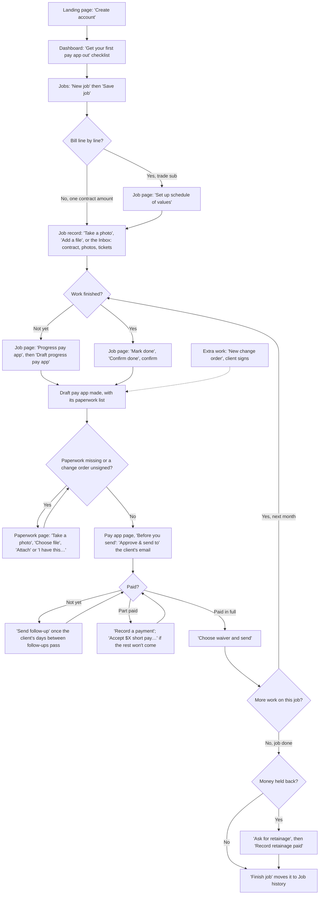

The money loop is the middle: draft, add the paperwork, send, follow up, record the payment, send the waiver, then back to next month's progress. A job usually goes round it once a month. Each step shows up on the Dashboard as a row, and in the owners' daily email, so the contractor can run the loop from Dashboard (section 14).

---

## 2. First day setup

**Goal:** create the company, confirm the email, and fill in the company details that print on every pay app. The screens are the wireframes `Landing`, `CheckEmail`, `FirstRun`, `NewJob` and `Settings`.

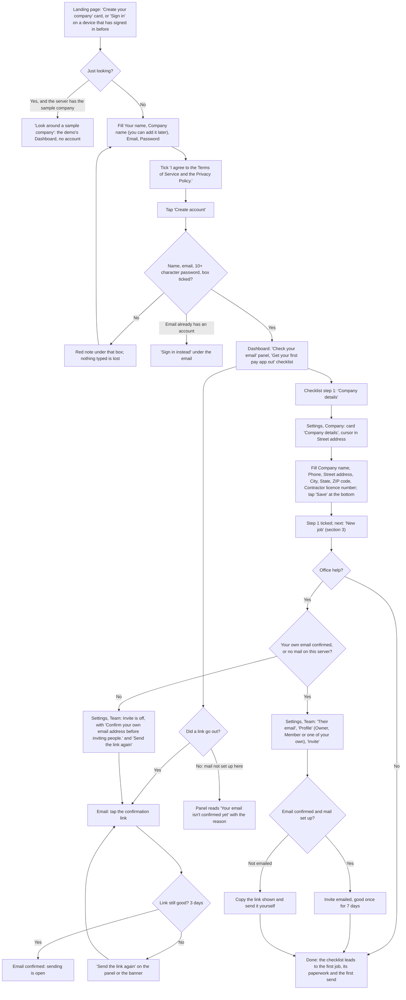

Code: landing and sign-up card `renderLanding`, static/js/views/auth.js:45 (Sign in first when this browser has signed in, static/js/views/auth.js:11-17; the terms box static/js/views/auth.js:94); **Look around a sample company** static/js/views/auth.js:71 and `lookAround` static/js/views/auth.js:219, server `_p_demo`; "Check your email" panel `checkEmailHtml`, static/js/views/auth.js:375 (**Send the link again**, **Got it**); checklist `onboardingHtml`, static/js/views/today.js:172-216, its step 1 **Company details** opens Settings, Company at `#co-address`; Company page `companyView`, static/js/views/settings.js:198; **Save** `save-company` static/js/views/settings.js:688 (the details, the address in four boxes and the switches together, S1 and S3; the server checks each box, `update_company`); Team `teamCardHtml`, static/js/views/settings.js:77, **Invite** `team-invite` static/js/views/settings.js:603 (off, with the reason and **Send the link again**, while `inviteLocked` static/js/setup.js:41; the server still refuses, `_p_team_invite`). Two-step sign-in is on for every account (section 16).

**Taps from start to done:** about 5. Create account (1, after typing 3 boxes and the tick), the email link (1), Company details on the checklist (1, lands in the Street address box), Save (1), Invite (1, optional).

**What changed since Round 2:** Settings is four pages (Company, Team, My account, Billing) instead of one long Team & account page (R6-03); the checklist and Before you send name Settings, Company. Sign-up is limited to 5 an hour per network (R6-05). The Company page has **Sending and email** (who may send, the daily email) for owners.

**Where it could still be simpler:**
- Hiding the checklist is per person, so a teammate who joins later sees it until they hide it (it can be brought back from Settings, My account).

---

## 3. Add a job by hand

**Goal:** get a job and the client who pays it into Duracash. Clients can also be added on their own (section 15).

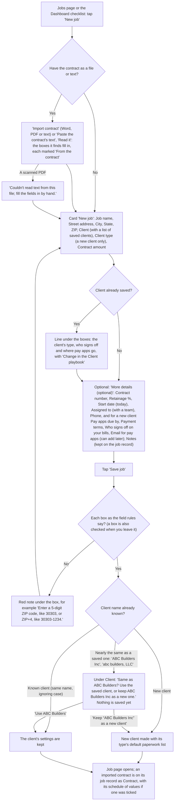

Code: `views.jobs`, static/js/views/jobs.js:372-442 (**New job**, the boxes, **More details (optional)**, **Save job**); `jobFields` static/js/views/jobs.js:25 (the address as four boxes, J1, and Start date, J8) and its checks `jobFieldErrors` :58 (on Edit job, with `savedJobFields` :73, only the boxes changed from what the form opened with are checked, the address's four as one; the server's `edit_job`, domain/__init__.py:4004, does the same, so a contract number or address saved before the rules doesn't block another edit), with the field rules of static/js/validate.js (G1, checked on leaving a box by static/js/forms.js); the saved-client line `knownPayerText` :106; **Import contract** `contractImportHtml` :228, `readContract` :288 (POST /api/contract/read, server `contract_import.read`, contract_import.py:36, which reads Word files, text PDFs and pasted text and saves nothing; a PDF is read moving forward only, for at most 1.5 s, 30 MB inflated and 400,000 characters, `pdf_text` :104 and `_tokens` :171, so a small crafted file can't hold the server), `fileContract` :307 (the file goes on the record as kind contract after the save; the schedule of values goes up with `update_contract` when **Use the schedule total as the contract amount** is ticked). When the contract's schedule of values doesn't add up to the contract amount, the line under its checkbox says by how much and offers that box (`sovTotalChoice` :258); **Save job** with neither refuses under the amount instead of losing the schedule after the save; **Save job** `create-job` :474; server `create_job`, :3800 (each box checked again by the same rules in domain/validate.py; a refusal is keyed by field and shown under its box, `showFieldErrors` in static/js/forms.js; the address is kept whole too, "Street, City, ST 12345", for the pay app PDF, the client's page and Inbox matching). Client type has five kinds: General contractor and Another subcontractor use a general contractor's defaults, Owner or developer, Homeowner and Public agency an owner's (`CLIENT_TYPES` static/js/jobs.js:462, `client_type_role` domain/jobinfo.py:31). Notes become a "Job notes" record, never paperwork (R1-04). A near match (Oct 23 note 5) is found by `payer_near` :2290, which compares names with `customer_key` (:2275: case, spaces, punctuation, "The" in front and Inc, LLC, Co, Corp, Company, Ltd at the end don't count); the refusal carries `same_customer` and `showSameCustomer` static/js/views/jobs.js:124 shows the two buttons, **Use ABC Builders** `nj-same-use` :529 and **Keep “ABC Builders Inc” as a new client** `nj-same-keep` :539 (sent again with `new_customer: true`). Nothing is merged without a tap.

Jobs saved before the address had four boxes keep their one line: Edit job shows it all in Street address until someone splits it (migration step `_jobs_clients_address_parts`, migrations.py:111, which also splits a line that reads as "Street, City, ST 12345").

**Taps from start to done:** 2 taps (New job, Save job) and 8 boxes, two of them selects; with a contract file, 3 (Import contract, pick it, Save job) and a check of each box.

**Where it could still be simpler:**
- The paperwork list for a new client is set by its Client type and only shows once the first pay app is drafted; it is changed in the Client playbook, not on the New job form.
- Reading a contract is plain rules, not a reader of any layout: a scanned PDF, or a contract that words the sum or the parties unusually, leaves those boxes for you to fill.

---

## 4. Set up the schedule of values

**Goal:** bill line by line (quantity times rate), the way a GC wants a trade sub to bill.

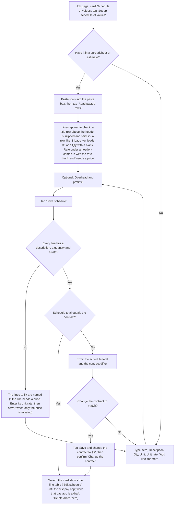

Code: `sovCardHtml`, static/js/views/job-sov.js:118-163 (**Set up schedule of values** static/js/views/job-sov.js:133, **Edit schedule** static/js/views/job-sov.js:159); editor `sovEditorHtml`, static/js/views/job-sov.js:78-116 (**Read pasted rows** static/js/views/job-sov.js:93, **Add line** static/js/views/job-sov.js:101, **Save schedule** static/js/views/job-sov.js:112, **Save and change the contract to $X** static/js/views/job-sov.js:74 and static/js/views/job-sov.js:113); the confirm static/js/views/job-sov.js:189; parse `sov.parse_rows`, sov.py:540 (a header found in the first 5 rows, R5-08; one number next to a unit word in `UNIT_WORDS` sov.py:420, after it or just before it, checked by `_counts_units` sov.py:510, is a quantity with no price, sent back with `needs_price` and a blank rate; under a header, a quantity with the rate and amount blank comes back the same way); the editor marks it with `sovLineProblem`, static/js/sov.js:53 ("needs a price" static/js/views/job-sov.js:61, the toast static/js/views/job-sov.js:186); save `save_sov`, domain/__init__.py:4169, which refuses a blank rate ("needs a price (unit rate)", sov.py:348). While the only pay app is a draft, the card's note and **Delete draft** come from `sovDraftLockHtml`, static/js/sov.js:68 (used at static/js/views/job-sov.js:127 for a job with no schedule and static/js/views/job-sov.js:137 for one with a schedule), from `draft_lock` in `_sov_view` (`_sov_draft_lock`, domain/__init__.py:4181); the button is the `void-draft` action and its confirm. On a phone each line is a card with the description on top (R6-02).

**Taps from start to done:** 3 with a paste (Set up schedule of values, Read pasted rows, Save schedule). One more (the confirm) if the contract changes to match.

**Where it could still be simpler:**
- The schedule is fixed once the first pay app exists, even an unsent draft. While the only pay app is a draft the card says "The schedule is fixed while PA-x is a draft. Delete the draft to change it." with a **Delete draft** button (owners; anyone else reads "An owner can delete the draft to change it." and no button); after one is sent it says "Fixed once the first pay app exists. Scope changes go through change orders, which add their own lines when approved." A mistake found on the second pay app means a change order. A job with no schedule whose only pay app is a draft shows one line instead of the card: "To bill line by line, delete draft PA-x first, then set up a schedule of values." with **Delete draft** (anyone else reads "To bill line by line, an owner has to delete draft PA-x first. Then you can set up a schedule of values."). Once a pay app is sent, a job with no schedule hides the card.

---

## 5. Import existing paperwork

**Goal:** get contracts, photos, tickets, emails and old notes onto the right job without retyping.

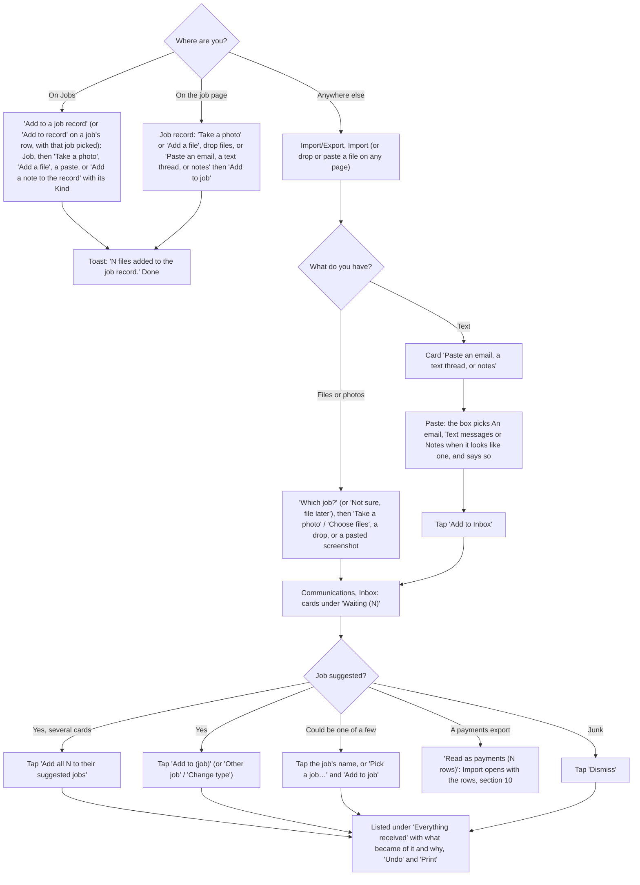

Code: job record card `recordCardHtml`, static/js/views/job-record.js:40-62 (**Take a photo** / **Add a file** `pick-files` static/js/views/inbox.js:454, paste box `pasteBoxHtml` static/js/views/inbox.js:191 with **Add to job**); record rows with **Edit** `recordRow` static/js/views/job-record.js:18 (R5-07), in groups with their counts and a filter row (All, Contract and change orders, Daily records, Photos, Tickets, time sheets and supplier invoices, Lien waivers, Insurance and certificates, Inspections and closeout, Pay app backup, Notes and other; J5, `recordGroupsHtml` static/js/views/job-record.js:44, `RECORD_GROUPS` static/js/jobs.js:502); **Add to a job record** on Jobs `addRecordCardHtml` static/js/views/jobs.js:330 (J4: open jobs only, `jr-open` :563, `jr-paste` :572, `jr-add-note` :580); Import `views.import`, static/js/views/data.js:51-71 (the file box `dropzoneHtml` static/js/views/inbox.js:172 with **Which job?** and the touch-only **Take a photo** / **Choose files**, the paste box, the payments import of section 10, and **Schedule of values**: a job whose schedule can still be set, none listed once each has a pay app out or its work done (D4, `sovPickerHtml` static/js/views/data.js:28), and **Open its schedule** `import-sov` static/js/views/data.js:117, which opens the job's schedule card for pasting); Inbox `views.inbox`, static/js/views/inbox.js:414-443 (**Waiting (N)**, a phone's **Take a photo**, **Everything received**, **Bring emails and texts in automatically**); **Everything received** `receivedHtml` static/js/views/inbox.js:272 (Received, From, Subject with the files, Came in by, Status in words `receivedStatus` :244 with how it was matched; filters **Came in by**, **Status**, **Job** and **Sort** `setReceivedFilter` :226, each label kept with its box, one per row on a phone (D5, `receivedSelect` :263); **Undo**, **Print** `print-received` :526), paged by the server `GET /api/inbox` (`_g_inbox_page` server.py:1188, `domain.inbox_page` domain/comms.py:78, the reason in words `_why` domain/comms.py:46); the page load carries only what waits and the last 20 others (`inbox_for_page_load` domain/comms.py:25, from `light_snapshot` :1776); cards `inboxItemCard` static/js/views/inbox.js:295 with `choiceJobs` / `choiceLine` / `pasteGuess` in static/js/inbox.js; uploads three at a time `uploadFiles` static/js/views/inbox.js:44; server matching `importer.match_job`, importer.py:466 (a job code in capitals, or in small letters as its own word when no job's name or address has that word; the full job name or a part of it no other job has, like Oak Street for Oak Street kitchen, or one telling word written with a capital, like Vesta; a code in small letters or one name word counts less than the client's AP email; a tie suggests nothing), kinds `guess_kind` importer.py:386, notes split `split_notes` importer.py:357, filing `file_item` importer.py:635; **Undo** `undo_item` importer.py:782, refused while paperwork uses the record by `_paperwork_refusal` importer.py:735, with a link in the refusal card (`showRefusal` static/js/app-core.js:348).

**Taps from start to done:** 2 from the job page (Take a photo or Add a file, pick); 3 from Jobs (Add to record on the row, Add a file, pick). From Import: 2 to add, then 1 per card in the Inbox to file, or 1 for all suggested cards.

**Where it could still be simpler:**
- Forwarding email and texts in needs an email service or a Twilio number set up by an owner (deferred: a provisioned address per company, improvement plan section 5).
- Once a record is attached by hand to paperwork, Undo on the Inbox is refused. For a draft it links to that pay app's Paperwork page, where Remove is. For a pay app that went out (whether the record was attached by hand or automatically) it links to the pay app: the record stays as sent, and pulling the pay app back (only while nothing is paid) is the way to change what went out.

---

## 6. Change order

**Goal:** record extra work (or a credit) with its reason and price, get it signed, and bill it.

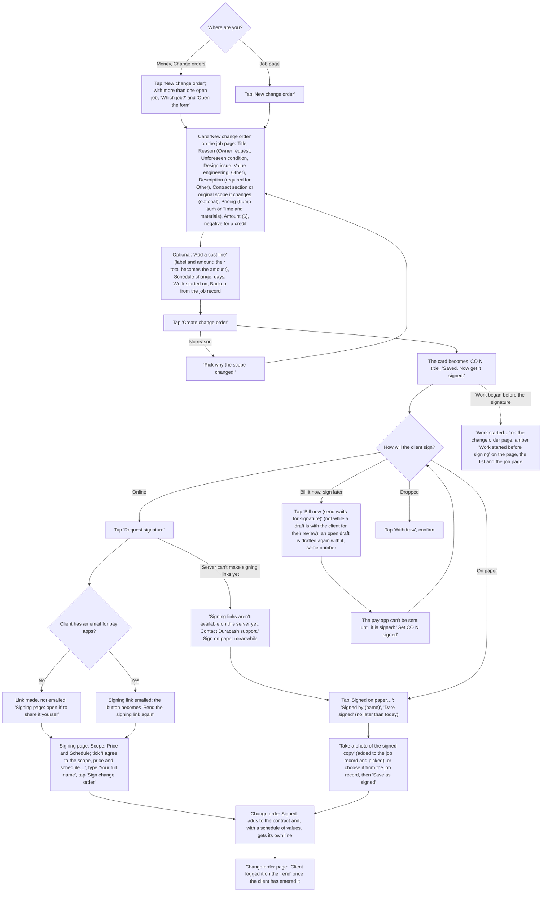

Code: **New change order** `new-co` static/js/views/job-cos.js:165 (a job action, static/js/jobs.js:392); card `newCoCardHtml` static/js/views/job-cos.js:74 and `coFormFields` static/js/views/job-cos.js:92 (**Add a cost line** `co-add-item` :167); **Create change order** `add-co-here` static/js/views/job-cos.js:173, checked first in `addChangeOrder`; server `_add_co` server.py:2895 and `add_change_order` :2668 (reasons `CO_REASONS` :2606; refuses a missing reason, Other without a description, more than 50 cost lines, an amount that differs from the cost lines, backup not on this job's record, a start day in the future, zero, and a credit larger than the contract total). On Money, Change orders (`views.cos`, static/js/views/changeorders.js:99) the list has no form: **New change order** `co-new` :185 opens the job's form straight away when only one job is open, else asks **Which job?** and **Open the form** `co-new-open` :192. Sign controls `coSignControls` static/js/views/job-cos.js:45 (**Request signature**, **Signed on paper…** with **Signed by (name)** and **Date signed**, **Withdraw**, **Take a photo of the signed copy**, **Save as signed** `approve-co` static/js/views/changeorders.js:199); server `request_co_signature` :2831 (without the site address it refuses with `NO_SIGNING_LINKS`, :2669, and the server log names DURACASH_URL, `_request_co_signature` server.py:2916), `mark_co_signed` :2896 (needs the signer's name and a date no later than today; signing, online or on paper, takes "(unsigned)" off the line of an open draft that billed it, so the PDF no longer says so), `withdraw_change_order` :3006; **Bill now (send waits for signature)** in `views.job` (static/js/views/job.js:350), server `include_change_order`, domain/__init__.py:3136 (an open draft still only here is drafted again with the CO on it, same number; one with the client for their review is refused); signing page `render_co`, payer_page.py:311 (Scope, Price and Schedule from `co_snapshot`, :2791, version 2; an older signature keeps its own snapshot and hash). The change order page `views.coDetail`, static/js/views/changeorders.js:85: Summary (reason, cost lines, pricing, schedule, work started, Waiting on), **Client logged it on their end** `co-logged` :214 (server `mark_co_logged`, :2967, only once signed), **Work started…** `co-work-started` :215 (server `set_co_work_started` :2952; the flag is `co_started_unsigned` :2926), Backup, the Contract sum card `coContractHtml` static/js/views/changeorders.js:55 ("if signed" while unsigned, counting every change order signed so far; a signed one counts those signed before it by signing day, `coSignedOn` :44) and History `coHistoryHtml` :30 (created, put on the bill, signature requested, signed, withdrawn, taken off a deleted draft, work started, client logged it, each with who and when; older change orders get theirs from the job's audit rows, migrations.py `_payapps_cos_co_history`).

**Taps from start to done:** 2 to create (New change order, Create change order) after typing, then 1 for online signing (Request signature) or 3 on paper (Signed on paper…, Take a photo of the signed copy, Save as signed).

**Where it could still be simpler:**
- A change order has no PDF of its own yet (improvement plan section 5).
- A change order can't be edited once made; withdraw it and make a new one.

---

## 7. Paperwork (what the client wants with each pay app)

**Goal:** get every missing item in so the pay app can be sent.

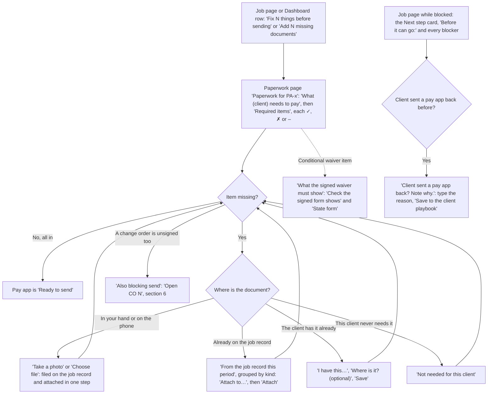

Code: the blocker button's words `domain.blocker_button`, domain/__init__.py:273; paperwork page `views.packetDetail`, static/js/views/paperwork.js:259-315 (**What (client) needs to pay** `clientNeedsHtml` :57; **Required items**, each attached record with its kind, its files as links and photos as small pictures, and who attached it when (`attachmentRow`, `recordFileLinks` :28); **Take a photo** / **Choose file** upload with `?attach=` and, on a waiver item, `&waiver_kind=` :297-298; **I have this…** / **Save** `resolve` :322; **Not needed for this client** (closeout: **Not needed on this job**) `packet-skip` :303, :334; **Remove** on a draft's, the job's and closeout paperwork `packet-detach` :295, :333; **What the signed waiver must show** with `waiverChecklistHtml` :103 and `waiverFormHtml` :85; **Also blocking send**); **From the job record this period** `periodHtml` :195 (the records after the previous pay app's period, grouped Photos, Daily records, Tickets and time sheets, Change orders, Waivers, Other; **Attach to…** lists only the missing items that take that kind of record, from the server's `accepts_kinds`, plus **Send with the pay app** `attach-from-period` :337; a waiver's type `waiver-type` :359; a ticket's change order or line `record-work` :354). Server: the standard items `PAPERWORK_ITEMS`, domain/__init__.py:3436 (progress photos, daily tickets and time sheets, supplier invoices and receipts, insurance certificate, stored materials documents, signed contract, conditional waiver; closeout: punch list sign-off, completion certificate, final lien waivers, as-builts, warranties); a new pay app's list `_new_packet` :3359 (the client's list, or the default one, and always a conditional waiver named by its type, final only when no retainage is held, `_name_conditional_waiver` :3447, unless this client was marked as not taking one; an item of the list naming an unconditional waiver is that type and never filled by a conditional one; the playbook says beside the Conditional waiver box that it is always asked for, static/js/views/clients.js:64); daily tickets when the pay app bills a change order or a unit-price line `_add_ticket_item` :3415 (Not needed for this client on it is kept on the client, `tickets_not_needed`, and the next pay app shows it as not needed); closeout paperwork for every job at Mark done `_ensure_closeout_packet` :3323; `attach_record_to_packet` :3763, `resolve_packet_item` :627, `skip_packet_item` :3642 (attach, skip and `add_packet_attachment` :3203 are refused once the pay app has gone to the client), `detach_packet_item` :3607, `set_waiver_type` :1078, `link_record_to_work` :4481; the note-why line folded at the bottom of the Next step card in `views.job` (static/js/views/job.js:292, `learn` :454, server `learn_rejection`, domain/__init__.py:3169). The list comes from the Client playbook, Paperwork needed with each pay app; a pay app, schedule of values or continuation sheet item is in from the start ("Produced by Duracash with the pay app").

**Taps from start to done:** 1 to open, then 2 per missing item (Take a photo, take it) or 2 to attach a record (pick, Attach).

**Where it could still be simpler:**
- The paperwork list only appears once the first pay app is drafted; the setup checklist asks for the contract and paperwork on the job record before that.

---

## 8. Draft, check and send a pay app

**Goal:** turn finished work into a pay app and email it with its PDF and paperwork.

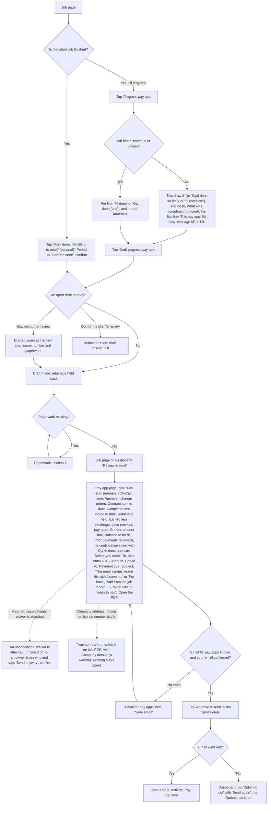

Code: **Progress pay app** and **Mark done** in `jobActions`, static/js/jobs.js:354-355; progress card `progressFormHtml`, static/js/views/job.js:94-118 (`progressFigures`, static/js/jobs.js:211, checks it as the server does), line-by-line card `sovProgressHtml` static/js/sov.js:91-114 (it names an open draft it replaces, which keeps its number and paperwork, M1; a lump-sum line's **% done** takes at most one decimal, `lumpDone` static/js/sov.js:34, never rounded); **Draft progress pay app** `progress` static/js/views/job.js:366 and `sov-progress` static/js/views/job-sov.js:242; Mark done card in `views.job` and its confirm static/js/views/job.js:377; server `record_progress` domain/__init__.py:323, `record_sov_progress` :4248, `mark_done` :403 (a draft still only here becomes the final pay app, same number and paperwork; one with the client for their review is refused), `draft_invoice` :447 (a redraft keeps the records added to the email and the files left out, `_carry_send_choices` :556); **Review & send** opens the pay app page at `.send-check` (static/js/jobs.js:372, static/js/today.js:26); pay app page `views.payappDetail`, static/js/views/payapps.js:70-150 (the **Pay app summary** card `payappSummaryHtml` :48, lines 1-9 as the PDF prints them, `payapp_pdf.summary` payapp_pdf.py:137, through `domain.payapp_figures` domain/__init__.py:1572, which adds the payments received on earlier pay apps; the continuation sheet `continuationHtml` static/js/sov.js:133, whose **Qty to date** column is also on the PDF sheet, payapp_pdf.py:302, and the client's page, `_sheet` payer_page.py:90; **Before you send**, **Open the PDF**, **Download for QuickBooks**, **Approve & send to …**; the blank company details warning `companyGapsHtml` static/js/setup.js:29, a warning only); the paperwork part of Before you send `beforeYouSendHtml`, static/js/views/paperwork.js:210 (**Leave out** / **Put back** / **Take off** `payapp-attach` :344, **Add from the job record…** `payapp-add` :349, **Send anyway** `send-override` :369; server `change_payapp_attachments` domain/__init__.py:4425, only while the pay app is a draft, `POST /api/jobs/<id>/payapp/<inv>/attachments` server.py:2790); server `approve_and_send`, domain/__init__.py:674 (an attached unconditional waiver is refused without an owner's reason, `unconditional_waivers_attached` :656, `_send_payapp` server.py:2961; the conditional waiver type that went with it is kept on the pay app); **Send again** `email-retry` static/js/views/communications.js:84. Mistakes: **Undo done** (before the final pay app goes out, `undo_mark_done`, domain/__init__.py:3103), **Delete draft** (`void_draft`, domain/__init__.py:3017), **Pull back this pay app…** on a sent one with nothing paid (`void_sent_pay_app`, domain/__init__.py:3044).

**Taps from start to done:** 3 for a progress bill with nothing missing (Progress pay app, Draft progress pay app, Review & send) plus Approve & send: 4.

**Where it could still be simpler:**
- **Send draft for their review** (the client checks the numbers first) is under More, not charted; it waits on **Client agreed to the draft** or **Client wants changes**.

---

## 9. Follow up on an unpaid pay app

**Goal:** send a polite chase email when the client's usual wait has passed, or note a phone call.

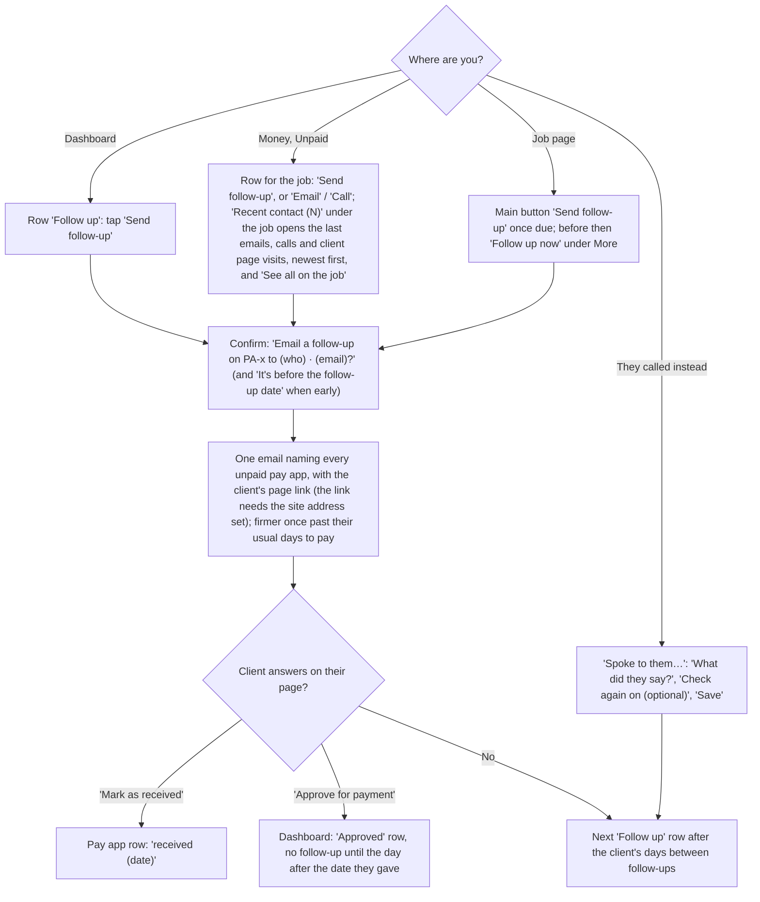

Code: Dashboard row kind `follow_up` in `domain.today_rows`, domain/__init__.py:1709-1841 (with **Spoke to them…**, static/js/today.js:54); Unpaid `views.collections`, static/js/views/collections.js:25 (**Recent contact (N)** `recentContactHtml` :14, from `contact_log`, domain/contact.py:45: emails to the client with how they went, calls noted with Spoke to them, client page events and the client's emails filed to the job; the job view carries the last five only while money is owed); job page **Send follow-up** / **Follow up now** static/js/jobs.js:375; the confirm static/js/views/collections.js:73; server `record_follow_up`, :794 (not-due refusal :779, from the third follow-up it also emails the client's **Also email from the third follow-up** address); **Spoke to them…** `contactFormHtml` static/js/views/job.js:55 and `note_contact`, :866; the client's page `payer_page.render`, payer_page.py:152 (**Mark as received** `mark_received` :211, **Approve for payment** `approve` :226).

**Taps from start to done:** 2 (Send follow-up, then the confirm).

**Where it could still be simpler:**
- The confirm says who it goes to but not what the email says; the Outbox shows the text once it has gone.

---

## 10. Record a payment

**Goal:** record a check or transfer against the right pay app so the waiver step opens.

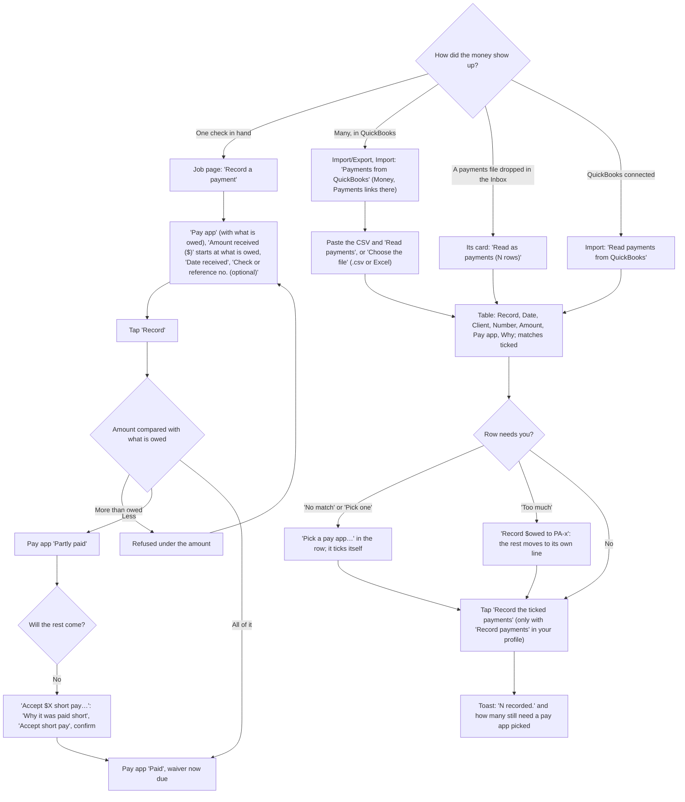

Code: **Record a payment** card in `views.job` (`match` static/js/views/job.js:438, prefill `prefillPaymentAmount` static/js/views/job.js:209), server `match_payment`, domain/__init__.py:901 (takes `received_on`); short pay `shortPayCardHtml` static/js/views/job.js:36, `accept-short-pay` static/js/views/payapps.js:203, server `settle_short_pay`, domain/__init__.py:998; the import card `paymentsImportHtml`, static/js/views/payments.js:95-111, on Import (`views.import` static/js/views/data.js:7); Payments `views.payments` static/js/views/payments.js:115-138 lists what was recorded and links to Import (**Read payments** `qbo-read` static/js/views/payments.js:145, **Choose the file** `qbo-choose-file` static/js/views/payments.js:178, **Record the ticked payments** `qbo-apply` static/js/views/payments.js:153, shown only with `can("record_payments")` (static/js/views/payments.js:108; the route has perm="record_payments", server.py:2887, `_m_payments_apply` server.py:1798), the split `qbo-split` static/js/views/payments.js:165); row cells `qboTick` / `qboPayAppCell` static/js/views/payments.js:62-74 with static/js/payimport.js (`pickPayApp`, `splitTooMuch`, `afterRecord`); server `qbo_csv.parse` qbo_csv.py:163 and `propose` :309; Inbox **Read as payments** `inbox-read-payments` static/js/views/payments.js:171 (opens Import); QuickBooks card `qboCardHtml` static/js/views/payments.js:78 (**Connect QuickBooks**, **Read payments from QuickBooks**, **Check against QuickBooks**, **Disconnect**). The wireframe is `PaymentsImport`.

**Taps from start to done:** 2 by hand (Record a payment, Record); 3 for a CSV (Read payments, a pick if needed, Record the ticked payments).

**Where it could still be simpler:**
- QuickBooks is read on request, not every day (deferred until a live Intuit connection is tested, improvement plan section 5).

---

## 11. Lien waiver

**Goal:** a conditional waiver goes with each pay app; once it is paid, send the signed unconditional one.

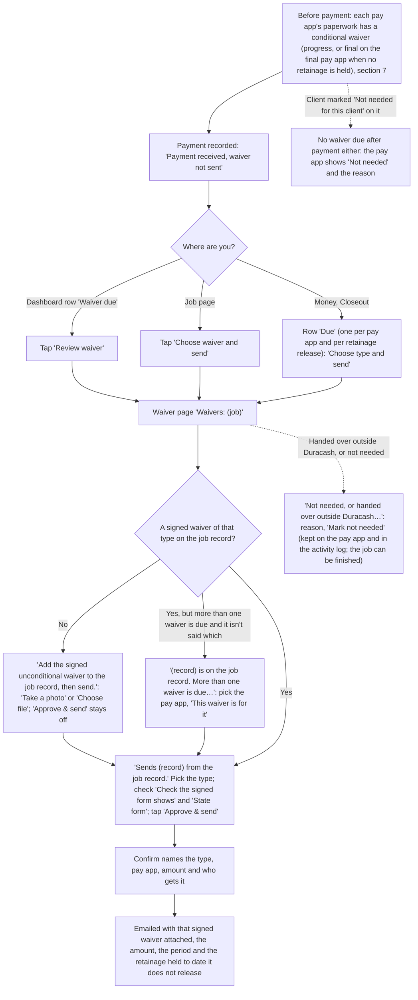

Code: Dashboard row kind `waiver` (**Review waiver**, `open-waiver`); job page **Choose waiver and send** static/js/jobs.js:373; Closeout `views.waivers`, static/js/views/closeout.js:139 (one row per pay app and per retainage release, `waiverRows` :33, with Not needed rows and their reason; **Which type?**, **Not chosen yet**, **Choose type and send**); waiver page `views.waiverDetail`, static/js/views/closeout.js:95-136 (**Waivers due**, **Check the signed form shows** `waiverChecklistHtml` static/js/views/paperwork.js:103, whose **Add your legal name** opens Settings, Company at the legal-name box (D2), **State form**, **By pay app** with **Before payment** and **After payment**); the confirm `waiver` :196; **This waiver is for it** `waiver-for` :226 when a signed waiver isn't tied to a pay app and more than one is due (`waiverForHtml` :70, server `set_waiver_type` domain/__init__.py:1078 with `for_id`; **Take a photo** on a row ties it with `&waiver_for=`, server.py:2154); **Not needed, or handed over outside Duracash…** with **Mark not needed** `waiver-not-needed` :232 (`waiverNotNeededHtml` :84, server `waiver_not_needed` domain/__init__.py:1295, needs a reason, kept on the pay app, release or older job-level waiver and in the activity log; a client marked Not needed for this client owes none after payment, `_waiver_comes_due` in `match_payment` :901, `settle_short_pay` :998 and `record_retainage_payment` :1460); type picker and hint `waiverSendForm` / `WAIVER_HINTS`, static/js/jobs.js:112-151; server `send_waiver`, domain/__init__.py:1191 (refused until a signed waiver of the type is on the job record, `waiver_on_file` :1130, never one that already went out in any email, the pay app's included, nor one taken for another pay app or release; one taken for none is refused while more than one waiver is due), both stages `waiver_stages` :1360 (naming the record that would go), the type it suggests `suggested_waiver_kind` :1049 (conditional before payment, unconditional after, never final while retainage is held); state forms `helper/waiver_forms.json` (Georgia so far), `GET /api/waiver-forms` server.py:2791.

**Taps from start to done:** 2 (Review waiver, Approve & send) and the confirm, plus the type if it isn't the one picked for you.

**Where it could still be simpler:**
- Duracash does not write the waiver: sign the form your state or the client requires and add it to the job record. Only Georgia's forms are listed so far.

---

## 12. Retainage release

**Goal:** get the money held back on the job paid at the end.

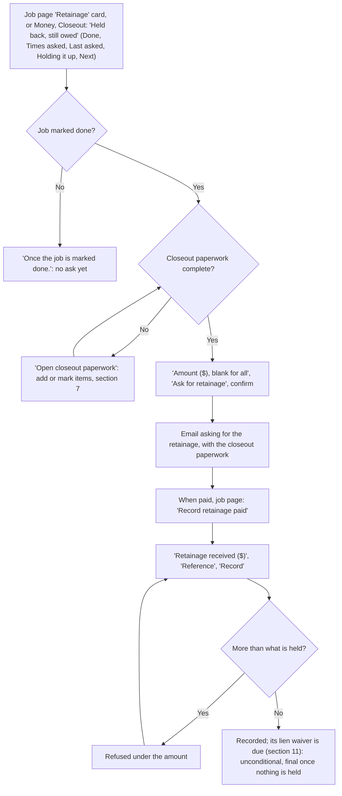

Code: the job page's **Retainage** card `retainageCardHtml`, static/js/views/job-money.js:39 (rate, held, released, still held, **Job done**, **Times asked**, **Last asked**, **Next ask allowed**, **Pay apps holding it**, **Releases** with each one's waiver, **Closeout paperwork** with its files; figures `retainageFacts` static/js/jobs.js:178); Closeout's held-back table in `views.waivers`, static/js/views/closeout.js:100-150, `retainageAskHtml` :17; job page **Ask for retainage** only once the work is done and the closeout paperwork is in (static/js/jobs.js:387; the card says why otherwise, `retainageNote` static/js/jobs.js:305); after a request, whole or part, the next waits the client's **Days between follow-ups** (`retainageAskWaits` static/js/jobs.js:299, the server's wait in `chase_retainage`); the confirm static/js/views/closeout.js:167; server `chase_retainage`, domain/__init__.py:1398 (refused before the job is marked done); **Record retainage paid** card in `views.job`, `retainage-paid` static/js/views/job.js:396, server `record_retainage_payment`, domain/__init__.py:1460 (each release owes a lien waiver, `retainage_waivers`).

**Taps from start to done:** 4 (Ask for retainage and the confirm, then later Record retainage paid, Record), then the release's waiver (section 11).

**Where it could still be simpler:**
- The Dashboard has no row for "retainage ready to ask for"; the job page and Closeout show it.

---

## 13. Finish the job

**Goal:** file a fully settled job away in Job history, with its job file.

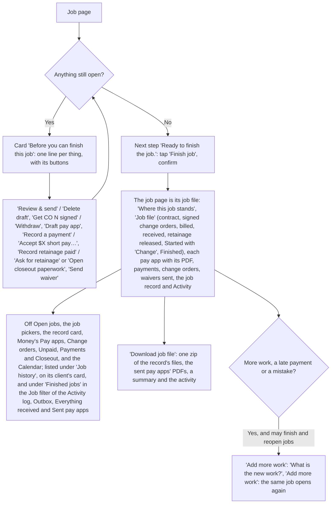

Code: the card in `views.job` from `close_blocker_items`, domain/__init__.py:188 ("A lien waiver is still due." until every paid pay app's and every retainage release's waiver is sent), buttons `closeBlockerActions`, static/js/jobs.js:409-411; **Finish job** static/js/jobs.js:382 and its confirm static/js/views/job.js:448; server `close_job`, domain/__init__.py:3180; the job file `archiveHtml` static/js/views/job.js:155 (J9); a finished job's **←** goes to Job history when opened from a link (D9, static/js/views/job.js:238) with **Change** for the start date (`save-start` :423; the server takes only the start date on a finished job, `edit_job` :3994); **Download job file** GET /api/jobs/<id>/archive/job-file.zip, `job_archive.build` job_archive.py:84 (anyone signed in to the company); **Add more work** in `views.job` (:244-254, `reopen` :416), server `reopen_job`, :3183 (the Finish and reopen jobs permission, `JOB_ACTION_PERMS` domain/profiles.py; the button shows with `may("reopen")`); the open jobs `openJobs` static/js/jobs.js:478, used by Money's lists (`views.payapps`, `views.cos`, `views.collections`, `views.payments`, `views.waivers`) and `views.calendar`; the job filters on pages of records `jobFilterOptions` static/js/jobs.js:494 (open jobs, then "Finished jobs"); a job with only drafts deleted before they were sent and no payments can be deleted instead (**Delete job** under Edit job, `can_delete_job` :3353).

**Taps from start to done:** 2 (Finish job, the confirm).

**Where it could still be simpler:**
- The Job filters on the pages of records offer only jobs finished in the last 90 days; an older job's records are in its job file under Job history.

---

## 14. The Dashboard routine

**Goal:** open one page, see everything waiting, who has it and when it is due, and handle it top to bottom. Each person gets their own rows by email each morning there is something due: an owner gets what is assigned to them and what nobody has; a member gets what is assigned to them.

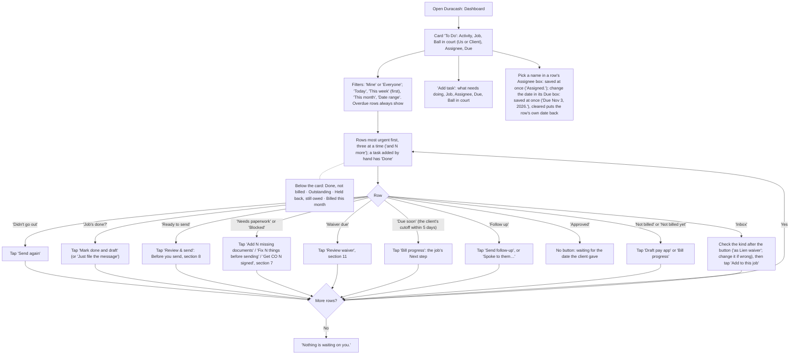

Code: the rows and their order `domain.today_rows`, domain/__init__.py:1882-2006 (one rule set for the Dashboard and the daily email `daily_digest` :2017, sent per person by `_digests`, monthly.py:75); each row's key, due date, ball in court and assignee `decorate_rows`, domain/tasks.py:49 (assigned with `assign_row` :245, tasks added by hand `add_task` :177, `edit_task` :196, `set_task_done` :233; routes `/api/tasks…`, server.py:2777-2781, handlers `_task_change` server.py:1892; a team member removed: `reassign_open_tasks` domain/tasks.py:284, which moves their open tasks, their rows and the jobs they were assigned to the owner who removed them, called from `_p_team_remove` server.py:2018); one list and the period filter `todoItems` / `periodRange` / `inPeriod`, static/js/tasks.js:35, :20, :35; drawn by `todoHtml` / `rowButtons` / `assignSelect` / `dueInput`, static/js/today.js:79, :52, :68, :79 (a due date set by hand: `dueFrom` static/js/views/today.js, to /api/tasks/assign's `due` for a row, saved as its `due_override`, or /api/tasks/<id> for a task); the card `todoCardHtml` static/js/views/today.js:77 with **Add task** `taskFormHtml` :61 (what each row's button does: `ACTIONS` :22-33; an Inbox row's kind select, which starts at the kind the Inbox guessed, `inboxKindSelect` :44, sent as the row's `item_kind`); Dashboard page `views.dashboard`, static/js/views/today.js:251-310 (metrics and the jobs table under the card); "Mark done and draft" confirm static/js/views/inbox.js:512. The daily email is turned off in Settings, Company: **Daily email of what's due**. A row with no date of its own is sent with a blank due date and is due on the person's own today (`todoItems`; the server's day is UTC, already tomorrow on a US evening); the same goes for a new job's start date and a Diary entry's day, which take the date the page sends (`local_today` domain/jobinfo.py:65). A due date set by hand is kept with the row's own date at the time (`row_due`) and stops applying when the row comes back with a new one (the next follow-up, next month's cutoff; `_override_holds` domain/tasks.py:74); `prune_assignments` :99 drops those and the assignments of rows that are gone before every save (server.py:795). The daily email lists only rows due today or before (`daily_digest`).

**Taps from start to done:** 1 to 2 per row. A typical week with one send, one follow-up and two filings is about 6 taps with the confirms.

**Where it could still be simpler:**
- No row for retainage ready to ask for (section 12).
- A pay app ready to send is due on the client's next cutoff, so with a cutoff weeks away it shows under **This month**, not **This week**.

The Calendar starts with **Tasks** (T6): the same items and the calendar's dates in **This week**, **Next week**, **This month** or **Custom**, each opening its day, with **Add task** (`tasksBlockHtml`, static/js/views/today.js:100).

---

## 15. Client playbook

**Goal:** keep each client's rules (who signs off, where pay apps go, follow-up timing, the paperwork list) right, since they drive every pay app and follow-up.

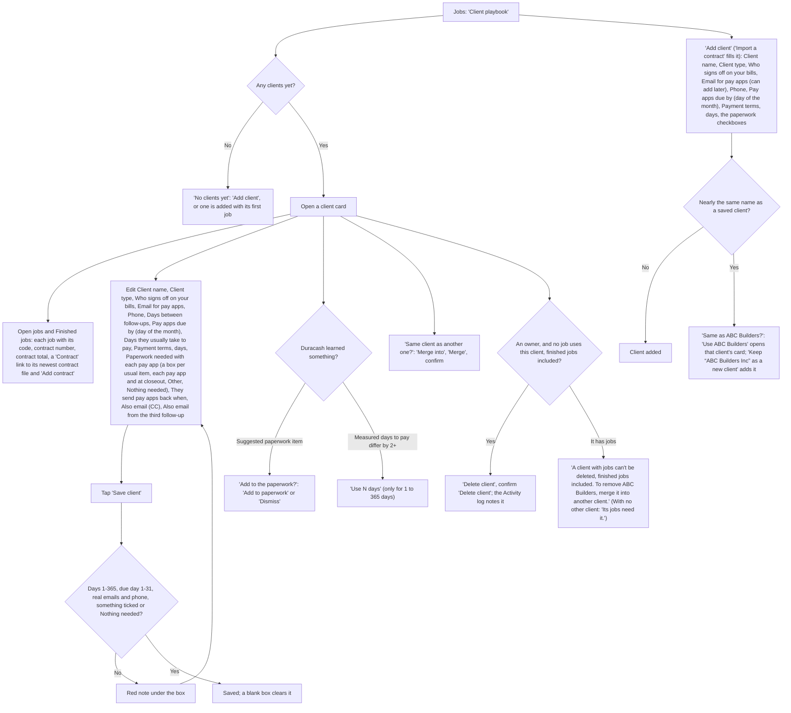

Code: page `views.playbook`, static/js/views/clients.js:101-185 (**Add client** `add-payer` static/js/views/clients.js:219, server `add_payer` :2332; **Save client** `save-playbook` static/js/views/clients.js:197, server `update_payer`, :2177; the jobs `clientJobsHtml` :39, asked for when the card opens from GET /api/payers/<id>/jobs, `payer_jobs` domain/jobinfo.py:182, finished jobs included (S10); the paperwork boxes `paperworkHtml` :54, built by `paperworkChoices` static/js/jobs.js:527 from the server's standard catalog `PAPERWORK_ITEMS` :3468 (sent as `paperwork_catalog` by `light_snapshot` :1776; a new client's list `DEFAULT_PAPERWORK` uses its labels, and `_followups_paperwork_catalog_labels` migrations.py:165 moved older saved labels to them), saved as the comma list the server reads, `parse_packet_text` :3280, read back from `packet_items` (S11); **Import a contract** as on New job (S12); **Add to paperwork** / **Dismiss** `sug-add` / `sug-dismiss` static/js/views/clients.js:141-155; **Use N days** `use-approval-days` static/js/views/clients.js:154; **Merge** `merge-payer` static/js/views/clients.js:176 (shown when there is another client), server `merge_payer`, domain/__init__.py:2150; **Use ABC Builders** / **Keep “ABC Builders Inc” as a new client** `ap-same-use` / `ap-same-keep` static/js/views/clients.js:127-131, server `payer_near` :2290; **Delete client** `delete-payer` static/js/views/clients.js:132, shown by `deletePayerHtml` static/js/views/jobs.js:150 to those whose profile may edit client settings (`can("company")`) when `job_count` is 0, server `delete_payer` domain/__init__.py:2172, a route with perm="company", server.py:2884, refused with the reason while any job, open or finished, uses the client; it says "counting finished jobs" only when one is finished, and points at Merge only when another client exists. The card's "N jobs", the Merge question and Delete client all count with `payerJobCount` static/js/views/jobs.js:142, which uses `job_count` so older finished jobs count too). Every label has an (i) with the trade term (`FIELD_HELP`, static/js/help.js).

**Taps from start to done:** 2 (open the card, Save client), plus 1 per suggestion.

---

## 16. Team, permissions and signing in

**Goal:** bring people in with the right permissions, keep the company's deletion with one person, and sign in safely. The screens are the wireframes `Settings` and `TwoStep`.

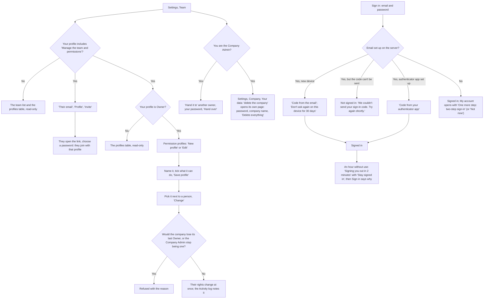

Code: Team page `teamView`, static/js/views/settings.js:246, with `teamCardHtml` static/js/views/settings.js:77 (**Change** `team-profile` static/js/views/settings.js:614), `profilesCardHtml` static/js/views/settings.js:115 and `profileFormHtml` static/js/views/settings.js:130 (**New profile**, **Edit**, **Save profile** `profile-save` static/js/views/settings.js:626, **Delete** `profile-delete` static/js/views/settings.js:637; shown to owners only, `ownerMe()`), `adminCardHtml` static/js/views/settings.js:145 (**Hand over** `admin-hand-over` static/js/views/settings.js:641). The permissions and the job action each needs are `PERMISSIONS` and `JOB_ACTION_PERMS`, domain/profiles.py:24 and domain/profiles.py:52; the server checks `has_perm` on every route flagged perm= (`_run`, server.py:930, the check at server.py:958; owner=True routes at server.py:955) and `may_take` on every job action (`_m_job_action`, server.py:2688), and the page hides the same through `mayTake` and `ACTION_PERM`, static/js/jobs.js:332-346, and `can`, static/js/app-core.js:462. Profiles are saved by `_p_profile_save`, server.py:2045 (`save_profile`, domain/profiles.py:151), on owner=True routes, server.py:2800-2802, so only the Owner profile adds, changes or deletes them (A4); a person's profile by `set_role`, auth.py:887; the Company Admin is `_admin`, auth.py:751, handed on by `hand_over_admin`, auth.py:959, and the only one `_p_account_delete` lets through, server.py:2035; the delete page is `deleteCompanyView`, static/js/views/settings.js:257. Signing in: `_p_login`, server.py:1454, asks for an emailed code when `_email_code_due`, server.py:1511 (`login_code_check` and `remember_device`, auth.py:1103-1122); a code that can't be sent (`_send_login_code`, server.py:1518, off the shared hourly limit) gives no session; five wrong codes drop the live ones (`_wrong_code`, auth.py:531), and the count of wrong tries clears only once every step has passed (`login_succeeded`, auth.py:360); a password reset (`reset_password`, auth.py:598) forgets remembered devices; the code step on the landing card, static/js/views/auth.js:79-88; with no mail on the server the setup card comes first (`twoStepCardHtml`, static/js/views/settings.js:317, **Not now** `2fa-later` static/js/views/settings.js:681). **Change password** opens `passwordView`, static/js/views/settings.js:351 (**Email me a code** `pw-code`, server `_p_password_code`, server.py:1736). Appearance is `appearanceCardHtml`, static/js/views/settings.js:302, saved with My account's one **Save** (`save-account`, static/js/views/settings.js:696) through `_p_appearance`, server.py:2083, and applied by `applyAppearance`, static/js/theme.js:24, to the dark palette and accents in static/styles.css:761. The idle sign-out is `session_check`, auth.py:417, and static/js/idle.js.

**Taps from start to done:** a new profile and a person on it: 4 (New profile, Save profile after ticking, pick it, Change). Sign in from a new device with email codes: 2 (Sign in, then Sign in with the code).

---

## Flows not charted, or charted with less confidence

- **Billing** (Settings, Billing: **Subscribe** / **Manage billing** through Stripe, `billingView` static/js/views/settings.js:369): shows only when Stripe is set up on the server; people whose profile doesn't include billing see it read-only.
- **The client's page** (`payer_page.render`, payer_page.py:152; wireframe `PayerPage`): This job (the pay app's lines 1-9 and the prior payments received, `_job_card` :75), the continuation sheet with Qty to date (`_sheet` :90), Mark as received, Approve for payment with a date, Send a question (an Inbox item for the contractor). Charted as branches in section 9.
- **QuickBooks connection** (**Connect QuickBooks**, Settings, Company and Import/Export, Import): the Intuit sign-in in the middle happens off our site. Charted as one branch in section 10.
- **Email forwarding, text messages and sharing from the phone into the Inbox** (`views.inbox`, **Bring emails and texts in automatically**): need an owner to set up an email service or Twilio. Shared while signed out, files wait 30 minutes for sign-in (**Finish adding N shared items**, `heldShareHtml` static/js/views/auth.js:386).
- **Export** (Import/Export, Export: `views.export` static/js/views/data.js:72-110): **Download everything** (owners only; the server refuses members, `_g_export`), **Sent pay apps** with each one's **PDF** and **Download for QuickBooks**, filtered by job (`GET /api/payapps/sent`, `_g_sent_payapps` server.py:1204, `domain.sent_payapps_page` domain/comms.py:99; closed jobs' too), the **Calendar feed** with **Copy** (`calendarFeedHtml` static/js/views/inbox.js:136), and links to the Outbox and the Activity log. Settings, Company, **Your data** links here and keeps Reset and Delete.
- **Outbox** (Communications, Outbox: `views.outbox` static/js/views/communications.js:58-78): each email lists what it carried, **Pay app PDF** and each file by name, opening it, or "A file no longer on the job record" (`attachmentsHtml` :19); **Print** (`print-email` :85) prints that one email (To, When, Status, Subject, the message and its attachments) through `printSheet` :40 and the `@media print` rule in static/styles.css (comms-data block), black on white even from dark mode (D7, the `--print-` tokens). **Print** on an Everything received row does the same for something that came in.
- **Daily record** (Jobs, Daily record; **New daily record** on a job page opens it with that job picked; `views.daily` static/js/views/daily.js:135): Job, **Crew members** and names, **Weather** and a note, **Materials used or installed**, **Deliveries**, **Diary**; boxes **Progress photos**, **Quantities** (only on a job with a schedule of values), **Change order work**, **Inspections or major discussions**, **New punchlist items**, each opening its fields; **Attach files**; **Save to job record**. Files go up first to the job record (`uploadDailyFiles` static/js/views/daily.js:198) and the record keeps their ids. The server checks every field (`clean_daily_details`, domain/daily.py:93) and reads them out in the job record's note (`daily_record_note` :223). Quantities put in place today add to each line's quantity done and update the draft pay app (`add_daily_record` :259 through `_apply_quantities` :301 and `record_sov_progress`, domain/__init__.py:4248). When they can't be added (the draft is with the client for their review, the job is marked done or finished, a line would go past its scheduled quantity, a lump sum past 100%) the record is saved anyway with them on it and `quantities_not_applied` saying why: under Quantities in Recent records and the job record's note, and in a message as it saves; the schedule card then says **Updated from daily records on …** (static/js/views/job-sov.js:146), and so does the draft's own page (`draftFromDailyOn` static/js/jobs.js:483, shown by `views.payappDetail` static/js/views/payapps.js:70). **Recent records** list each record's crew, weather, materials, deliveries, what each ticked section held, why quantities weren't added, and links to its files (`recordMeta` static/js/views/daily.js:103).
- **Draft for the client's review** (**Send draft for their review**, **Client agreed to the draft**, **Client wants changes**, static/js/jobs.js:389-391): an optional side path before send.
- **Tap counts** are the fewest taps on the happy path with fields already filled, counted from the code, not timed with a user. Confirms count as a tap.
